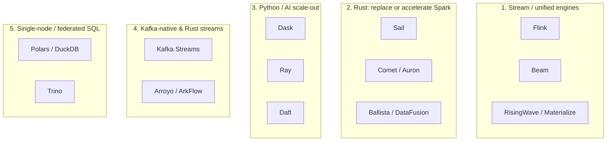
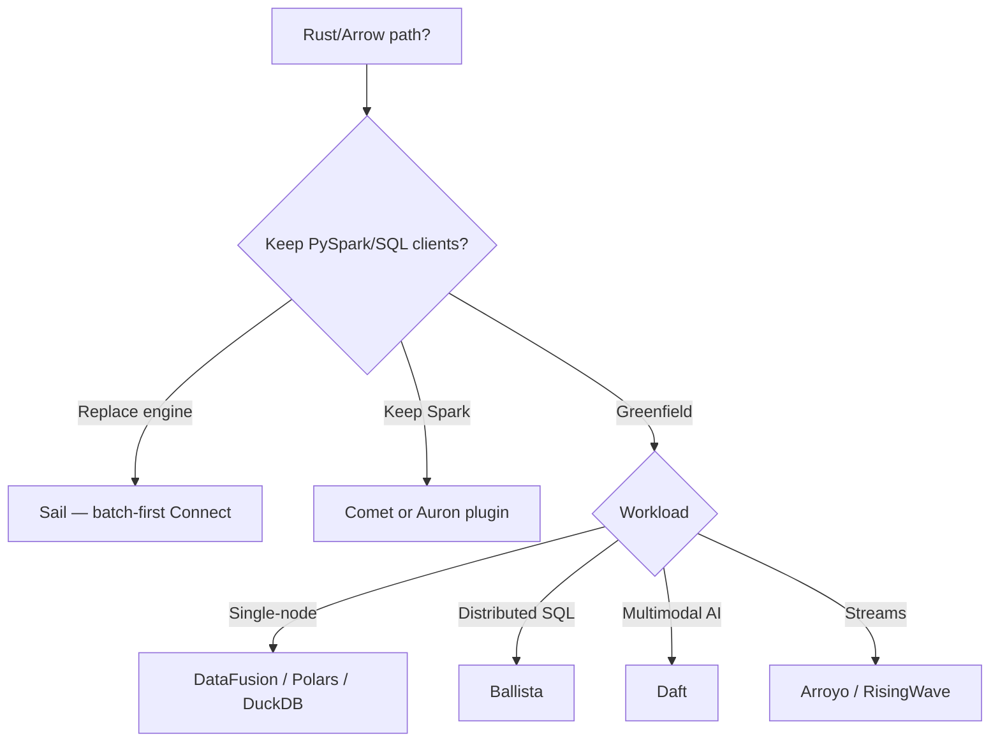
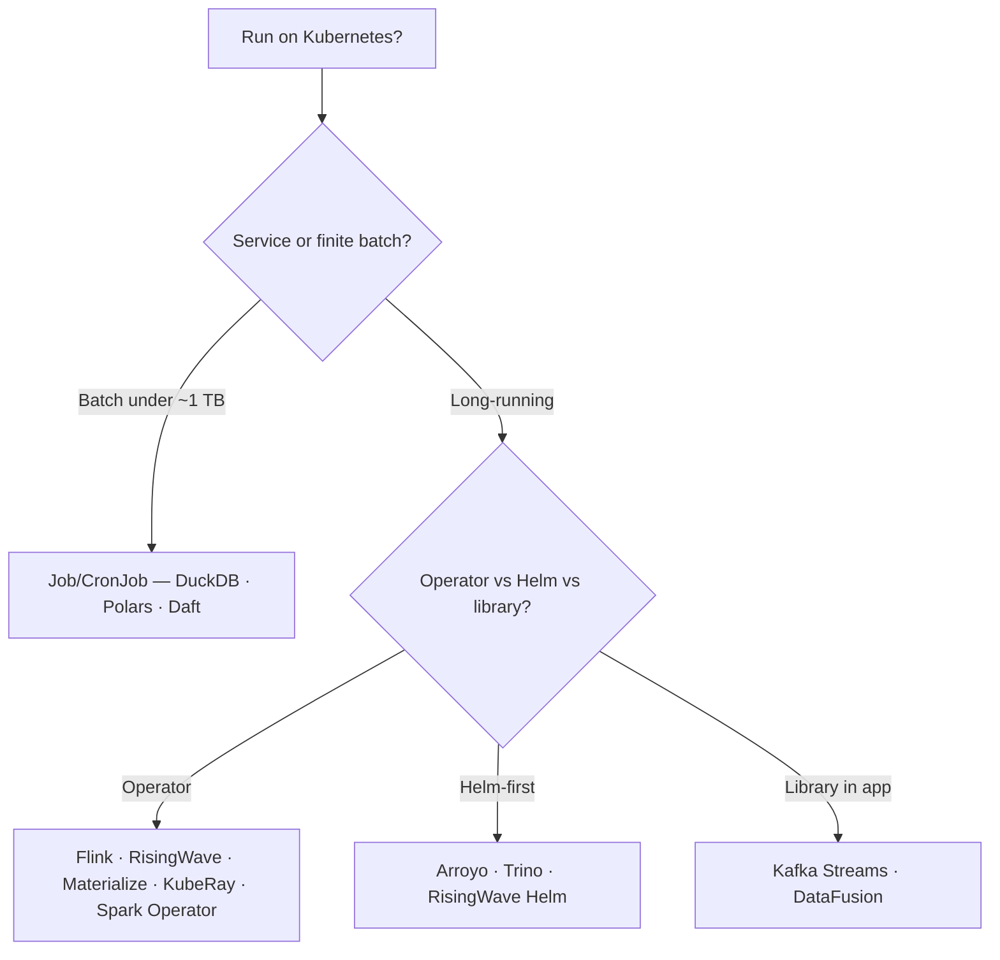
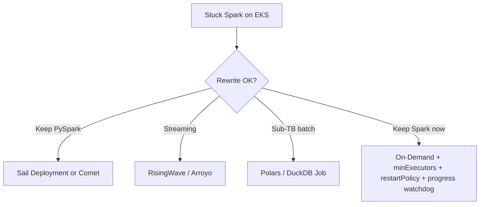

## What Are Apache Spark Alternatives?

**Apache Spark alternatives** are open-source or freely self-hostable engines for large-scale batch ETL, SQL analytics, and stream or event processing when Spark’s cluster overhead, micro-batch streaming limits, or JVM operations cost more than they return—especially for sub-terabyte jobs or Kubernetes estates.

> Primary keyword targets: Apache Spark alternatives, Spark vs Flink, DuckDB vs Spark, Spark on EKS.
{: .prompt-info }

Spark remains a strong **generalist** for massive-scale ETL and lakehouse stacks. Specialized engines often win by skipping cluster coordination, optimizing for **single-node** speed, running **event-at-a-time** streams, or targeting **multimodal / GPU** AI prep. Most enterprise analytical jobs are under ~1 TB — a Spark cluster for those can mean JVM startup and shuffle tax you do not need.

Spark Structured Streaming is still **micro-batch by default**. Newer releases add a low-latency **Real-Time Mode** for a growing (still incomplete) operator set — so “Spark cannot do low latency” is no longer absolute; Flink and streaming DBs still lead for CEP, large keyed state, and event-time timers. Treat vendor latency claims as *benchmarks to re-run*.

This guide has **five** layers:

1. **Where Spark falls short (classic / hybrid)** — Flink, Kafka Streams, RisingWave / Materialize, DuckDB, Trino, Ray, Daft, Beam, Dask, Bytewax.
2. **Rust + Apache Arrow** — Sail, Comet, Auron, DataFusion, Ballista, Polars, Arroyo, ArkFlow.
3. **Cloud & Kubernetes readiness** — Operators, Helm, plain Jobs/Deployments, managed offerings.
4. **Spark on EKS** — stabilize Spark Operator vs migrate.
5. **One decision map** — when each wins.

> Spark itself is Apache-2.0. This post is about **when not to default to Spark**, not about proprietary SaaS replacements.

## TL;DR — Quick Recommendations

| Use Case | Best Fit | Runner-Up | Why |
| -------- | -------- | --------- | --- |
| **Keep PySpark / Spark Connect (batch-first)** | **LakeSail Sail** | Comet (in-place) | Connect-compatible Rust engine; **streaming still WIP** — verify SSS coverage |
| **Speed up existing Spark SQL/DataFrames** | **DataFusion Comet** | **Auron** | Native vectorized plugin; JAR + config |
| **Low-latency stateful streaming / CEP** | **Flink** | RisingWave / **Arroyo** | Event-at-a-time, watermarks, CEP, large keyed state |
| **Kafka→Kafka microservices (no extra cluster)** | **Kafka Streams** | Flink | Library-in-app |
| **Live SQL MVs on streams** | **RisingWave** | **Materialize** (BSL CE) | Postgres-style continuous SQL |
| **Sub-TB analytics (cheaper than Spark)** | **DuckDB** | Polars | In-process / single-node; no shuffle tax |
| **Interactive federated BI** | **Trino** | Spark SQL / Ballista | Fast startup, multi-source SQL |
| **Multimodal AI prep** | **Daft** | Ray Data | Images/video/embeddings + tables |
| **Distributed Python ML** | **Ray** | Daft / Dask | Train/Tune/Serve on CPU/GPU |
| **Rust streaming SQL** | **Arroyo** | RisingWave / ArkFlow | DataFusion SQL + distributed runtime |
| **Portable batch + stream** | **Beam** | Flink | Multi-runner portability |
| **Embeddable SQL/DF library** | **DataFusion** | Polars / DuckDB | Foundation for Ballista/Comet/Sail |
| **Distributed DataFusion SQL** | **Ballista** | Sail / Trino | Multi-node without Spark API |
| **Scale pandas / NumPy** | **Dask** | Polars / Ray | Minimal rewrite |
| **K8s Operator lifecycle** | **Flink** / **RisingWave** / **KubeRay** | Materialize Operator | CRDs + upgrades |
| **K8s Helm-first (no custom Operator needed)** | **Trino** / **Arroyo** / RisingWave Helm | — | Chart install |
| **Simplest K8s batch (no CRD)** | **DuckDB** / **Polars** `Job`/`CronJob` | Single-pod Daft | Native backoff |
| **Stop babysitting Spark on EKS** | Stabilize *or* migrate | RisingWave / Arroyo / DuckDB / Sail | See [EKS section](#spark-on-eks-stabilize-or-migrate) |

> Jump to [Cloud & Kubernetes](#cloud--kubernetes-readiness), [Spark on EKS](#spark-on-eks-stabilize-or-migrate), [Rust & Arrow](#rust--arrow-spark-replacements--accelerators), or [When to Use What](#when-to-use-what).

## Approach & Scope Demarcation

### Selection Criteria

1. **Open source or freely self-hostable core** — OSI preferred; BSL / community licenses called out (ksqlDB, Materialize).
2. **Real batch and/or stream role** — not message brokers alone.
3. **Active maintenance**.
4. **Practical Spark displacement** — drop-in API, accelerator, or greenfield replacement for a major workload class.

### What This Guide Is NOT

1. Spark vs Databricks product comparison.
2. Message brokers alone (Kafka/Pulsar/Redpanda).
3. Orchestrators (Airflow/Dagster/Prefect).
4. Warehouse SaaS as “OSS Spark replacements.”
5. Guaranteed Spark feature parity for Sail/Comet/Auron.

## Legend

| Symbol | Meaning |
| ------ | ------- |
| ✅ | Supported in usable OSS / self-host core |
| ◐ | Partial, plugin, WIP, or limited vs Spark-class scale |
| ⭐ | Standout strength |
| — | Not a design goal |
| EE | Stronger in commercial / managed edition |

## Candidate Tools Evaluated

### Classic / hybrid

| Tool | Stack | Batch | Stream | License | Persona |
| ---- | ----- | ----- | ------ | ------- | ------- |
| **[Apache Flink](https://github.com/apache/flink)**{:target="_blank" rel="noopener"} | Java / SQL / PyFlink | ✅ | ⭐ | Apache-2.0 | Stream platforms |
| **[Apache Beam](https://github.com/apache/beam)**{:target="_blank" rel="noopener"} | Java / Python / Go | ✅ | ✅ | Apache-2.0 | Portable pipelines |
| **[Dask](https://github.com/dask/dask)**{:target="_blank" rel="noopener"} | Python | ⭐ | ◐ | BSD-3-Clause | pandas shops |
| **[Ray](https://github.com/ray-project/ray)**{:target="_blank" rel="noopener"} | Python | ✅ | ◐ | Apache-2.0 | ML platforms |
| **[Daft](https://github.com/Eventual-Inc/Daft)**{:target="_blank" rel="noopener"} | Rust / Python | ⭐ | — | Apache-2.0 | Multimodal AI prep |
| **[Kafka Streams](https://github.com/apache/kafka)**{:target="_blank" rel="noopener"} | Java / Kotlin | — | ⭐ | Apache-2.0 | Kafka microservices |
| **[RisingWave](https://github.com/risingwavelabs/risingwave)**{:target="_blank" rel="noopener"} | Rust / SQL | ◐ | ⭐ | Apache-2.0 | Streaming SQL / CDC |
| **[Materialize](https://materialize.com/)**{:target="_blank" rel="noopener"} | Rust / SQL | ◐ | ⭐ | BSL 1.1 (CE) | Streaming SQL / MVs |
| **[Trino](https://github.com/trinodb/trino)**{:target="_blank" rel="noopener"} | Java / SQL | ⭐ | — | Apache-2.0 | Federated BI SQL |
| **[DuckDB](https://github.com/duckdb/duckdb)**{:target="_blank" rel="noopener"} | C++ / SQL | ⭐ | — | MIT | Embedded analytics |
| **[Bytewax](https://github.com/bytewax/bytewax)**{:target="_blank" rel="noopener"} | Python / Rust | ◐ | ✅ | Apache-2.0 | Python streams |

### Rust / Arrow family

| Tool | Role vs Spark | Distributed? | Spark API? | License |
| ---- | ------------- | ------------- | ---------- | ------- |
| **[LakeSail Sail](https://github.com/lakehq/sail)**{:target="_blank" rel="noopener"} | Connect engine (batch-first) | Yes | Yes (Connect) | Apache-2.0 |
| **[DataFusion Comet](https://datafusion.apache.org/comet/)**{:target="_blank" rel="noopener"} | Native plugin *inside* Spark | via Spark | Yes (plugin) | Apache-2.0 |
| **[Apache Auron](https://github.com/apache/auron)**{:target="_blank" rel="noopener"} | Native accelerator (ex-Blaze) | via host | Yes (plugin) | Apache-2.0 |
| **[Apache DataFusion](https://datafusion.apache.org/)**{:target="_blank" rel="noopener"} | Embeddable SQL/DF library | No | Partial | Apache-2.0 |
| **[Apache Ballista](https://github.com/apache/datafusion-ballista)**{:target="_blank" rel="noopener"} | Distributed DataFusion | Yes | No | Apache-2.0 |
| **[Polars](https://github.com/pola-rs/polars)**{:target="_blank" rel="noopener"} | High-perf DataFrame | Mostly no | No | MIT |
| **[Arroyo](https://www.arroyo.dev/)**{:target="_blank" rel="noopener"} | Stateful streaming SQL | Yes | No | MIT / Apache-2.0 |
| **[ArkFlow](https://github.com/arkflow-rs/arkflow)**{:target="_blank" rel="noopener"} | Lightweight Arrow streams | ◐ | No | Apache-2.0 |

**Baseline:** [Apache Spark](https://spark.apache.org/){:target="_blank" rel="noopener"} — still the broadest hiring/ecosystem default.

## Architectural Archetypes



## Where Spark Falls Short (Streams & Batch)

Useful overviews: [OLake](https://olake.io/blog/apache-spark-alternatives/){:target="_blank" rel="noopener"}, [Confluent — Spark vs Flink](https://www.confluent.io/compare/spark-streaming-vs-flink/){:target="_blank" rel="noopener"}, [Databricks — Spark vs Flink](https://www.databricks.com/blog/spark-vs-flink){:target="_blank" rel="noopener"} (vendor — cross-check).

### Stream processing

**[Apache Flink](https://flink.apache.org/)**{:target="_blank" rel="noopener"} — Default for event-at-a-time processing, CEP, advanced watermarks, and large/disaggregated keyed state. Prefer Flink when those dominate; Spark RTM narrows latency for *some* workloads but does not erase Flink’s CEP/state/timer strengths.

**[Kafka Streams](https://kafka.apache.org/documentation/streams/)**{:target="_blank" rel="noopener"} — Java/Kotlin **library**, not a cluster. Wins on ops simplicity for Kafka→Kafka services.

**[RisingWave](https://risingwave.com/)**{:target="_blank" rel="noopener"} & **[Materialize](https://materialize.com/)**{:target="_blank" rel="noopener"} — Streaming databases with incremental SQL MVs. Both are Rust under the hood; teams usually use SQL only. RisingWave core is Apache-2.0. **Materialize** is **BSL 1.1**: Self-Managed **Community Edition** allows free production use with caps (typically **24 GiB memory / 48 GiB disk** per installation; license key required from v26+); versions convert to Apache-2.0 on a stated Change Date. Enterprise/Cloud remove CE caps — verify [current license docs](https://materialize.com/docs/license/){:target="_blank" rel="noopener"}.

### Batch & analytical (often faster under ~1 TB)

**[DuckDB](https://duckdb.org/)**{:target="_blank" rel="noopener"} — In-process C++ OLAP SQL; often beats Spark for tens–hundreds of GB (and ~1 TB on a large VM).

**[Trino](https://trino.io/)**{:target="_blank" rel="noopener"} — Federated interactive SQL; Spark wins long ETL, Trino wins BI startup latency/concurrency.

**[Daft](https://www.daft.ai/)**{:target="_blank" rel="noopener"} — Rust+Python multimodal DataFrames (media + embeddings + tables); scale via Ray/Kubernetes. Not a full lakehouse ETL twin.

**[Ray](https://www.ray.io/)**{:target="_blank" rel="noopener"} — Distributed Python/AI (train/tune/serve). Pair with Ray Data or Daft for prep.

Also: **Beam** (portability), **Dask** (pandas scale-out), **Bytewax** (Python streams — community-maintained; verify stewardship), Storm/Samza/ksqlDB (legacy or non-OSI — honorable mentions).

| Alternative | Category | Where it beats Spark |
| ----------- | -------- | -------------------- |
| **Flink** | Stream | CEP, large state, event-time timers |
| **Kafka Streams** | Stream | No extra compute cluster |
| **RisingWave** | Streaming SQL | Live MVs, Apache-2.0 self-host |
| **Materialize** | Streaming SQL | Incremental SQL MVs (BSL CE caps) |
| **DuckDB / Polars** | Single-node | Sub-TB cost/latency |
| **Trino** | Federated SQL | Interactive BI |
| **Ray / Daft** | AI batch | GPU / multimodal prep |
| **Sail / Comet / Auron** | Rust Spark path | Keep APIs or accelerate plans |

---

## Rust & Arrow Spark Replacements & Accelerators

Built largely on **[Arrow](https://arrow.apache.org/)**{:target="_blank" rel="noopener"} + **[DataFusion](https://datafusion.apache.org/)**{:target="_blank" rel="noopener"}. Three paths: **replace** engine (Sail), **accelerate** Spark (Comet/Auron), or **greenfield** (DataFusion/Ballista/Polars/Daft/Arroyo).

### Drop-in / accelerate

**[LakeSail Sail](https://github.com/lakehq/sail)**{:target="_blank" rel="noopener"} — Rust Spark Connect server: PySpark/Spark SQL clients without JVM workers. **Primary fit is batch / DataFrame / SQL.** Structured Streaming support is **partial / not general-use** — treat streaming as WIP and verify the current LakeSail matrix before cutover. Speed/cost claims are project benchmarks.

**[DataFusion Comet](https://datafusion.apache.org/comet/)**{:target="_blank" rel="noopener"} — JAR plugin: supported Spark physical operators → DataFusion; others fall back to JVM Spark. Still operate Spark.

**[Apache Auron](https://github.com/apache/auron)**{:target="_blank" rel="noopener"} (ex-Blaze) — ASF native accelerator mapping host plans into DataFusion; Spark-first, extensibility toward other engines.

### Batch / query libraries

**DataFusion** — embeddable single-node SQL/DF library (not a cluster alone).
**Ballista** — distributed DataFusion (no Spark Connect API).
**Polars** — single-node (mostly) DataFrames that often replace small Spark jobs.

### Stream (Rust)

**Arroyo** — distributed streaming SQL on DataFusion (Helm on K8s).
**ArkFlow** — lighter Arrow/DataFusion streams; narrower ecosystem.
**Timely / Differential Dataflow** — low-level libraries, not drop-in ETL platforms.

| Tool | Primary workload | Distributed? | Spark API? |
| ---- | ---------------- | ------------- | ---------- |
| **Sail** | Batch (+ partial SSS / streaming WIP) | Yes | Yes (Connect) |
| **Comet / Auron** | Accelerate Spark batch SQL/DF | via Spark | Plugin |
| **DataFusion** | Embedded SQL/DF | No | Partial |
| **Ballista** | Distributed SQL/DF | Yes | No |
| **Polars** | Single-node batch | Mostly no | No |
| **Daft** | Multimodal AI DF | Yes (Ray/K8s) | No |
| **Arroyo** | Stateful streaming SQL | Yes | No |
| **ArkFlow** | Lightweight Rust streams | ◐ | No |



---

## Capability Matrices

### Batch & ETL

| Capability | Sail | Comet/Auron | Flink | Ballista | DataFusion | Polars | DuckDB | Daft | Dask | Ray | Trino |
| ---------- | ---- | ----------- | ----- | -------- | ---------- | ------ | ------ | ---- | ---- | --- | ----- |
| **Large-scale batch ETL** | ✅ | ✅ via Spark | ✅ | ✅ | ◐ | ◐ | ◐ | ✅ | ✅ med | ✅ | ◐ |
| **SQL analytics** | ⭐ | ⭐ | ⭐ | ⭐ | ⭐ | ✅ | ⭐ | ✅ | ◐ | ◐ | ⭐ |
| **Keep Spark client code** | ⭐ Connect | ⭐ plugin | — | — | — | — | — | — | — | — | — |
| **No JVM compute** | ⭐ | ◐ host Spark | — | ⭐ | ⭐ | ⭐ | ⭐ | ⭐ | ⭐ | ⭐ | — |
| **Multimodal / GPU** | ◐ | — | — | — | — | ◐ | — | ⭐ | ◐ | ⭐ | — |
| **Lakehouse formats** | ✅* | ✅ via Spark | ✅ | ✅* | ✅ | ◐ | ✅ | ✅ | ◐ | ◐ | ⭐ |

\*Verify Iceberg/Delta/Hudi + catalogs for your version.

### Stream processing

| Capability | Flink | Arroyo | RisingWave | Materialize | Sail | Kafka Streams | Bytewax | ArkFlow | Spark SSS* |
| ---------- | ----- | ------ | ---------- | ----------- | ---- | ------------- | ------- | ------- | ---------- |
| **Event-at-a-time** | ⭐ | ⭐ | ⭐ | ⭐ | ◐ WIP | ⭐ | ✅ | ✅ | ◐ / RT Mode |
| **Event-time + watermarks** | ⭐ | ✅ | ✅ | ✅ | ◐ | ✅ | ✅ | ◐ | ✅ |
| **Large keyed state** | ⭐ | ✅ | ✅ | ✅ | ◐ | ◐ | ◐ | ◐ | ✅ |
| **CEP** | ⭐ | ◐ | ◐ | ◐ | — | ◐ | ◐ | — | ◐ |
| **Streaming SQL / MVs** | ⭐ | ⭐ | ⭐ | ⭐ | ◐ | — | — | ◐ | ✅ |
| **Embedded (no cluster)** | — | — | — | — | — | ⭐ | ◐ | ◐ | — |
| **Rust / Arrow native** | — | ⭐ | ⭐ | ⭐ | ⭐ | — | ◐ | ⭐ | — |

\*Spark Structured Streaming + Real-Time Mode for orientation — RTM operator coverage is incomplete vs Flink CEP/state.

## Licensing / "Actually Free" Notes

| Tool | Reality | Watch-outs |
| ---- | ------- | ---------- |
| **Sail** | Apache-2.0 | Connect/feature gaps; **streaming WIP**; LakeSail commercial |
| **Comet / Auron / DataFusion / Ballista** | Apache-2.0 | Comet/Auron need Spark (or host) control plane |
| **Polars / DuckDB** | MIT | Distributed Polars still evolving |
| **Daft / Arroyo / ArkFlow** | Apache-2.0 / MIT+Apache | Younger ecosystems vs Flink/Spark |
| **Flink / Beam / Spark** | Apache-2.0 | Managed platforms are paid |
| **RisingWave** | Apache-2.0 | RisingWave Cloud commercial |
| **Materialize** | **BSL 1.1** Self-Managed CE (≈24 GiB / 48 GiB caps; key required) | Not OSI; Change Date → Apache-2.0 per version; Enterprise/Cloud for scale |
| **Trino / Dask / Ray** | Apache-2.0 / BSD-3 | Starburst / Coiled / Anyscale |
| **Bytewax** | Apache-2.0 | Community maintenance transition |
| **ksqlDB** | Confluent Community License | **Not OSI** |

## Cloud & Kubernetes Readiness

| Label | Meaning |
| ----- | ------- |
| **Operator** | Official/widely used Operator + CRD |
| **Helm** | Project Helm chart |
| **Plain K8s** | Deployment / StatefulSet / Job / CronJob |
| **Library** | Embed in your app image |
| **Plugin** | Runs inside Spark (inherits Spark Operator) |

| Tool | Managed / cloud | Operator | Helm | Plain pods? | Typical shape |
| ---- | --------------- | -------- | ---- | ----------- | ------------- |
| **Spark** | EMR, Databricks, … | ⭐ Spark Operator | ◐ | ◐ | `SparkApplication` → driver+executors |
| **Flink** | Ververica, Managed Flink, … | ⭐ Flink K8s Operator | ✅ | ◐ | `FlinkDeployment` |
| **RisingWave** | RisingWave Cloud | ⭐ risingwave-operator | ✅ | ◐ | CR or Helm release |
| **Arroyo** | Self-host | — | ⭐ | ◐ | Controller + workers |
| **Materialize** | Materialize Cloud | ⭐ (via Helm) | ✅ | — | Operator + instance CRs |
| **Trino** | Starburst, … | — | ⭐ | ✅ | Coordinator + workers |
| **Ray** | Anyscale | ⭐ KubeRay | ✅ | ◐ | `RayCluster` / Jobs |
| **Daft** | Self-host | via KubeRay when distributed | ◐ | ✅ single-pod | Job or Ray workers |
| **Sail** | LakeSail offerings | — | ◐ manifests | ✅ | Connect **Deployment** + on-demand workers |
| **Ballista** | Self-host | — | ◐ | ✅ | Scheduler + executors |
| **DataFusion** | Embed | — | — | ✅ | Library in your container |
| **Comet / Auron** | via Spark | — (via Spark Operator) | — | via Spark | JARs on Spark pods |
| **DuckDB / Polars** | MotherDuck / Polars Cloud | — | — | ⭐ | **Job / CronJob** |
| **Kafka Streams** | MSK / Confluent (Kafka) | — | — | ⭐ | Your app **Deployment** |
| **Dask** | Coiled | ◐ Dask Operator | ✅ | ✅ | Scheduler + workers |
| **Beam** | Dataflow, … | — | ◐ | ◐ | Runner-dependent |



| If you want… | Prefer |
| ------------ | ------ |
| **Least CRDs for small batch** | DuckDB / Polars Jobs |
| **Streaming + Operator HA** | Flink or RisingWave Operator |
| **Streaming SQL without Spark Operator** | RisingWave / Arroyo |
| **Interactive lake SQL** | Trino Helm |
| **Keep PySpark** | Sail Deployment or Spark Operator + Comet |
| **GPU / Python distribute** | KubeRay (+ Daft/Ray Data) |

Docs: [RisingWave Operator](https://docs.risingwave.com/deploy/risingwave-kubernetes){:target="_blank" rel="noopener"} · [Arroyo K8s](https://doc.arroyo.dev/deployment/kubernetes/){:target="_blank" rel="noopener"} · [Trino Helm](https://trino.io/docs/current/installation/kubernetes.html){:target="_blank" rel="noopener"} · [Flink Operator](https://nightlies.apache.org/flink/flink-kubernetes-operator-docs-stable/){:target="_blank" rel="noopener"} · [KubeRay](https://docs.ray.io/en/latest/cluster/kubernetes/index.html){:target="_blank" rel="noopener"} · [Sail on Kubernetes](https://docs.lakesail.com/sail/latest/guide/deployment/kubernetes.html){:target="_blank" rel="noopener"} · [Materialize self-managed](https://materialize.com/docs/self-managed-deployments/){:target="_blank" rel="noopener"}.

## Spark on EKS: Stabilize or Migrate

Stuck Spark on EKS (frozen micro-batches, driver–executor hangs, Spot reclaim, Spark Operator babysitting) pushes teams to harden Operator setup **or** leave JVM multi-pod Spark.

| Workload | Prefer | Why |
| -------- | ------ | --- |
| **Streaming** | RisingWave / Arroyo | Continuous processing; object-store state; fewer micro-batch freeze modes |
| **Batch under ~1 TB** | Polars / DuckDB `Job`/`CronJob` | One pod + `backoffLimit` vs multi-pod SparkApplication |
| **PySpark lock-in** | Sail (batch) or Comet | Keep APIs; shed JVM tax |

### Stabilize Spark Operator (short-term)

1. **Reduce zero-executor stalls** — `spark.dynamicAllocation.enabled=true` with `minExecutors≥1`, and **pin drivers (and ideally a minimum executor pool) to On-Demand** via `nodeSelector`/affinity. A DA floor alone does **not** stop Spot reclaim of the last executor — pair with On-Demand capacity, PDBs, and progress health checks ([AWS re:Post](https://repost.aws/knowledge-center/emr-eks-spark-driver-executor){:target="_blank" rel="noopener"}).

2. **Explicit `restartPolicy`** on `SparkApplication` (verify CRD fields for your Operator version):

```yaml
restartPolicy:
  type: Always   # prefer OnFailure for finite batch
  onFailureRetries: 3
  onFailureRetryInterval: 30
  onSubmissionFailureRetries: 3
  onSubmissionFailureRetryInterval: 30
```

3. **Frozen-stream detection** — K8s liveness can pass while SSS makes no progress. Emit `StreamingQueryListener` / `lastProgress` to Prometheus/CloudWatch, or a watchdog that deletes the driver when no batch completes inside your SLA so `restartPolicy` recreates the app.

| Pain | Stabilize | Migrate |
| ---- | --------- | ------- |
| Silent stream freeze | On-Demand driver + progress kill | RisingWave / Arroyo |
| Batch FAILED | `OnFailure` retries + memory overhead | DuckDB / Polars Jobs |
| PySpark lock-in | Newer Operator + Comet/Auron | Sail (batch) or Comet |



## When to Use What

```text
Need Spark API?
    ├─ Yes → Sail (batch-first) or Comet/Auron (keep Spark)
    └─ No
         ├─ Streams → Flink | RisingWave/Materialize | Arroyo | Kafka Streams
         ├─ Sub-TB batch → DuckDB | Polars
         ├─ Federated BI → Trino
         ├─ Multimodal AI → Daft | Ray
         ├─ pandas scale → Dask
         └─ Portable → Beam
```

- **Sail** — PySpark/SQL over Connect on Rust; **batch-first**; streaming WIP.
- **Comet/Auron** — Keep Spark; accelerate supported plans.
- **Flink** — CEP, timers, large keyed state, widest stream connectors.
- **RisingWave** — Continuous SQL + CDC + MVs (Apache-2.0).
- **Materialize** — Same category; BSL CE caps / license key — confirm before “OSS forever.”
- **Arroyo** — Rust streaming SQL on K8s (Helm).
- **Kafka Streams** — Kafka-only Java services; no second cluster.
- **DuckDB/Polars** — Sub-TB / one strong pod; simplest EKS Jobs.
- **Trino** — Interactive federated SQL, not stream ETL.
- **Daft/Ray** — Multimodal prep vs Train/Tune/Serve.
- **Dask** — Scale pandas/NumPy without JVM.
- **Beam** — Multi-runner portability requirement.
- **Ballista/DataFusion** — Distributed or embedded Arrow SQL without Spark API.
- **Keep Spark** — Petabyte lakehouse + hiring pool; optionally Comet/Auron; stabilize Operator if stuck on EKS this quarter.
- **K8s style** — Operator (Flink/RisingWave/KubeRay) vs Helm (Trino/Arroyo) vs plain Jobs (DuckDB/Polars) — see [matrix](#cloud--kubernetes-readiness).

## Known Limitations & Gotchas

| Tool | Limitation | Impact |
| ---- | ---------- | ------ |
| **Sail** | Streaming / connector parity incomplete | Inventory SSS + UDFs before cutover |
| **Comet / Auron** | Partial operators; Spark still required | Dual execution paths |
| **DataFusion** | Single-node library | Need Ballista/Sail/your scheduler for clusters |
| **Ballista / Arroyo / ArkFlow / Daft** | Smaller ecosystems | Thinner hiring/tooling vs Spark/Flink |
| **Polars / DuckDB** | Scale-up ceiling | Multi-node shuffle → cluster engine |
| **Materialize** | BSL CE caps + key | Not unlimited free self-host |
| **Flink** | Ops weight; weak native ML | Pair ML elsewhere |
| **Beam** | Runner gaps | Test on production runner |
| **Dask / Ray** | Not Spark-scale streaming SQL | Wrong for CEP/lakehouse ETL alone |
| **Bytewax** | Community maintenance transition | Confirm release cadence |

## Frequently Asked Questions

### Is Apache Spark still open source?

Yes — Apache-2.0. Teams usually pay for managed platforms and support, not the engine license.

### Sail vs Comet?

**Sail** replaces the engine behind Spark Connect (no JVM workers) — **batch-first** today. **Comet/Auron** keep Spark and accelerate supported plans. Choose Sail to shed JVM ops; Comet for incremental wins inside Spark.

### Is DataFusion a Spark replacement?

Not alone. Ballista, Sail, Comet, Auron, and Arroyo productize it.

### Flink vs Arroyo vs RisingWave?

**Flink** — mature stream platform. **Arroyo** — Rust streaming SQL. **RisingWave** — streaming DB + serving. Pick by API and ops model.

### DuckDB/Polars on EKS without an Operator?

Yes — container + `Job`/`CronJob` + `backoffLimit`.

### Which tools have Operators or Helm?

**Operators:** Flink, RisingWave, Materialize, KubeRay, Spark Operator (± Dask). **Helm-first:** Arroyo, Trino, RisingWave. **Plain Jobs/Deployments:** DuckDB, Polars, Kafka Streams apps, Sail Connect server. See [Cloud & Kubernetes](#cloud--kubernetes-readiness).

### Why do EKS Spark streams look healthy but idle?

Driver can stay RUNNING with zero executors, or SSS can hang while liveness passes. Health must use **query progress**, not only container probes.

### Stabilize Operator or migrate?

Stabilize when Spark SQL/connectors are mandatory this quarter. Migrate streams to RisingWave/Arroyo and sub-TB batch to DuckDB/Polars when Operator toil is the tax. Trial Sail for PySpark batch without JVM workers.

### RisingWave vs Materialize?

Same streaming-DB niche. RisingWave → Apache-2.0 self-host. Materialize → BSL 1.1 CE with resource caps (and license key); Change Date → Apache-2.0 per version.

### Is ksqlDB OSS?

Confluent Community License — not OSI. Prefer Flink SQL, RisingWave, Arroyo, or Kafka Streams when license purity matters.

## Honorable Mentions

- **[Apache Storm](https://storm.apache.org/)**{:target="_blank" rel="noopener"} / **[Samza](https://samza.apache.org/)**{:target="_blank" rel="noopener"} — Legacy streams; greenfield → Flink/Arroyo/Kafka Streams.
- **[Timely](https://github.com/TimelyDataflow/timely-dataflow)**{:target="_blank" rel="noopener"} / **[Differential Dataflow](https://github.com/TimelyDataflow/differential-dataflow)**{:target="_blank" rel="noopener"} — Low-level Rust incremental compute.
- **[ksqlDB](https://ksqldb.io/)**{:target="_blank" rel="noopener"} — Kafka SQL; non-OSI community license.
- **[Apache NiFi](https://nifi.apache.org/)**{:target="_blank" rel="noopener"} — Visual dataflow; complementary.
- **[ClickHouse](https://clickhouse.com/)**{:target="_blank" rel="noopener"} / **[Druid](https://druid.apache.org/)**{:target="_blank" rel="noopener"} / **[Pinot](https://pinot.apache.org/)**{:target="_blank" rel="noopener"} — Analytics stores (often sinks).
- **[delta-rs](https://github.com/delta-io/delta-rs)**{:target="_blank" rel="noopener"} / **[iceberg-rust](https://github.com/apache/iceberg-rust)**{:target="_blank" rel="noopener"} — Rust lakehouse libraries.

## How This Fits Adjacent Guides

> - Local containers / K8s installers: [`_drafts/open-source-container-runtimes-compared.md`](/_drafts/open-source-container-runtimes-compared.md), [`_drafts/open-source-local-kubernetes-installers-and-uis.md`](/_drafts/open-source-local-kubernetes-installers-and-uis.md) (swap to `` when published).
> - Operating clusters: [Open-Source Observability Platforms Compared](), [Open-Source Metrics Tools Compared]().

## References

### Official Projects

- **Spark** · **Flink** · **Beam** · **Sail** ([GitHub](https://github.com/lakehq/sail){:target="_blank" rel="noopener"} · [K8s guide](https://docs.lakesail.com/sail/latest/guide/deployment/kubernetes.html){:target="_blank" rel="noopener"})
- **DataFusion** / **Comet** / **Auron** / **Ballista** · **Polars** · **Arroyo** · **ArkFlow** · **Daft** · **RisingWave** · **Materialize** ([license](https://materialize.com/docs/license/){:target="_blank" rel="noopener"})
- **Trino** · **DuckDB** · **Ray** · **Dask** · **Kafka Streams** · **Bytewax**

### Further Reading

- [OLake — Spark alternatives](https://olake.io/blog/apache-spark-alternatives/){:target="_blank" rel="noopener"}
- [Confluent — Spark Streaming vs Flink](https://www.confluent.io/compare/spark-streaming-vs-flink/){:target="_blank" rel="noopener"}
- [Databricks — Spark vs Flink](https://www.databricks.com/blog/spark-vs-flink){:target="_blank" rel="noopener"}
- [AWS re:Post — EMR on EKS driver/executor](https://repost.aws/knowledge-center/emr-eks-spark-driver-executor){:target="_blank" rel="noopener"}
- [Kubeflow spark-operator #2658](https://github.com/kubeflow/spark-operator/issues/2658){:target="_blank" rel="noopener"}
- [Materialize — Self-Managed + Community Edition](https://materialize.com/blog/materialize-for-everyone/){:target="_blank" rel="noopener"}
- [Eventual — multimodal benchmarks (Spark / Ray Data / Daft)](https://www.eventual.ai/blog/benchmarks-for-multimodal-ai-workloads){:target="_blank" rel="noopener"}
- [Arrow DataFusion primer](https://www.work-bench.com/post/apache-arrow-datafusion-a-primer){:target="_blank" rel="noopener"} · [Are we learning yet? — data](https://www.arewelearningyet.com/data/){:target="_blank" rel="noopener"}

---

*Draft revised: November 2026 — SEO_GUIDE pass (title/description lengths, DevOps/Streaming categories, 6 tags, slug rename, FAQ AEO heading). Hero WebP + LQIP still optional before `_posts/`.*
