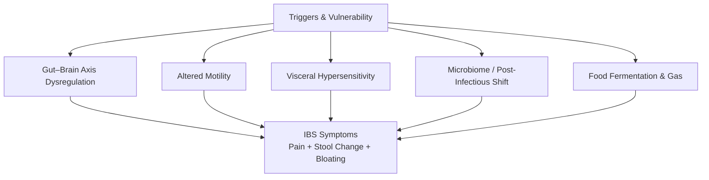
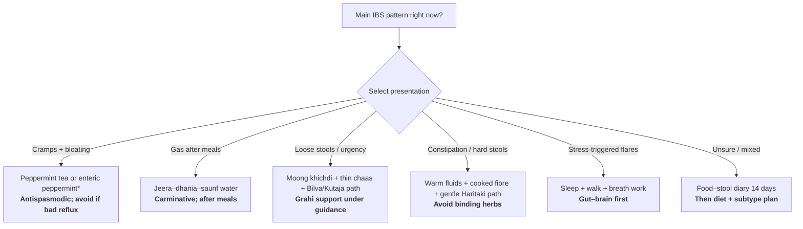

## Why IBS Needs Both Modern Gut Science and Kitchen Wisdom

Irritable Bowel Syndrome (IBS) is a chronic **disorder of gut–brain interaction (DGBI)**. It causes recurrent abdominal pain with altered stool frequency or form — without structural damage visible on routine colonoscopy. People often bounce between “nothing is wrong on reports” and daily bloating, urgency, constipation, or diarrhoea that still ruins work, travel, and sleep.

Modern medicine maps IBS to visceral hypersensitivity, motility changes, post-infectious microbiome shifts, stress-axis arousal, and food triggers (especially fermentable carbohydrates). Ayurveda maps the same lived pattern largely to **Grahani Roga** — weakened digestive fire (*Agni*) and impaired holding/absorptive function of the small intestine (*Grahani*), often with *Ama* (undigested residue) and dosha-specific stool patterns.

This guide pairs modern IBS care with kitchen Pathya, subtype-wise Indian food lists, and Ayurvedic research — including negative trial results — so you can choose supports that match your stool pattern.

> **Clinical & Medical Context:** Kitchen spices, lifestyle changes, and Ayurvedic formulations are **complementary supports**. They do **not** replace medical evaluation for red-flag symptoms (blood in stool, unexplained weight loss, fever, anaemia, night pain waking you from sleep, onset after age 50, family history of colorectal cancer/IBD). Always consult a gastroenterologist and a qualified Ayurvedic physician before starting herbal *arishta*, *churna*, *basti*, or long courses of *grahi* medicines — especially if you are pregnant, on anticoagulants, have liver/kidney disease, or take prescription gut drugs.
{: .prompt-warning }

### Key Takeaways

- IBS is diagnosed clinically (Rome IV) after limited tests exclude lookalikes; Indian community prevalence is generally lower than many Western internet surveys ([INMA/ISG 2023](https://doi.org/10.1007/s12664-022-01333-5){:target="_blank" rel="noopener"}).
- Among kitchen-adjacent herbs, **enteric peppermint oil** has the strongest RCT/meta-analysis signal for pain and global symptoms — with caveats on evidence quality and reflux ([Alammar 2019](https://doi.org/10.1186/s12906-018-2409-0){:target="_blank" rel="noopener"}; [Ingrosso 2022](https://doi.org/10.1111/apt.17179){:target="_blank" rel="noopener"}).
- A key Ayurveda IBS RCT found a **whole-system Ayurveda protocol** superior to single-agent **Kalingadi Churna** on severity and stool outcomes ([Naik et al., 2023](https://doi.org/10.1016/j.jaim.2022.100592){:target="_blank" rel="noopener"}).
- Not every Ayurvedic kitchen mix works in trials: curry leaf + pomegranate + turmeric was **no better than placebo** in IBS-D ([Lauche et al., 2016](https://doi.org/10.1016/j.ctim.2016.04.002){:target="_blank" rel="noopener"}).

> Kitchen herbs are not automatically proven: trial-negative stacks still belong in the conversation so Pathya choices stay honest.
{: .prompt-tip }

---

## What Is IBS?

**Irritable bowel syndrome (IBS)** is a chronic gut–brain disorder with recurrent abdominal pain tied to stool frequency or form, without structural damage on routine tests. It is diagnosed clinically (Rome IV) after limited labs exclude lookalikes such as IBD, coeliac disease, and infection.

Key features:

| Feature | IBS (typically) | Red-flag / other disease (evaluate urgently) |
| :--- | :--- | :--- |
| Pain pattern | Related to defecation; changes with stool frequency/form | Progressive, nocturnal, or unrelated to stools |
| Stool | Constipation, diarrhoea, mixed, or unclassified | Persistent bloody stools, black tarry stools |
| Weight | Stable | Unexplained weight loss |
| Labs / scope | Often normal; diagnosis is symptom-based after limited tests | Anaemia, raised CRP/ESR, abnormal colonoscopy |
| Fever / night sweats | Absent | Present → infection/IBD/other systemic disease |

IBS sits under the Rome Foundation’s DGBI framework. It is real, measurable in quality-of-life scores, and often overlaps with anxiety, dyspepsia, and sleep disturbance — especially when the gut–brain axis is overactive. A clinical overview is available in *The Lancet* ([Ford et al., 2020](https://doi.org/10.1016/S0140-6736(20)31548-8){:target="_blank" rel="noopener"} · [PubMed 33049223](https://pubmed.ncbi.nlm.nih.gov/33049223/){:target="_blank" rel="noopener"}).

---

## How Common Is IBS? India and Worldwide Statistics

Prevalence depends heavily on **which Rome criteria** and **survey method** (household vs internet) researchers use.

| Region / Source | Approximate Prevalence | Notes |
| :--- | :--- | :--- |
| **Global meta-analysis (Rome III/IV, 2006–2024)** | ~**14.1%** pooled across 52 countries | Subtype mix: IBS-M ~31.4%, IBS-D ~26.5%, IBS-C ~26.1%, IBS-U ~8.3% ([Arif et al., Eur J Gastroenterol Hepatol, 2025](https://doi.org/10.1097/meg.0000000000002994){:target="_blank" rel="noopener"}) |
| **Rome Foundation multinational surveys** | Rome III internet ~**10.1%** vs Rome IV ~**4.1%**; household surveys lower (~3.5% vs ~1.5%) | Rome IV is stricter (pain ≥1 day/week; “discomfort” removed) |
| **India — community studies (INMA/ISG consensus)** | Roughly **0.4%–4.2%** (older Mumbai urban estimate ~7.2% in a dyspepsia-focused survey) | Household surveys; Indian patients often report bloating/discomfort more than severe pain ([Ghoshal et al., 2023](https://doi.org/10.1007/s12664-022-01333-5){:target="_blank" rel="noopener"} · [PMC10036984](https://pmc.ncbi.nlm.nih.gov/articles/PMC10036984/){:target="_blank" rel="noopener"}) |
| **Older Indian task-force / clinic citations** | Often quoted **~4%–7%** depending on criteria and setting | Clinic samples over-represent care-seeking adults |
| **Sex pattern** | West: female predominance (OR ~1.5 in meta-analyses). India: nearer **1:1** in community data | Referral bias can make Indian clinic cohorts look male-heavy |

Psychological comorbidity matters: a 2006–2024 global meta-analysis linked stress (OR 2.47), anxiety (OR 2.93), and depression (OR 2.24) with IBS — roughly **double to triple** odds ([Arif et al., 2025](https://doi.org/10.1097/meg.0000000000002994){:target="_blank" rel="noopener"}).

---

## Why Does IBS Occur?

No single cause explains every case. Most people have a stack of contributors:

### 1. Gut–brain axis and stress physiology

Central arousal (anxiety, sleep loss, trauma history) amplifies pain signalling from the gut. Stress hormones and autonomic imbalance speed or slow transit and raise awareness of normal gas/stretch.

### 2. Visceral hypersensitivity

The intestine “feels too much.” Normal amounts of gas or stool stretch register as pain or urgency.

### 3. Motility dysregulation

Segments of bowel can spasm (cramps), empty too fast (diarrhoea), or move too slowly (constipation). Subtypes reflect which pattern dominates.

### 4. Post-infectious IBS

After gastroenteritis (bacterial/viral), a subset of people develop lasting IBS-like symptoms — likely via barrier injury, immune priming, and microbiome change.

### 5. Food chemistry (FODMAPs and more)

Fermentable oligosaccharides, disaccharides, monosaccharides, and polyols (FODMAPs) draw water into the gut and feed gas-producing bacteria. Onion, garlic, wheat, certain dals, and polyol sweeteners are classic triggers in Indian kitchens. South Asian applicability of low-FODMAP principles is reviewed by [Hewawasam et al., 2018](https://doi.org/10.1111/jgh.13885){:target="_blank" rel="noopener"}.

### 6. Ayurvedic framing (*Grahani*)

Classical texts describe weakened *Agni*, accumulation of *Ama*, and disturbed *Samana/Apana Vata* (and often *Pitta* or *Kapha*) so the intestine cannot properly digest, absorb, and form stool. Treatment therefore prioritises **Deepana** (kindling digestion), **Pachana** (clearing Ama), then **Grahi** or gentle **Anulomana** depending on whether stools are loose or hard. Contemporary clinical writing equates IBS patterns with *Grahani Roga* features such as *Muhurbaddha-muhurdrava* (alternating formed/loose stools), *Udara Shoola*, and *Adhmana* ([Mungale & Thatere, 2026](https://doi.org/10.1016/j.jaim.2026.101377){:target="_blank" rel="noopener"}).

---

## Types of IBS

Clinicians subtype IBS mainly by stool pattern (Bristol Stool Form Scale), because treatment differs:

| Type | Code | Dominant Pattern | Typical Priorities |
| :--- | :--- | :--- | :--- |
| Constipation-predominant | **IBS-C** | Hard, infrequent stools; straining | Soluble fibre titration, fluids, secretagogues if needed; avoid strong *grahi*/binding herbs |
| Diarrhoea-predominant | **IBS-D** | Loose/urgent stools | Binding/*grahi* support, caffeine/alcohol cutback, rifaximin/eluxadoline in selected cases, peppermint for pain if no reflux |
| Mixed | **IBS-M** | Alternating constipation and diarrhoea | Stabilise meals/timing first; avoid swinging between laxatives and binders |
| Unclassified | **IBS-U** | Meets IBS criteria but stool pattern unclear | Symptom diary + diet trial before complex regimens |

Ayurveda does not use Rome letters, but practical mapping often looks like:

| Modern subtype | Common Ayurvedic lean | Care bias |
| :--- | :--- | :--- |
| IBS-D / mucus urgency | *Grahani* with *Atisara*-like or *Pravahika*-like features | *Grahi* herbs (Kutaja, Bilva), *Takra*, warm light food, Piccha Basti in selected cases |
| IBS-C | *Vata*-dominant dry gut | Warm oils/ghee in food if tolerated, *Haritaki*/gentle *Anulomana*, cooked fibre |
| IBS-M | Unstable *Agni* + *Vata* | Deepana–Pachana first; then subtype-specific support |

---

## How Is IBS Detected?

### Rome IV symptom criteria (current clinical standard)

Recurrent **abdominal pain**, on average **≥1 day per week in the last 3 months**, associated with **≥2** of:

1. Related to defecation
2. Associated with a change in stool frequency
3. Associated with a change in stool form

Symptom onset should be at least **6 months** before diagnosis.

> **India note:** The [INMA/ISG Indian consensus (2023)](https://doi.org/10.1007/s12664-022-01333-5){:target="_blank" rel="noopener"} emphasises that many Indian patients report **bloating and discomfort** more than severe pain. Strict Rome IV can under-count Indian IBS relative to Rome III or clinician judgement — so history quality matters more than checkbox rigidity.

### Limited tests commonly used to exclude lookalikes

| Test | Why |
| :--- | :--- |
| CBC | Anaemia, infection clues |
| CRP / ESR | Inflammation → think IBD/infection |
| Coeliac serology (tTG/EMA) | Mimics IBS-D/bloating |
| Stool studies (selected cases) | Infection, calprotectin if IBD suspected |
| Colonoscopy | Red flags, age-based cancer screening, atypical course — not mandatory for every young classic IBS |

NICE similarly advises assessing red flags and limited blood/inflammatory testing before labelling IBS ([NICE CG61](https://www.nice.org.uk/guidance/cg61/chapter/Recommendations){:target="_blank" rel="noopener"}).

### Red flags — do not self-treat as “just IBS”

- Rectal bleeding or black stools
- Unintentional weight loss
- Persistent fever
- Iron-deficiency anaemia
- Symptom onset after ~50 years (or family history of colorectal cancer/IBD)
- Progressive dysphagia, persistent vomiting, or nocturnal diarrhoea with systemic illness

---

## Precautions to Reduce the Chance of Flares

Prevention here means **reducing flare frequency and severity**, not a one-time cure guarantee.

1. **Keep meal timing regular.** Skipping lunch then overeating at night destabilises motility.
2. **Eat warm, freshly cooked food** during flares; iced drinks and raw salad piles often worsen gas.
3. **Chew slowly; stop at 70–80% fullness.** Mechanical overload is a common Vata/IBS trigger.
4. **Sleep 7–8 hours and cut late caffeine.** Sleep debt sensitises the gut–brain axis.
5. **Move daily** — 20–30 minutes of walking after meals aids transit without straining.
6. **Manage stress deliberately** (breath work, short walks, therapy if anxiety/depression coexists).
7. **After food poisoning, rehydrate and rebuild gently** (khichdi, oral rehydration, gradual fibre) to lower post-infectious IBS risk.
8. **Avoid yo-yo laxative and binder cycles** in IBS-M; they amplify rebound swings.
9. **Review medications** with a clinician (some antibiotics, NSAIDs, magnesium antacids, or sugar-free syrups worsen symptoms).
10. **Do not start harsh “detox,” castor-oil purges, or unsupervised Panchakarma** during active diarrhoea or dehydration. For everyday fat choices in Indian cooking (ghee vs seed oils), see the [cooking oils health guide]().

---

## Diet Preferences and Foods to Limit

Two useful lenses overlap well for Indian homes: **low-FODMAP principles** (short elimination → structured reintroduction) and Ayurvedic **Pathya** (warm, light, regular, easy-to-digest). Use the **Indian Food Matrix** below as the single eat/avoid shortlist by IBS subtype — the rules here are the *why*, not a second food catalogue.

### Pathya / FODMAP rules that matter most

1. **Warm, freshly cooked, modest plates** beat cold leftovers, iced drinks, and oversized late dinners.
2. **Eliminate briefly (2–6 weeks), then reintroduce** one food at a time — lifelong ultra-restriction is not the goal.
3. **Onion and garlic fructans** are common kitchen triggers; use hing tadka or garlic-infused oil with cloves removed (fructans are water-soluble, not oil-soluble). Culinary spices such as jeera, dhania, saunf, adrak, and hing are usually low-FODMAP at typical doses ([Monash FODMAP](https://www.monashfodmap.com/blog/using-herbs-spices-low-fodmap-diet/){:target="_blank" rel="noopener"}).
4. **Avoid FODMAP stacking** — coconut water + papaya + peanuts in one sitting can tip you over threshold even if each item is “allowed.”
5. **Fat quality and load matter** in flares: prefer a teaspoon of ghee or a light [cooking-oil choice suited to Indian kitchens]() over deep-fried snacks and heavy restaurant gravies.
6. **Dal rule:** soak yellow moong, discard soak water, cook soft with jeera–haldi–adrak; pause rajma, chole, soy chunks, and large toor/urad portions during elimination.

---

## Indian Food Matrix by IBS Type: What to Eat or Avoid

Use this as a **kitchen shortlist**, not a lifelong ban list. Most people do best with a short elimination (often low-FODMAP–style), then reintroduce foods one by one. Portion size matters: a “prefer” food can still flare symptoms if overeaten or stacked with other fermentable foods.

### How to read the columns

| Symbol | Meaning |
| :--- | :--- |
| ✅ Prefer | Usually better tolerated for that subtype (start here) |
| ◐ Limit | Small portion / occasional / prepare carefully |
| ❌ Avoid (flare phase) | Common trigger — skip during elimination or active flares |

### Subtype logic (India kitchen + clinical diet practice)

- **IBS-D:** favour binding, warm, low-residue / low-FODMAP cooked food; be stricter with lactose, fried food, caffeine, and large dals.
- **IBS-C:** favour soluble fibre + fluids + gentle fats; do not use strong binding foods (*grahi*) as daily staples.
- **IBS-M / IBS-U:** keep a stable bland core; avoid swinging between laxative foods and binding foods day-to-day; personalise with a 14-day food–stool diary.

> Portions and ratings draw on low-FODMAP / South Asian diet guidance ([Monash FODMAP food lists](https://www.monashfodmap.com/about-fodmap-and-ibs/high-and-low-fodmap-foods/){:target="_blank" rel="noopener"}, [Hewawasam et al., 2018](https://doi.org/10.1111/jgh.13885){:target="_blank" rel="noopener"}) plus Ayurvedic Pathya (warm, light, freshly cooked). Individual tolerance varies.
{: .prompt-info }

### Pulses & lentils (dal / beans)

| Food (common Indian names) | IBS-D | IBS-C | IBS-M / IBS-U | Notes |
| :--- | :---: | :---: | :---: | :--- |
| Yellow moong dal (split, soaked, well-cooked) | ✅ | ✅ | ✅ | Best starter dal for most subtypes |
| Masoor dal (red lentil), small katori | ◐ | ✅ | ◐ | Keep portions modest |
| Toor / arhar dal | ◐ | ◐ | ◐ | Often gas-forming — keep servings small; skip in severe IBS-D flares |
| Chana dal | ❌ | ◐ | ❌ | Higher FODMAP load |
| Rajma (kidney beans) | ❌ | ❌ | ❌ | High GOS — skip in elimination |
| Chole / kabuli chana | ❌ | ❌ | ❌ | High GOS |
| Urad (whole / heavy dals) | ❌ | ❌ | ❌ | Heavy; often worsens bloating |
| Soy chunks / soybeans | ❌ | ❌ | ❌ | Common gas trigger |
| Sprouts (large raw servings) | ❌ | ◐ | ❌ | Cook lightly if reintroducing |

### Grains & flours

| Food | IBS-D | IBS-C | IBS-M / IBS-U | Notes |
| :--- | :---: | :---: | :---: | :--- |
| Soft white/brown rice, rice roti, idli/dosa (plain) | ✅ | ✅ | ✅ | Core safe grain for most |
| Poha / murmura | ✅ | ✅ | ✅ | Light; good flare food |
| Jowar / bajra roti (moderate) | ◐ | ✅ | ◐ | Useful wheat alternative |
| Rolled oats (small bowl) | ◐ | ✅ | ◐ | Soluble fibre helps IBS-C |
| Wheat roti / chapati (atta) | ◐ | ◐ | ◐ | Fructans — reduce in elimination; skip larger stacks in IBS-D flares |
| Maida, bakery bread, naan, biscuits | ❌ | ❌ | ❌ | Often poorly tolerated |
| Suji / rava / dalia (large servings) | ❌ | ◐ | ❌ | Wheat-based; portion-sensitive |
| Sabudana (plain, peanut-light) | ◐ | ◐ | ◐ | Tolerance varies |

### Dairy & dairy alternatives

| Food | IBS-D | IBS-C | IBS-M / IBS-U | Notes |
| :--- | :---: | :---: | :---: | :--- |
| Ghee (small tsp with meals) | ✅ | ✅ | ✅ | Often better than milk fat loads |
| Lactose-free milk / curd | ✅ | ✅ | ✅ | Prefer if lactose-sensitive |
| Thin chaas / takra with roasted jeera | ✅ | ◐ | ◐ | Classical for loose stools if dairy OK |
| Regular cow/buffalo milk, lassi, milk sweets | ❌ | ◐ | ❌ | Lactose + sugar load |
| Paneer (small portion ~50 g) | ◐ | ◐ | ◐ | Lower lactose than milk; still personal |
| Hard aged cheese (small) | ◐ | ◐ | ◐ | Usually lower lactose |
| Khoya, rabri, ice cream, condensed milk | ❌ | ❌ | ❌ | High lactose / fat / sugar |
| Unsweetened almond / rice milk | ✅ | ✅ | ✅ | Useful swaps |

### Proteins (veg & non-veg)

| Food | IBS-D | IBS-C | IBS-M / IBS-U | Notes |
| :--- | :---: | :---: | :---: | :--- |
| Eggs (boiled/scrambled, simple) | ✅ | ✅ | ✅ | Easy protein |
| Plain chicken / fish (home ginger–tomato, no onion–garlic paste) | ✅ | ✅ | ✅ | Avoid heavy restaurant gravies |
| Soft tofu (firm, plain) | ◐ | ◐ | ◐ | Better than soy chunks for many |
| Mutton / rich red-meat curries | ❌ | ◐ | ❌ | Heavy fat slows or irritates |
| Restaurant kebabs / tikka in onion–garlic marinade | ❌ | ❌ | ❌ | Hidden FODMAP load |
| Deep-fried pakora / samosa protein snacks | ❌ | ❌ | ❌ | Oil + maida + onion |

### Vegetables

| Food | IBS-D | IBS-C | IBS-M / IBS-U | Notes |
| :--- | :---: | :---: | :---: | :--- |
| Lauki, tori/turai, carrot, pumpkin, potato | ✅ | ✅ | ✅ | Best cooked sabzi base |
| Spinach, green beans, tomato, cucumber | ✅ | ✅ | ✅ | Prefer cooked during flares |
| Brinjal, capsicum (moderate) | ◐ | ✅ | ◐ | Watch portion/oil |
| Onion, garlic (including pastes) | ❌ | ❌ | ❌ | Use hing / garlic-infused oil instead |
| Cauliflower, broccoli, mushrooms, matar (peas) | ❌ | ❌ | ❌ | High FODMAP / gas |
| Large bhindi / karela servings | ❌ | ◐ | ❌ | Portion-sensitive |
| Raw salad heaps / coleslaw-style | ❌ | ◐ | ❌ | Prefer cooked veg in flares |

### Fresh fruits

| Food | IBS-D | IBS-C | IBS-M / IBS-U | Notes |
| :--- | :---: | :---: | :---: | :--- |
| Firm banana, papaya, orange/mosambi, pineapple, kiwi | ✅ | ✅ | ✅ | Reliable starters |
| Muskmelon (kharbuja), grapes (modest), guava | ◐ | ✅ | ◐ | Better than watermelon for many |
| Pomegranate (≈¼ cup arils) | ✅ | ◐ | ◐ | Small astringent portion; useful in IBS-D |
| Mango, apple, pear, watermelon, custard apple | ❌ | ❌ | ❌ | Classic high-FODMAP fruits |
| Overripe spotty banana | ❌ | ◐ | ❌ | Fructans rise with ripening |
| Very sour citrus on empty stomach | ❌ | ◐ | ❌ | May aggravate burning/Pitta |

### Nuts, seeds, dry fruits

| Food | IBS-D | IBS-C | IBS-M / IBS-U | Notes |
| :--- | :---: | :---: | :---: | :--- |
| Peanuts, walnuts, pumpkin seeds (small handful) | ◐ | ✅ | ◐ | Prefer roasted, unsalted |
| Makhana (foxnuts) lightly roasted | ✅ | ✅ | ✅ | Light snack |
| Flax / chia (small, soaked) | ◐ | ✅ | ◐ | Soluble fibre — better for IBS-C |
| Cashew, pistachio | ❌ | ❌ | ❌ | High FODMAP nuts |
| Raisins (≤1 tbsp garnish) | ◐ | ◐ | ◐ | Easy to overdo |
| Dates, dried figs, dried mango/papaya | ❌ | ◐ | ❌ | Concentrated sugars; usually skip in flares; tiny amounts only if IBS-C and well tolerated |
| Mixed dry-fruit trail mix | ❌ | ❌ | ❌ | Stacking risk |

### Coffee, tea, juices & other drinks

| Drink | IBS-D | IBS-C | IBS-M / IBS-U | Notes |
| :--- | :---: | :---: | :---: | :--- |
| Warm water / jeera–saunf water / ginger tea | ✅ | ✅ | ✅ | Default fluids |
| Peppermint / pudina tea | ✅ | ✅ | ✅ | Skip if reflux |
| Black tea / filter coffee (1 small cup, not on empty angry gut) | ◐ | ◐ | ◐ | Caffeine can speed transit (harder in IBS-D) |
| Strong chai with lots of milk + sugar | ❌ | ◐ | ❌ | Lactose + caffeine + sugar |
| Fresh orange/mosambi juice (small glass, diluted) | ◐ | ◐ | ◐ | Whole fruit usually better than juice |
| Mango shake, watermelon juice, sugarcane juice | ❌ | ❌ | ❌ | High FODMAP / sugar rush |
| Coconut water (≤100 ml) | ◐ | ✅ | ◐ | Don’t stack with other FODMAPs |
| Fizzy soft drinks / energy drinks | ❌ | ❌ | ❌ | Gas + sweeteners |
| Alcohol (beer, wine, spirits) | ❌ | ❌ | ❌ | Common flare trigger |

### Sugar, sweeteners, sauces & condiments

| Item | IBS-D | IBS-C | IBS-M / IBS-U | Notes |
| :--- | :---: | :---: | :---: | :--- |
| Table sugar / small amount of jaggery | ◐ | ◐ | ◐ | Moderation; sweets still flare many people |
| Honey | ❌ | ❌ | ❌ | Excess fructose |
| Sorbitol / mannitol “sugar-free” sweets & syrups | ❌ | ❌ | ❌ | Polyols — classic IBS trigger |
| Tomato puree / homemade tomato gravy (no onion–garlic) | ✅ | ✅ | ✅ | Good base |
| Commercial curry pastes, schezwan, tomato ketchup (large) | ❌ | ❌ | ❌ | Onion/garlic powder + additives common |
| Soy sauce (small) / vinegar (small) | ◐ | ◐ | ◐ | Check labels; keep tiny |
| Pickles in oil, heavy chutneys with raw onion | ❌ | ❌ | ❌ | Spice + FODMAP load |
| Creamy cashew gravies / malai sauces | ❌ | ❌ | ❌ | Fat + cashew FODMAPs |
| Hing, jeera, dhania, haldi, adrak, curry leaves, mustard | ✅ | ✅ | ✅ | Preferred flavour toolkit |

### One-page subtype cheat sheet

| If your pattern is… | Build plates around | Strictly pause |
| :--- | :--- | :--- |
| **IBS-D** | Rice–moong, cooked lauki/carrot, firm banana/papaya, eggs/chicken plain, thin chaas if tolerated, pudina/jeera water | Rajma/chole, milk sweets, onion–garlic gravies, mango/watermelon, cashew, coffee binges, sugar-free polyols |
| **IBS-C** | Rice/oats/jowar, cooked veg + fluids, small nuts/seeds, kiwi/papaya, soluble fibre foods, warm water | Binding dry snacks only, low-fluid days, excess cheese/maida, cashew–pistachio mixes, fizzy drinks |
| **IBS-M** | Same bland core every day; change **one** food at a time | Alternating “detox juices” and fried outside food; binder + laxative food ping-pong |
| **IBS-U** | Treat like IBS-M until diary shows a dominant stool pattern | Guesswork elimination of entire food groups forever |

---

## Quick-Start Decision Matrix: What Should You Try First?

\*Enteric-coated peppermint oil has the strongest herbal RCT/meta-analysis signal among kitchen-adjacent remedies; plain tea is milder and may worsen reflux in some people.

> Kitchen steps are first-aid only. Named Ayurvedic formulas (Kutajarishta, Piccha Basti, Haritaki paths) and prescription drugs in the table below are **clinician-directed** — match subtype first; do not self-stack binders and laxatives.
{: .prompt-warning }

### At-a-Glance Recommendation Table

| Your main problem | First kitchen step | Ayurvedic lean (with clinician) | Allopathy lean (with clinician) |
| :--- | :--- | :--- | :--- |
| Cramping pain | Peppermint / pudina; ginger tea | Antispasmodic + Deepana spices | Antispasmodics; enteric peppermint |
| Bloating / gas | Jeera–saunf water; hing tadka | Hingvashtak / carminative churnas | Diet first; selected antibiotics if SIBO/IBS-D |
| IBS-D | Rice–moong; chaas if tolerated | Kutajarishta / Bilva / Takrarishta / Piccha Basti class | Loperamide; rifaximin; eluxadoline (selected) |
| IBS-C | Warm water; stewed fruit; soluble fibre | Haritaki-leaning gentle Anulomana; WSAP-style care | Psyllium; PEG; linaclotide class |
| IBS-M | Regular meals; diary | Stabilise Agni before strong grahi/laxatives | Avoid binder–laxative ping-pong |
| Stress flares | Sleep hygiene + walks | Pathya + Satwavajaya / whole-system care | TCA/SSRI neuromodulators in refractory pain |

---

## Home-Kitchen Remedies for IBS

These are **supportive household measures**. Stop and seek care if pain is severe, stools contain blood, or dehydration appears.

### 1. Jeera–Dhania–Saunf (CDF) water

**Use for:** post-meal gas and bloating.

**How:** Lightly roast ½ tsp cumin + ½ tsp coriander + ½ tsp fennel; steep in 1 cup hot water 5–10 minutes; sip warm after lunch/dinner.

### 2. Fresh ginger (Adrak) tea

**Use for:** nausea, sluggish digestion, mild cramps.

**How:** Simmer 3–4 thin slices in water 5 minutes; optional pinch of rock salt. Avoid large amounts if you have burning acidity. Ginger appears in herbal IBS reviews as a motility/nausea-supportive spice ([Int J Mol Sci 2025 review](https://doi.org/10.3390/ijms26199345){:target="_blank" rel="noopener"} · [PMC12525128](https://pmc.ncbi.nlm.nih.gov/articles/PMC12525128/){:target="_blank" rel="noopener"}).

### 3. Peppermint (Pudina) tea / enteric peppermint oil

**Use for:** spasmodic pain and bloating — the kitchen–clinic bridge with the strongest herbal trial signal.

**Evidence note:**

- A pooled meta-analysis of 12 RCTs (n = 835) found peppermint oil improved **global IBS symptoms** (RR 2.39) and **abdominal pain** (RR 1.78) versus placebo, with NNT ≈ 3–4 ([Alammar et al., 2019](https://doi.org/10.1186/s12906-018-2409-0){:target="_blank" rel="noopener"} · [PMC6337770](https://pmc.ncbi.nlm.nih.gov/articles/PMC6337770/){:target="_blank" rel="noopener"}).
- An updated meta-analysis (10 RCTs, n = 1,030) still favoured peppermint for global symptoms (NNT ≈ 4) and pain (NNT ≈ 7), but rated evidence quality **very low** and noted more adverse events (often reflux/dyspepsia) ([Ingrosso et al., 2022](https://doi.org/10.1111/apt.17179){:target="_blank" rel="noopener"} · [PubMed 35942669](https://pubmed.ncbi.nlm.nih.gov/35942669/){:target="_blank" rel="noopener"}).
- A rigorous Rome IV RCT did **not** meet FDA/EMA primary pain-response endpoints, though small-intestinal-release peppermint improved secondary pain/discomfort/severity scores ([Weerts et al., 2020](https://www.gastrojournal.org/article/S0016-5085(19)41246-8/fulltext){:target="_blank" rel="noopener"}).

**Practical:** tea is milder; enteric-coated oil is the studied form. Skip if GERD/heartburn is prominent.

### 4. Ajwain (carom) water — selective use

**Use for:** Vata-type gas in some people.

**Caution:** Can aggravate Pitta/acidity. Start with a small pinch steeped in hot water.

### 5. Hing (asafoetida) in cooking

**Use for:** onion–garlic–like flavour + carminative effect in dals/sabzi.

**Tip:** Use a **pinch** in hot ghee/oil; choose wheat-free hing if sensitive.

### 6. Thin buttermilk (Takra / Chaas) with roasted jeera

**Use for:** IBS-D-leaning patterns when dairy is tolerated — a classical *Anupana* in Grahani care, also used as the vehicle for **Kalingadi Churna** in an Ayurveda RCT ([Naik et al., 2023](https://doi.org/10.1016/j.jaim.2022.100592){:target="_blank" rel="noopener"}).

**How:** Fresh curd churned thin with water; add roasted jeera + pinch of rock salt. Avoid if lactose triggers you, during feverish infection, or severe watery diarrhoea with dehydration.

### 7. Moong khichdi / rice gruel during flares

**Use for:** resetting digestion for 1–3 days of a flare.

**How:** Soft rice + yellow moong, extra water, jeera–haldi–ginger, teaspoon ghee if tolerated. This is Pathya, not a “cleanse.”

### 8. Pomegranate (Dadima) arils or thin juice (unsweetened)

**Use for:** mild astringent support in loose stools for some people. Pomegranate was one component of the Ayurvedic compound tested by [Lauche et al., 2016](https://doi.org/10.1016/j.ctim.2016.04.002){:target="_blank" rel="noopener"} — that **three-herb mix as a whole did not beat placebo**, so treat kitchen pomegranate as supportive food, not a proven monotherapy.

**Caution:** Portion-control; juices with sugar syrup can worsen fermentation.

### 9. Turmeric in food amounts

**Use for:** routine anti-inflammatory seasoning. Curcumin has preclinical and emerging clinical interest for gut inflammation/motility pathways ([IJMS herbal review, 2025](https://doi.org/10.3390/ijms26199345){:target="_blank" rel="noopener"}), but culinary pinches ≠ high-dose supplements.

**Caution:** High-dose curcumin supplements need medical advice (gallstones, anticoagulants, pregnancy).

### 10. Warm water habit

**Use for:** IBS-C and general Agni support.

Sip warm water through the day; prefer warm over iced beverages during flares.

---

## Allopathic Medicines Used for IBS (Guideline Snapshot)

These drugs are **not home remedies**. Selection is subtype-specific and clinician-directed. Sources: [ACG 2021](https://doi.org/10.14309/ajg.0000000000001036){:target="_blank" rel="noopener"}, [BSG 2021](https://doi.org/10.1136/gutjnl-2021-324598){:target="_blank" rel="noopener"}, [AGA IBS-D 2022](https://doi.org/10.1053/j.gastro.2022.04.017){:target="_blank" rel="noopener"}, [INMA/ISG India 2023](https://doi.org/10.1007/s12664-022-01333-5){:target="_blank" rel="noopener"}.

| Class | Examples | Main use |
| :--- | :--- | :--- |
| Antispasmodics | hyoscine, mebeverine, drotaverine (India evidence cited in INMA) | Cramping pain |
| Peppermint oil | enteric Mentha oil | Global symptoms / pain |
| Antidiarrheals | loperamide | IBS-D urgency |
| Non-absorbable antibiotic | rifaximin | IBS-D / bloating (selected) |
| Mixed opioid | eluxadoline | IBS-D (selected; contraindications apply) |
| Bile-acid binders | cholestyramine / colesevelam | IBS-D with bile-acid diarrhoea suspicion |
| Secretagogues | linaclotide, lubiprostone, plecanatide | IBS-C |
| Osmotic laxatives / fibre | PEG, psyllium (soluble) | IBS-C |
| Neuromodulators | low-dose TCAs (e.g. amitriptyline), SSRIs | Pain / gut–brain refractory cases |
| Probiotics | strain-specific products | Selected patients; not one-size-fits-all |

---

## Research Evidence Directory: Clinical Findings

| Condition / question | Intervention studied | Key quantitative / clinical finding | Usefulness | Primary citation |
| :--- | :--- | :--- | :--- | :--- |
| IBS (Rome IV), IBS-C + IBS-D | **Whole-system Ayurveda protocol (WSAP)** vs **Kalingadi Churna** 3 g BID with buttermilk × 60 days (n = 48 RCT) | WSAP superior on IBS-SSS, IBS-AR, IBS-VAS, CSBM, Bristol diarrhoea & constipation; both arms improved within-group | Strong Ayurveda IBS RCT signal; favours individualised multi-modal care over single powder | [Naik et al., 2023](https://doi.org/10.1016/j.jaim.2022.100592){:target="_blank" rel="noopener"} · [PubMed 36371363](https://pubmed.ncbi.nlm.nih.gov/36371363/){:target="_blank" rel="noopener"} · [PMC10105243](https://pmc.ncbi.nlm.nih.gov/articles/PMC10105243/){:target="_blank" rel="noopener"} |
| IBS-D | Ayurvedic decoction: curry leaf + pomegranate + turmeric × 4 weeks (crossover RCT, n = 32) | **No significant difference vs placebo** on IBS symptom intensity (diff 24.1; 95% CI −17.1 to 65.3; p = 0.26) | Important negative finding — kitchen herb stacks need trial proof | [Lauche et al., 2016](https://doi.org/10.1016/j.ctim.2016.04.002){:target="_blank" rel="noopener"} · [PubMed 27261998](https://pubmed.ncbi.nlm.nih.gov/27261998/){:target="_blank" rel="noopener"} |
| IBS-M | **Kutajarishta** 25 ml BID (open-label, n ≈ 180, 98 days incl. follow-up) | Reported improvement in clinical features, IBS severity score, WHO-QOL BREF; renal/liver labs stable in cohort | Suggestive for grahi arishta in loose/mixed patterns; not RCT-grade | [J Nat Remedies, 2025](https://doi.org/10.18311/jnr/2025/36414){:target="_blank" rel="noopener"} |
| IBS-D / Grahani (single case) | **Piccha Basti** 16 days + staged Shamana (Sanjivani, Arogyavardhini, Takrarishta, Hingwashtaka, Yashtimadhu Ghrita, etc.) | IBS-SSS 320 → 70; stool 4–5/day → 1–2/day; IBS-QoL 50 → 86 over ~4.5 months | Formula-rich clinical narrative; not generalisable | [Mungale & Thatere, 2026](https://doi.org/10.1016/j.jaim.2026.101377){:target="_blank" rel="noopener"} · [PubMed 42492167](https://pubmed.ncbi.nlm.nih.gov/42492167/){:target="_blank" rel="noopener"} · [PMC13427539](https://pmc.ncbi.nlm.nih.gov/articles/PMC13427539/){:target="_blank" rel="noopener"} |
| Adult IBS (pooled RCTs) | **Peppermint oil** | Global symptom RR 2.39; pain RR 1.78 vs placebo (2019 MA); later MA still positive but very-low certainty | Best-studied herbal antispasmodic; watch reflux AEs | [Alammar 2019](https://doi.org/10.1186/s12906-018-2409-0){:target="_blank" rel="noopener"}; [Ingrosso 2022](https://doi.org/10.1111/apt.17179){:target="_blank" rel="noopener"} |
| Herbal IBS landscape | Peppermint, Iberogast/STW 5, curcumin, fennel, ginger, etc. | Peppermint & Iberogast have the clearest RCT footprint; many others limited by small/short trials | Context map for complementary care | [IJMS review 2025](https://doi.org/10.3390/ijms26199345){:target="_blank" rel="noopener"} · [PMC12525128](https://pmc.ncbi.nlm.nih.gov/articles/PMC12525128/){:target="_blank" rel="noopener"} |
| India practice standards | Diagnostics, lifestyle, drugs available in India | 28 consensus statements (Delphi) for adult IBS care | Local epidemiology + treatment realism | [INMA/ISG 2023](https://doi.org/10.1007/s12664-022-01333-5){:target="_blank" rel="noopener"} · [PMC10036984](https://pmc.ncbi.nlm.nih.gov/articles/PMC10036984/){:target="_blank" rel="noopener"} |

---

## Ayurvedic View: Grahani and Treatment Types

### Conceptual match

| Ayurvedic idea | Practical meaning in IBS |
| :--- | :--- |
| *Mandagni* | Weak digestive processing → heaviness, gas, irregular stools |
| *Ama* | Sticky undigested residue → coated tongue, foul gas, mucus stools |
| *Grahani dushti* | Poor “holding/absorbing” function → urgency, incomplete digestion |
| *Vata* aggravation | Cramp, bloating, constipation, stress link |
| *Pitta* aggravation | Burning, urgency, yellowish loose stools |
| *Kapha* aggravation | Heaviness, mucus, sluggishness |

### Treatment types (Chikitsa framework)

Ayurvedic management is staged, not a single tonic for everyone:

1. **Nidana Parivarjana** — remove causes (trigger foods, irregular meals, sleep debt, alcohol).
2. **Deepana** — kindle Agni (ginger, cumin, pippali in selected cases).
3. **Pachana** — digest Ama (musta, shunthi, and other clinician-chosen combinations in clinical reports).
4. **Grahi / Sangrahana** — bind excess fluidity in IBS-D patterns (kutaja, bilva, takra/takrarishta).
5. **Anulomana / mild Mridu Virechana** — orderly downward movement in IBS-C (haritaki-leaning; never harsh purgation in weak/dehydrated patients).
6. **Pathya–Apathya** — diet and routine as medicine (buttermilk, ghee, moong, light grains in reported regimens).
7. **Satwavajaya / lifestyle** — stress regulation; gut–brain is central.
8. **Shamana formulations** — churnas, vati, arishta/asava, ghrita chosen to stage and subtype.
9. **Shodhana / specialised Basti** — e.g. Piccha Basti for chronic loose/mucosal-irritation patterns under inpatient/supervision ([Mungale 2026](https://doi.org/10.1016/j.jaim.2026.101377){:target="_blank" rel="noopener"}).

> **Rule of safety:** Binding (*grahi*) formulas that help IBS-D can **worsen IBS-C**. Laxative-leaning herbs that help IBS-C can **worsen IBS-D**. Subtype first. The Naik RCT implies **protocolised whole-system care** may outperform isolated powders ([DOI](https://doi.org/10.1016/j.jaim.2022.100592){:target="_blank" rel="noopener"}).

---

## Ayurvedic Remedies From Research Papers

The **Research Evidence Directory** above is the quantitative scorecard. This section adds only the practical takeaways — full DOI/PubMed links stay in the directory and References.

### 1) Whole-system Ayurveda protocol (WSAP) — strongest IBS RCT so far

**Naik et al., 2023** (Rome IV IBS, n = 48, 60 days): individualised **WSAP** beat single-agent **Kalingadi Churna** (3 g BID with buttermilk) on IBS-SSS, IBS-AR, IBS-VAS, CSBM, and Bristol stool outcomes. Both arms improved within-group on several quality-of-life and gut scores.

**Takeaway:** Prefer clinician-led **multi-modal Ayurveda** (diet + lifestyle + staged medicines) over buying one powder online.

### 2) Curry leaf + pomegranate + turmeric — negative RCT

**Lauche et al., 2016** (IBS-D crossover RCT): the three-herb powdered decoction was **no better than placebo** on symptom intensity. Safety was acceptable, with minor adverse events in roughly one-third of participants.

**Takeaway:** Classical kitchen ingredients ≠ automatic clinical efficacy. Keep turmeric/pomegranate as food; do not oversell untested stacks.

### 3) Kutajarishta — open-label IBS-M signal

**Singh et al., 2025** (~180 Rome III IBS-M; open-label): Kutajarishta was associated with lower IBS severity and higher WHO-QOL BREF, with stable routine labs in that cohort — **no placebo control**.

**Takeaway:** Fits classical *grahi* use of Kutaja for loose/mucus patterns — **not** IBS-C. Alcohol-containing arishtas are unsuitable in pregnancy, liver disease, alcohol-use disorder, or personal/religious avoidance of alcohol. Dosing belongs with a qualified Ayurvedic physician (see also [pharmacy career pathways in India]() for how formulary care is trained).

### 4) Piccha Basti + staged Shamana — scored IBS-D case (n = 1)

**Mungale & Thatere, 2026:** a supervised inpatient/outpatient stack (including Sanjivani Vati, Arogyavardhini Vati, Takrarishta, Hingwashtaka Churna, Yashtimadhu Ghrita, and **Piccha Basti** with Mocharasa) reported IBS-SSS 320 → 70, stools 4–5 → 1–2/day, and IBS-QoL 50 → 86 over ~4.5 months.

**Takeaway:** Useful published “what was prescribed?” narrative — **not** a DIY protocol. Omit copying doses from case reports; formula choice and *basti* require specialist supervision.

### 5) Supporting herb science (Kutaja / Bilva lineage)

Preclinical and adjacent clinical work supports the antidiarrheal *tradition* of Kutaja (*Holarrhena*) and Bilva (*Aegle marmelos*). One Holarrhena comparator trial was in **ulcerative colitis vs mesalamine** — that is **IBD, not IBS** (immune-mediated colitis ≠ DGBI). Treat those papers as pharmacology context only; they do not justify self-treating IBS with UC drugs or raw potent herbs.

---

## Ayurvedic Herbs and Classical Formulas

### Single herbs frequently used in Grahani/IBS-like care

Potent classical herbs used only under specialist care (for example Ativisha / *Aconitum heterophyllum*) are intentionally **omitted** from this consumer table.

| Herb (Sanskrit / common) | Latin / note | Traditional role | Best aligned pattern | Research note |
| :--- | :--- | :--- | :--- | :--- |
| **Kutaja** | *Holarrhena antidysenterica* | Premier *grahi*; mucus, loose stools | IBS-D / Pravahika-like | Core of Kutajarishta open-label IBS-M work |
| **Bilva** | *Aegle marmelos* (bael) | Astringent, gut tone | IBS-D, mucus | Preclinical colitis support; classical Bilvadi use |
| **Musta** | *Cyperus rotundus* | Deepana–Pachana; loose digestion | Ama + IBS-D/M | Used in supervised clinical kwatha combinations |
| **Shunthi** | Dry ginger | Kindles Agni; Kapha–Vata gas | Bloating, poor appetite | Appears in clinical case + herbal reviews |
| **Jeeraka** | Cumin | Carminative | Gas, post-meal heaviness | Kitchen + Pathya |
| **Shatapushpa / Saunf** | Fennel | Cramp/gas ease | Bloating, mild spasm | Fennel oil discussed in IJMS herbal review |
| **Hing** | Asafoetida | Vata-gas | IBS bloating (not high Pitta) | Hingwashtaka in clinical case |
| **Dadima** | Pomegranate | Mild grahi + appetite | Loose stools (selected) | Component of negative Lauche compound RCT |
| **Haritaki** | *Terminalia chebula* | Anulomana | IBS-C (not acute diarrhoea) | Avoid in active IBS-D |
| **Yashtimadhu** | Licorice | Soothing (Pitta care) | Burning/irritation | Yashtimadhu Ghrita in JAIM case; caution if BP/edema |
| **Guduchi** | *Tinospora cordifolia* | Rasayana / Pitta support | Supportive in staged care | Sanshamani / Guduchi Satva in JAIM case |
| **Mocharasa / Shalmali** | *Bombax ceiba* | Picchila / mucosal coating | Piccha Basti for chronic loose patterns | Key basti ingredient in JAIM case |

### Classical / research-linked formulas

| Formula | Form | Typical use | Evidence status |
| :--- | :--- | :--- | :--- |
| **Kalingadi Churna** | Powder | IBS comparator arm with buttermilk | Active control in Naik 2023 RCT (inferior to WSAP) |
| **Kutajarishta** | Arishta | Atisara, Grahani, Pravahika | Open-label IBS-M effectiveness/safety signal (2025) |
| **Takrarishta** | Arishta | Deepana + Grahi vehicle | Used throughout JAIM IBS-D case |
| **Hingwashtaka Churna** | Powder | Gas, Agnimandya, Grahani | Documented in JAIM case; watch Pitta |
| **Avipattikara Churna** | Powder | Pitta / Amlapitta lean | JAIM case (clinician-staged) |
| **Sanjivani Vati / Arogyavardhini Vati** | Vati | Ama-pachana / Agni | JAIM case early phase |
| **Yashtimadhu Ghrita** | Medicated ghee | Mucosal soothing | JAIM maintenance phase |
| **Piccha Basti** | Specialised enema | Chronic diarrhoea / Grahani mucosal care | JAIM case with scored outcomes |
| **Bilvadi Leha** | Leha | Loose stools, mucus | Classical + CCRAS programme literature (open-label contexts) |
| **Mustakarishta** | Arishta | Agnimandya, Ajirna, Grahani | Traditional; clinician-directed |

## Master Comparison: Kitchen, Ayurveda, and Allopathy

| Approach | Best for | Evidence anchor | Limitation |
| :--- | :--- | :--- | :--- |
| Meal timing + Pathya diet | All subtypes | Guideline lifestyle + classical Pathya | Needs consistency |
| Low-FODMAP-style Indian swaps | Gas, bloating, mixed | South Asia FODMAP review + [cooking oils guide]() for fat load | Temporary; needs reintroduction |
| Jeera–saunf–ginger kitchen teas | Mild gas/cramps | Traditional + supportive reviews | Won’t fix red-flag disease |
| Peppermint (esp. enteric oil) | Pain/cramp | Multiple meta-analyses + mixed Rome IV RCT | Reflux; evidence certainty limited |
| Chaas / Takra regimens | IBS-D if dairy OK | Classical + RCT vehicle + case use | Lactose triggers some |
| WSAP-style Ayurveda | IBS-C and IBS-D | Naik 2023 RCT | Requires skilled clinician; not OTC |
| Kutajarishta / Kutaja class | IBS-D / mucus loose stools | Open-label IBS-M + herb pharmacology | Wrong in IBS-C; alcohol/sugar |
| Piccha Basti + Shamana stack | Refractory IBS-D / Grahani | Detailed scored case | n = 1; supervised only |
| Curry–pomegranate–turmeric stack | — | Lauche 2016 RCT **negative** | Do not market as proven IBS cure |
| Antispasmodics / neuromodulators / rifaximin / secretagogues | Subtype-specific refractory care | ACG/BSG/AGA/INMA guidelines | Side effects; access; need diagnosis |

---

## Frequently Asked Questions (FAQ)

### 1. Is IBS the same as IBD?

**No.** IBS is a functional gut–brain disorder with normal-looking mucosa on routine tests. IBD (Crohn’s/ulcerative colitis) involves immune-mediated inflammation, often abnormal calprotectin/CRP and colonoscopy findings. Treatment pathways differ completely.

### 2. Can Ayurveda cure IBS permanently?

Many people achieve long remissions with diet, stress care, and subtype-matched herbs, but IBS is typically a **relapsing–remitting** condition. The Naik RCT supports symptom improvement with whole-system care — not a guaranteed permanent eradication for every patient.

### 3. Should I take Kutajarishta for any IBS?

**No.** It is traditionally *grahi* and studied/used for loose or mixed patterns. Using it in IBS-C can worsen constipation. Alcohol content also matters.

### 4. Is buttermilk always good for IBS?

Only if you tolerate dairy and your pattern leans toward loose stools/poor digestion without active infection. In lactose-triggered IBS, chaas can worsen symptoms — even though buttermilk is classical Pathya and was the RCT vehicle for Kalingadi Churna.

### 5. Which single Ayurvedic remedy has the best trial evidence?

Among published IBS trials, **individualised whole-system Ayurveda (WSAP)** currently outranks single agents. **Kalingadi Churna** helped but less than WSAP. A popular kitchen three-herb Ayurvedic mix **failed** versus placebo. Peppermint oil (herbal, not classical Ayurveda per se) remains the most meta-analysed plant product for IBS pain.

### 6. How long should a diet trial last?

A structured reduction phase often runs **2–6 weeks**, then foods are reintroduced one by one to find personal thresholds. Lifelong extreme restriction risks nutrient gaps and food fear.

### 7. When must I see a doctor urgently?

Blood in stool, black stools, high fever, severe dehydration, persistent vomiting, sudden severe abdominal pain, or unexplained weight loss — same day/urgent care, not home remedies.

---

## References and Verified Clinical Sources

### Epidemiology, diagnosis, and allopathic guidelines

1. **Indian IBS Consensus (INMA/ISG):** Ghoshal UC, Sachdeva S, Pratap N, et al. (2023). *Indian consensus statements on irritable bowel syndrome in adults.* Indian J Gastroenterol. [DOI: 10.1007/s12664-022-01333-5](https://doi.org/10.1007/s12664-022-01333-5){:target="_blank" rel="noopener"} · [PubMed 36961659](https://pubmed.ncbi.nlm.nih.gov/36961659/){:target="_blank" rel="noopener"} · [PMC10036984](https://pmc.ncbi.nlm.nih.gov/articles/PMC10036984/){:target="_blank" rel="noopener"}
2. **Global IBS Prevalence Meta-analysis (2006–2024):** Arif TB, et al. Eur J Gastroenterol Hepatol. (2025). Pooled prevalence ~14.1% (Rome III/IV). [DOI: 10.1097/meg.0000000000002994](https://doi.org/10.1097/meg.0000000000002994){:target="_blank" rel="noopener"}
3. **Lancet IBS Clinical Overview:** Ford AC, et al. (2020). *Irritable bowel syndrome.* Lancet. [DOI: 10.1016/S0140-6736(20)31548-8](https://doi.org/10.1016/S0140-6736(20)31548-8){:target="_blank" rel="noopener"} · [PubMed 33049223](https://pubmed.ncbi.nlm.nih.gov/33049223/){:target="_blank" rel="noopener"}
4. **ACG Clinical Guideline:** Lacy BE, et al. (2021). *ACG Clinical Guideline: Management of Irritable Bowel Syndrome.* Am J Gastroenterol. [DOI: 10.14309/ajg.0000000000001036](https://doi.org/10.14309/ajg.0000000000001036){:target="_blank" rel="noopener"} · [PubMed 33315591](https://pubmed.ncbi.nlm.nih.gov/33315591/){:target="_blank" rel="noopener"}
5. **BSG Guidelines:** Vasant DH, et al. (2021). *British Society of Gastroenterology guidelines on the management of irritable bowel syndrome.* Gut. [DOI: 10.1136/gutjnl-2021-324598](https://doi.org/10.1136/gutjnl-2021-324598){:target="_blank" rel="noopener"} · [PubMed 33903147](https://pubmed.ncbi.nlm.nih.gov/33903147/){:target="_blank" rel="noopener"}
6. **AGA IBS-D Pharmacology Guideline:** Lembo A, et al. (2022). *AGA Clinical Practice Guideline on the Pharmacological Management of IBS With Diarrhea.* Gastroenterology. [DOI: 10.1053/j.gastro.2022.04.017](https://doi.org/10.1053/j.gastro.2022.04.017){:target="_blank" rel="noopener"} · [PubMed 35738725](https://pubmed.ncbi.nlm.nih.gov/35738725/){:target="_blank" rel="noopener"}
7. **NICE IBS Guidance (red flags & basic tests):** [NICE CG61 Recommendations](https://www.nice.org.uk/guidance/cg61/chapter/Recommendations){:target="_blank" rel="noopener"}
8. **Evidence Update Review:** Black CJ, Ford AC. (2025). *An evidence-based update on the diagnosis and management of irritable bowel syndrome.* Expert Rev Gastroenterol Hepatol. [DOI: 10.1080/17474124.2025.2455586](https://doi.org/10.1080/17474124.2025.2455586){:target="_blank" rel="noopener"} · [PubMed 39835671](https://pubmed.ncbi.nlm.nih.gov/39835671/){:target="_blank" rel="noopener"}

### Herbal / kitchen-adjacent clinical evidence

1. **Peppermint Oil Meta-analysis:** Alammar N, et al. (2019). *The impact of peppermint oil on the irritable bowel syndrome: a meta-analysis of the pooled clinical data.* BMC Complement Altern Med. [DOI: 10.1186/s12906-018-2409-0](https://doi.org/10.1186/s12906-018-2409-0){:target="_blank" rel="noopener"} · [PMC6337770](https://pmc.ncbi.nlm.nih.gov/articles/PMC6337770/){:target="_blank" rel="noopener"}
2. **Peppermint Oil Updated Meta-analysis:** Ingrosso MR, et al. (2022). *Systematic review and meta-analysis: efficacy of peppermint oil in irritable bowel syndrome.* Aliment Pharmacol Ther. [DOI: 10.1111/apt.17179](https://doi.org/10.1111/apt.17179){:target="_blank" rel="noopener"} · [PubMed 35942669](https://pubmed.ncbi.nlm.nih.gov/35942669/){:target="_blank" rel="noopener"}
3. **Peppermint Oil Rome IV RCT:** Weerts ZZRM, et al. (2020). *Efficacy and Safety of Peppermint Oil in a Randomized, Double-Blind Trial of Patients With Irritable Bowel Syndrome.* Gastroenterology. [GastroJournal full text](https://www.gastrojournal.org/article/S0016-5085(19)41246-8/fulltext){:target="_blank" rel="noopener"} · [PubMed 33030150](https://pubmed.ncbi.nlm.nih.gov/33030150/){:target="_blank" rel="noopener"}
4. **Natural / Herbal IBS Review:** *Natural Remedies for Irritable Bowel Syndrome: A Comprehensive Review of Herbal-Based Therapies.* Int J Mol Sci. (2025). [DOI: 10.3390/ijms26199345](https://doi.org/10.3390/ijms26199345){:target="_blank" rel="noopener"} · [PubMed 41096612](https://pubmed.ncbi.nlm.nih.gov/41096612/){:target="_blank" rel="noopener"} · [PMC12525128](https://pmc.ncbi.nlm.nih.gov/articles/PMC12525128/){:target="_blank" rel="noopener"}
5. **South Asian FODMAP Applicability:** Hewawasam SP, et al. (2018). *Dietary practices and FODMAPs in South Asia…* J Gastroenterol Hepatol. [DOI: 10.1111/jgh.13885](https://doi.org/10.1111/jgh.13885){:target="_blank" rel="noopener"}
6. **Monash FODMAP — Herbs & Spices:** [Using herbs and spices on a low FODMAP diet](https://www.monashfodmap.com/blog/using-herbs-spices-low-fodmap-diet/){:target="_blank" rel="noopener"}

### Ayurvedic clinical research (priority)

1. **Whole-System Ayurveda RCT:** Naik TD, Tubaki BR, Patankar DS. (2023). *Efficacy of whole system ayurveda protocol in irritable bowel syndrome – A Randomized controlled clinical trial.* J Ayurveda Integr Med. [DOI: 10.1016/j.jaim.2022.100592](https://doi.org/10.1016/j.jaim.2022.100592){:target="_blank" rel="noopener"} · [PubMed 36371363](https://pubmed.ncbi.nlm.nih.gov/36371363/){:target="_blank" rel="noopener"} · [PMC10105243](https://pmc.ncbi.nlm.nih.gov/articles/PMC10105243/){:target="_blank" rel="noopener"}
2. **Negative Ayurvedic Compound RCT (curry–pomegranate–turmeric):** Lauche R, et al. (2016). *Efficacy and safety of Ayurvedic herbs in diarrhoea-predominant irritable bowel syndrome: A randomised controlled crossover trial.* Complement Ther Med. [DOI: 10.1016/j.ctim.2016.04.002](https://doi.org/10.1016/j.ctim.2016.04.002){:target="_blank" rel="noopener"} · [PubMed 27261998](https://pubmed.ncbi.nlm.nih.gov/27261998/){:target="_blank" rel="noopener"}
3. **Kutajarishta Open-label IBS-M Study:** Singh H, et al. (2025). *An Open-label Prospective Study to Assess the Effectiveness, Tolerability, and Safety of Ayurvedic Intervention (Kutajarishta) in the Treatment of Irritable Bowel Syndrome.* J Nat Remedies. [DOI: 10.18311/jnr/2025/36414](https://doi.org/10.18311/jnr/2025/36414){:target="_blank" rel="noopener"}
4. **IBS-D / Grahani Case with Piccha Basti + Shamana Formulas:** Mungale MM, Thatere AA. (2026). *Ayurvedic management of Irritable Bowel Syndrome (Grahani Roga): A case report.* J Ayurveda Integr Med. [DOI: 10.1016/j.jaim.2026.101377](https://doi.org/10.1016/j.jaim.2026.101377){:target="_blank" rel="noopener"} · [PubMed 42492167](https://pubmed.ncbi.nlm.nih.gov/42492167/){:target="_blank" rel="noopener"} · [PMC13427539](https://pmc.ncbi.nlm.nih.gov/articles/PMC13427539/){:target="_blank" rel="noopener"}
5. **Holarrhena (Kutaja) Clinical Comparator in UC (not IBS):** (2016). Monoherbal Holarrhena vs mesalamine in chronic ulcerative colitis — IBD context only. Anc Sci Life. [DOI: 10.4103/0257-7941.195409](https://doi.org/10.4103/0257-7941.195409){:target="_blank" rel="noopener"} · [PubMed 28182023](https://pubmed.ncbi.nlm.nih.gov/28182023/){:target="_blank" rel="noopener"} · [PMC5255966](https://pmc.ncbi.nlm.nih.gov/articles/PMC5255966/){:target="_blank" rel="noopener"}
6. **Holarrhena Preclinical Antidiarrheal Study:** (2015). Ethanolic seed extract in rats. Vet World. [DOI: 10.14202/vetworld.2015.1392-1395](https://doi.org/10.14202/vetworld.2015.1392-1395){:target="_blank" rel="noopener"} · [PubMed 27047049](https://pubmed.ncbi.nlm.nih.gov/27047049/){:target="_blank" rel="noopener"} · [PMC4774815](https://pmc.ncbi.nlm.nih.gov/articles/PMC4774815/){:target="_blank" rel="noopener"}
7. **Aegle marmelos (Bilva) Experimental Colitis:** (2014). Protective effects of fruit pulp in TNBS colitis. Pharmacogn Mag. [DOI: 10.4103/0973-1296.127366](https://doi.org/10.4103/0973-1296.127366){:target="_blank" rel="noopener"} · [PubMed 24914296](https://pubmed.ncbi.nlm.nih.gov/24914296/){:target="_blank" rel="noopener"}

---

*Draft status: research-enriched + fact-checked + SEO revise pass (Nov 2026). Hero/OG image still pending; Ayurveda not in SEO_GUIDE taxonomy (mapped to Health/Nutrition).*
