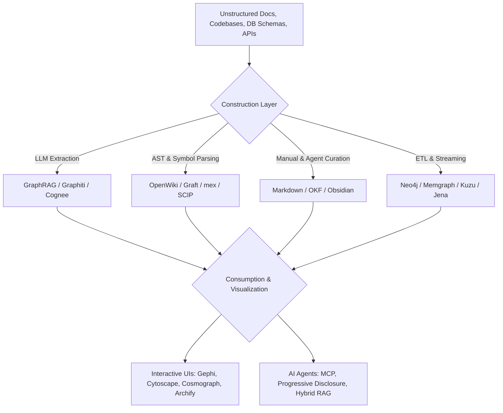

Modern software teams and AI systems rarely fail because they lack raw data — they fail because **relationships between entities are trapped in silos**. Database schemas live in migrations, service ownership lives in Slack, business metrics live in BI tools, and architectural decisions live in wikis.

A **knowledge graph** turns those disconnected fragments into an explicit, traversable network of entities and relationships — usable by humans, analytics pipelines, and AI agents alike. Depending on your scale and workflow, that graph might live in a dedicated graph database like **Neo4j**, an AI-extracted **GraphRAG** index, or a lightweight, git-native **Markdown knowledge graph** using Google's **Open Knowledge Format (OKF)**.

This guide maps the complete **2026 Knowledge Graph & Visualization stack**: graph databases, GraphRAG frameworks, file-based Markdown/OKF graphs, codebase graph tools, visualization libraries, and the AI engineering practices that keep graphs accurate over time.

---

## Table of Contents

- [What is a Knowledge Graph?](#what-is-a-knowledge-graph)
- [The Modern Knowledge Graph Stack](#the-modern-knowledge-graph-stack)
- [1. Graph Databases & Storage Platforms](#1-graph-databases--storage-platforms)
- [2. AI & GraphRAG Frameworks](#2-ai--graphrag-frameworks)
- [3. File-Based & Markdown Knowledge Graphs (PKM & OKF)](#3-file-based--markdown-knowledge-graphs-pkm--okf)
- [4. Codebase & Architecture Knowledge Graphs](#4-codebase--architecture-knowledge-graphs)
- [5. Knowledge Graph Visualization Tools & Libraries](#5-knowledge-graph-visualization-tools--libraries)
- [6. AI Skills & Best Practices for Knowledge Graphs](#6-ai-skills--best-practices-for-knowledge-graphs)
- [Choosing the Right Approach](#choosing-the-right-approach)
- [Frequently Asked Questions](#frequently-asked-questions)

---

## What is a Knowledge Graph?

A **knowledge graph** is a structured representation of real-world entities (people, services, tables, concepts) as **nodes** and their relationships as **edges**, enriched with properties and provenance. Unlike flat documents or isolated tables, knowledge graphs enable multi-hop reasoning, lineage tracing, and context-aware retrieval for both human exploration and AI systems.

At a high level, every knowledge graph implementation answers three questions:

1. **Storage:** Where do nodes and edges live? (Graph DB, triple store, embedded engine, or linked Markdown files)
2. **Construction & Maintenance:** How are entities extracted and kept fresh? (ETL pipelines, LLM extraction, or agent-maintained wikis)
3. **Consumption & Visualization:** How do users and agents query or explore the graph? (Cypher/SPARQL, GraphRAG, MCP servers, or interactive visualizers)

---

## The Modern Knowledge Graph Stack



No single tool fits every use case. An enterprise fraud-detection pipeline needs a transactional graph database; a solo developer or platform team often gets more value from a git-versioned Markdown knowledge graph that requires zero infrastructure.

---

## 1. Graph Databases & Storage Platforms

When you need **multi-hop queries at scale, ACID transactions, or millisecond graph traversals**, a dedicated graph database is the right foundation.

### Property Graph & Multi-Model Databases

Property graphs store attributes directly on nodes and edges and are typically queried with **Cypher** (openCypher / GQL) or domain-specific logic languages.

| Platform | Architecture | Best For | Key Strength |
| :--- | :--- | :--- | :--- |
| **[Neo4j](https://neo4j.com/)** | Native graph DB (JVM) | Enterprise KGs, fraud, recommendations | Maturest ecosystem, Cypher, APOC, Neo4j Bloom |
| **[Memgraph](https://memgraph.com/)** | In-memory C++ | Real-time streaming graphs (Kafka) | High throughput, Cypher-compatible |
| **[NebulaGraph](https://github.com/vesoft-inc/nebula)** | Distributed shared-nothing | Billion-node / trillion-edge enterprise graphs | Horizontal scalability, Raft consensus, openCypher |
| **[FalkorDB](https://www.falkordb.com/)** | Redis-module sparse matrix | Low-latency GraphRAG & agent memory | Ultra-fast multi-tenant graph queries |
| **[Kuzu](https://kuzudb.com/)** | Embedded columnar graph DB | Local analytics, Python/DuckDB workflows | Zero-server embedded deployment, fast scans |
| **[Apache AGE](https://github.com/apache/age)** | PostgreSQL extension | Teams already on Postgres needing graphs | Combines ANSI SQL + openCypher + `pgvector` in one DB |
| **[TypeDB](https://github.com/typedb/typedb)** | Type-theoretic, logic-based | Complex domain ontologies & reasoning | Strict type inheritance and TypeQL inference engine |
| **[TerminusDB](https://github.com/terminusdb/terminusdb)** | Document-graph hybrid | Collaborative, versioned knowledge bases | Git-like branch, merge, diff, and time-travel (WOQL/Datalog) |
| **[SurrealDB](https://surrealdb.com/)** | Multi-model (Doc + Graph + Vector) | Unified app backends | Single engine for records, graph edges, and embeddings |

#### Quick Example: Embedded Cypher Graph in Python (Kuzu)

```python
import kuzu

db = kuzu.Database("./kg_db")
conn = kuzu.Connection(db)

conn.execute("CREATE NODE TABLE Service(name STRING, owner STRING, PRIMARY KEY (name))")
conn.execute("CREATE REL TABLE DEPENDS_ON(FROM Service TO Service)")
conn.execute("CREATE (:Service {name: 'api-gateway', owner: 'platform'})")
conn.execute("CREATE (:Service {name: 'auth-service', owner: 'security'})")
conn.execute(
    "MATCH (a:Service {name: 'api-gateway'}), (b:Service {name: 'auth-service'}) "
    "CREATE (a)-[:DEPENDS_ON]->(b)"
)

res = conn.execute("MATCH (a:Service)-[:DEPENDS_ON]->(b:Service) RETURN a.name, b.owner")
while res.has_next():
    print(res.get_next())  # ['api-gateway', 'security']
```

### RDF Triple Stores & Semantic Web

RDF (Resource Description Framework) models data as `subject → predicate → object` triples with formal ontologies (**OWL**, **RDFS**, **SHACL**) and **SPARQL** queries.

- **[Apache Jena / Fuseki](https://jena.apache.org/)** — Open-source Java framework and SPARQL server for linked data.
- **[Ontotext GraphDB](https://www.ontotext.com/products/graphdb/)** — Enterprise semantic graph database with strong reasoning/inference support.
- **[Oxigraph](https://github.com/oxigraph/oxigraph)** — Fast, lightweight, Rust-based SPARQL triple store (embeddable in Python/Rust).
- **[Amazon Neptune](https://aws.amazon.com/neptune/)** *(Managed Cloud)* — AWS graph DB supporting both Property Graph (openCypher/Gremlin) and RDF (SPARQL).

### Enterprise Metadata & Lineage Catalogs

Data catalogs are specialized knowledge graphs mapping tables, columns, dashboards, pipelines, and owners:

- **[DataHub](https://datahubproject.io/)** & **[OpenMetadata](https://open-metadata.org/)** — Open-source metadata graphs with lineage, ownership, and glossary terms.
- **[Google Cloud Knowledge Catalog](https://github.com/GoogleCloudPlatform/knowledge-catalog)** *(Managed Cloud)* — Enterprise catalog that natively ingests **Open Knowledge Format (OKF)** bundles.

---

## 2. AI & GraphRAG Frameworks

Traditional vector RAG chunks text into isolated snippets and loses cross-document structure. **GraphRAG** frameworks use LLMs to extract entities and relationships into a knowledge graph, then combine graph traversal with vector search.

| Framework | Core Approach | Standout Capability |
| :--- | :--- | :--- |
| **[Microsoft GraphRAG](https://github.com/microsoft/graphrag)** | LLM entity extraction + Leiden community detection | Hierarchical community summaries for global "sensemaking" questions |
| **[Graphiti (Zep)](https://github.com/getzep/graphiti)** | Bi-temporal knowledge graph | Tracks *when* facts became true/invalid — ideal for evolving AI agent memory |
| **[Cognee](https://github.com/topoteretes/cognee)** | Modular ECL (Extract, Cognify, Load) pipeline | Combines vector stores and graph DBs with minimal boilerplate |
| **[LlamaIndex PropertyGraphIndex](https://docs.llamaindex.ai/)** | Schema-guided + implicit extractors | Flexible Python integration with Neo4j, Kuzu, and NebulaGraph |
| **[LightRAG](https://github.com/HKUDS/LightRAG)** | Dual-level (low-level entity + high-level topic) retrieval | Significantly lower token/indexing cost than full Microsoft GraphRAG |
| **[Neo4j LLM Graph Builder](https://github.com/neo4j-labs/llm-graph-builder)** | Automated PDF/text-to-Neo4j pipeline | Turns unstructured files directly into queryable Neo4j graphs with LLMs |
| **[LLM2KG](https://github.com/nngabe/llm2kg)** | Agentic KG construction + ReAct QA | Dynamic ontology extraction, hybrid retrieval, and built-in RAGAS evaluation |

> **Cost & accuracy warning:** Unconstrained LLM graph extraction over large corpora can burn tokens quickly and create duplicate nodes (`"Postgres"` vs `"PostgreSQL"`). Always define a target ontology/schema and run entity resolution (see [Section 6](#6-ai-skills--best-practices-for-knowledge-graphs)).
{: .prompt-warning }

---

## 3. File-Based & Markdown Knowledge Graphs (PKM & OKF)

Not every knowledge graph needs a database server. A growing movement treats **plain Markdown files + YAML frontmatter + cross-links in Git** as a portable knowledge graph — readable by humans in any editor and traversable by AI agents.

### Personal & Team Knowledge Graphs (PKM)

- **[Obsidian](https://obsidian.md/)** — Local-first Markdown vault with an interactive Graph View, backlinks, and Dataview queries. Widely paired with coding agents as a personal knowledge base.
- **[Logseq](https://logseq.com/)** — Outliner-first, local-first knowledge graph supporting Markdown and Org-mode with block-level references.
- **[Foam](https://foambubble.github.io/foam/)** — Open-source VS Code extension bringing Roam/Obsidian-style `[[wikilinks]]` and graph visualization directly into your IDE.

### Open Knowledge Format (OKF): Vendor-Neutral Markdown Graphs

**[Open Knowledge Format (OKF)](https://github.com/GoogleCloudPlatform/knowledge-catalog/blob/main/okf/SPEC.md)** (v0.2, June 2026) is Google Cloud's open specification that formalizes the ["LLM Wiki" pattern](https://gist.github.com/karpathy/1dd0294ef9567971c1e4348a90d69285) — articulated by Andrej Karpathy — into an interoperable, file-based knowledge graph.

**Why OKF stands out:**

- **Zero infrastructure:** Just UTF-8 Markdown files, YAML frontmatter, and Git.
- **Minimal contract:** Only one frontmatter field is required (`type`). Everything else is extensible.
- **Built-in graph edges:** Standard Markdown links (bundle-relative `/tables/users.md` or relative `./other.md`) form the knowledge graph.
- **Progressive disclosure:** Reserved `index.md` files at each directory level let humans and agents browse high-level structure before loading individual concept nodes.
- **First-class provenance, trust & staleness:** Frontmatter natively tracks `sources` (with `usage_count` and `last_modified`), `generated` + `verified` (deriving `unverified`, `machine-confirmed`, or `human-reviewed` trust tiers), and `stale_after` timestamps.

#### Example OKF Knowledge Graph Bundle

```text
knowledge-bundle/
├── index.md                    # Root graph index (progressive disclosure)
├── log.md                      # Chronological update history
├── services/
│   ├── index.md
│   └── auth-service.md         # Node: type: Service
├── tables/
│   ├── index.md
│   └── users.md                # Node: type: PostgreSQL Table
└── computations/
    └── revenue.md              # Attested Computation node
```

Example concept node (`services/auth-service.md`):

```yaml
---
type: Service
title: Authentication Service
description: Handles user login, JWT issuance, token validation, and session management.
resource: https://github.com/yourorg/auth-service
tags: [auth, security, core]
generated: { by: human:yourname, at: 2026-11-27T10:00:00Z }
verified:
  - { by: human:lead-architect, at: 2026-11-27T10:15:00Z }
status: stable
stale_after: 2027-02-27T00:00:00Z
---

## Overview

Issues JWTs (15-minute TTL) and refresh tokens (7-day TTL).

## Dependencies (Graph Edges)

- [PostgreSQL users table](/tables/users.md) — credential storage
- [Redis session cache](/services/redis.md) — active session lookup
```
{: file="knowledge-bundle/services/auth-service.md" }

> See our [Token Usage Optimization Guide]() for how progressive context disclosure (`index.md` → linked concept) cuts AI agent token consumption.
{: .prompt-tip }

---

## 4. Codebase & Architecture Knowledge Graphs

Software repositories are naturally structured graphs (modules, symbols, callers, schemas, and services). These tools turn raw codebases into explorable knowledge graphs:

| Tool | Approach | Key Capability |
| :--- | :--- | :--- |
| **[OpenWiki](https://github.com/langchain-ai/openwiki)** (LangChain) | Auto-generated Markdown wiki from code | Emits **OKF-conformant** bundles (`openwiki code` / `openwiki update`) with an interactive visualizer and 9 external connectors (Slack, Notion, Git) |
| **[mex](https://github.com/mex-memory/mex)** | Repo-local, symbol-grounded wiki | Links facts directly to code symbols and flags **drift** when code changes invalidate documentation |
| **[Graft](https://github.com/NanoNets/Graft)** | Plain-English explanations + symbol graph | Serves persistent codebase graph context directly to agents over **[MCP](https://modelcontextprotocol.io/)** |
| **[OpenViking](https://github.com/volcengine/OpenViking)** (ByteDance) | Context database with filesystem paradigm | Self-evolving context layer that restructures links based on usage patterns |
| **[Sourcegraph SCIP](https://github.com/sourcegraph/scip)** / **[Tree-sitter](https://tree-sitter.github.io/)** | Deterministic AST & compiler-grade indexing | Exact cross-file and cross-repo call graphs and symbol references |

### Quick Start: Auto-Generate a Repo Knowledge Graph with OpenWiki

```bash
# 1. Install OpenWiki globally
npm install -g openwiki

# 2. Configure your LLM provider (e.g., Gemini)
export OPENWIKI_PROVIDER="gemini"
export GEMINI_API_KEY="AIzaSy..."

# 3. Generate an OKF-conformant knowledge graph in openwiki/
openwiki code

# 4. Refresh after code changes (or wire into GitHub Actions)
openwiki update
```

---

## 5. Knowledge Graph Visualization Tools & Libraries

A knowledge graph only delivers full value when humans can **see clusters, trace paths, and spot bottlenecks**. Visualization tools fall into four categories:

### A. Standalone & No-Code Graph Visualizers

- **[Gephi](https://gephi.org/)** & **[Gephi Lite](https://gephi.org/gephi-lite/)** — The gold standard for network analysis, community coloring, centrality metrics, and force-directed layouts (ForceAtlas2).
- **[Cytoscape](https://cytoscape.org/)** — Desktop & web platform (born in bioinformatics, widely used for any complex network) with rich layout and plugin ecosystems.
- **[Cosmograph](https://cosmograph.app/)** — GPU-accelerated WebGL visualizer capable of rendering hundreds of thousands of nodes smoothly in the browser.
- **[Neo4j Bloom](https://neo4j.com/product/bloom/)** *(Commercial UI)* — Search-driven, no-code exploration UI for Neo4j property graphs.
- **[OKF Static HTML Visualizer](https://github.com/GoogleCloudPlatform/knowledge-catalog)** — Google's zero-backend reference artifact that compiles any OKF Markdown bundle into a single self-contained HTML graph file.

### B. Web & Developer Visualization Libraries

| Library | Rendering | Best For |
| :--- | :--- | :--- |
| **[AntV G6](https://github.com/antvis/G6)** | Canvas / SVG / WebGL / WebGPU | Enterprise graph analysis, 10+ built-in layouts, and rich interactions |
| **[Reagraph](https://github.com/reaviz/reagraph)** | React + WebGL | High-performance 2D/3D React apps with path-finding, clustering, and edge bundling |
| **[Force-Graph / React-Force-Graph](https://github.com/vasturiano/force-graph)** | Canvas / WebGL (Three.js) | Physics-driven 2D and 3D force-directed network prototypes |
| **[Sigma.js](https://www.sigmajs.org/)** | WebGL | Large graphs (10k–100k+ nodes) in web apps |
| **[Cytoscape.js](https://js.cytoscape.org/)** | Canvas | Rich graph algorithms, compound nodes, interactive exploration |
| **[D3.js (d3-force)](https://d3js.org/)** | SVG / Canvas | Custom bespoke visualizations and editorial graphics |
| **[React Flow](https://reactflow.dev/)** | HTML / SVG | Node-based architecture diagrams, pipelines, and DAG editors |
| **[vis-network](https://visjs.github.io/vis-network/docs/network/)** | Canvas | Quick drop-in network graphs with physics simulation |

### C. Python & Data Science Visualization

- **[PyVis](https://pyvis.readthedocs.io/)** — Wraps `vis.js` to turn NetworkX graphs into interactive HTML widgets in a few lines of Python.
- **[NetworkX](https://networkx.org/) + [Plotly](https://plotly.com/python/network-graphs/)** — Great for reproducible analytical notebooks and interactive hover inspection.
- **[Graphistry](https://www.graphistry.com/)** — GPU-accelerated visual graph analytics for massive security, fraud, and telemetry networks.

```python
import networkx as nx
from pyvis.network import Network

G = nx.DiGraph()
G.add_edge("api-gateway", "auth-service", label="DEPENDS_ON")
G.add_edge("auth-service", "users_table", label="READS_FROM")

net = Network(height="500px", width="100%", directed=True, bgcolor="#111827", font_color="#f9fafb")
net.from_nx(G)
net.show("knowledge_graph.html", notebook=False)
```

### D. AI-Assisted Diagramming & Text-to-Graph Skills

- **[Archify](https://github.com/tt-a1i/archify)** — An agent skill (`npx skills add tt-a1i/archify -g`) that reads knowledge bundles (like `openwiki/`) and generates self-contained, interactive HTML diagrams (architecture, workflow, sequence, data flow, lifecycle) with search, route tracing, and PNG/SVG/WebM export.
- **[Mermaid.js](https://mermaid.js.org/)**, **[D2](https://d2lang.com/)**, & **[Graphviz (DOT)](https://graphviz.org/)** — Declarative text-to-diagram languages ideal for version-controlled documentation and static site generators like Jekyll.

---

## 6. AI Skills & Best Practices for Knowledge Graphs

Building a knowledge graph with AI is easy; keeping it **accurate, deduplicated, and trustworthy** is the hard part. Adopt these practices from production GraphRAG and context-engineering systems:

1. **Enforce Schema-Guided Extraction:** Never ask an LLM to "extract all entities and relationships" freeform. Provide a strict list of allowed node types (`Service`, `Table`, `Owner`, `Metric`) and edge types (`READS_FROM`, `OWNS`, `DEPENDS_ON`) to prevent graph explosion.
2. **Run Entity Resolution & Deduplication:** Normalize aliases before writing edges (`"pg-prod"`, `"PostgreSQL"`, `"users_db"` → canonical ID). Combine string normalization with embedding similarity thresholds.
3. **Separate Extraction from Trust (Provenance Tiers):** Store *where* every fact came from (`sources`, file paths, line numbers, timestamps) and distinguish **AI-extracted (`machine-confirmed`)** edges from **human-verified (`human-reviewed`)** ones.
4. **Track Time & Staleness:** Knowledge decays. Use bi-temporal validity (`valid_from` / `valid_to` as in Graphiti), explicit expiration (`stale_after` in OKF), or symbol-drift checks (`mex`) so stale facts don't silently mislead queries or agents.
5. **Use Progressive Disclosure for Context:** Don't dump 500 graph nodes into a prompt. Start with an `index.md` or community summary (Microsoft GraphRAG / OKF pattern), then expand only 1–2 hops around relevant entry nodes.
6. **Combine Vector Search + Graph Traversal (Hybrid RAG):** Use embeddings to locate entry-point nodes semantically, then traverse deterministic graph edges to gather exact dependencies, schemas, and owners.
7. **Automate Graph Maintenance in CI:** Treat knowledge updates like code — run `openwiki update` or schema/link validators on pull requests so the graph evolves alongside the codebase.

---

## Choosing the Right Approach

| If your primary goal is... | Start with... | Visualize with... |
| :--- | :--- | :--- |
| **Enterprise queries, fraud, or recommendations** | Neo4j, Memgraph, or Neptune | Neo4j Bloom, Cosmograph, or Sigma.js |
| **Local Python graph analytics** | Kuzu + NetworkX | PyVis or NetworkX + Plotly |
| **RAG over unstructured PDFs & docs** | GraphRAG, LightRAG, or Cognee | Gephi Lite or Cosmograph |
| **Evolving AI agent memory** | Graphiti (Zep) | Custom WebGL / Cytoscape.js |
| **Zero-infra team/agent knowledge base** | **OKF** + Git (or Obsidian) | OKF Static HTML Visualizer or Obsidian Graph |
| **Codebase architecture & docs** | OpenWiki, Graft, or mex | Archify or Mermaid / D2 |

> **When NOT to use a Knowledge Graph:** If your queries are single-hop lookups, flat document retrieval, or straightforward relational joins already served by PostgreSQL, a knowledge graph adds schema and maintenance overhead without enough return. Start with simple SQL, full-text/vector search, or a small `index.md` until multi-hop relationships become the bottleneck.
{: .prompt-info }

---

## Frequently Asked Questions

### Do I need a graph database like Neo4j to build a knowledge graph?

No. For smaller or documentation-centric graphs (hundreds to a few thousand nodes), file-based formats like **OKF (Markdown + YAML)** or **Obsidian vaults** in Git give you cross-linking, version history, and human readability with zero database overhead. Move to Neo4j, Memgraph, or Kuzu when you need complex multi-hop queries, aggregations, or millions of edges.

### What is the difference between Vector RAG and GraphRAG?

Vector RAG retrieves isolated text chunks based on semantic similarity, which struggles when answers require connecting facts across multiple documents (e.g., *"Which services owned by Team A depend on tables containing PII?"*). **GraphRAG** extracts entities and explicit relationships into a graph, enabling structured multi-hop traversal alongside vector search.

### How do I visualize a knowledge graph without writing frontend code?

For graph exports (CSV, GraphML, GEXF, JSON), use **Gephi Lite**, **Cytoscape**, or **Cosmograph**. For Markdown/OKF bundles, use **Obsidian's Graph View**, **OpenWiki's built-in visualizer**, or ask an AI agent with the **Archify** skill to generate a standalone interactive HTML diagram.

### How do I prevent AI-generated knowledge graphs from going stale?

Combine three safeguards: (1) attach `sources` and `stale_after` timestamps to every node/edge, (2) run automated updates in CI (such as `openwiki update` or drift-detection tools like `mex`), and (3) require human review (`verified` metadata) for critical definitions and runbooks.
