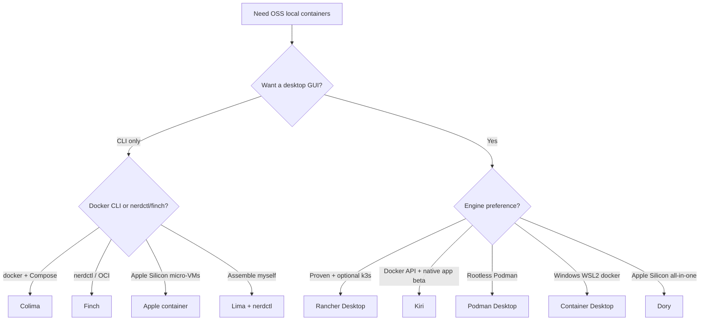

**Open-source container runtimes** are local engines and desktop wrappers that build, pull, and run Linux containers on a laptop without a proprietary Docker Desktop seat — typically via Docker Engine API, Podman, or nerdctl/containerd, with optional Compose and single-node Kubernetes.

Replacing Docker Desktop is usually a **runtime** decision first: do containers, Compose, and bind mounts still work, and can the whole team use it without a paid desktop license? Optional local Kubernetes is a bonus — not the same problem as picking **minikube** vs **kind**.

> Prefer tools you can audit and run at work with no per-seat Desktop tax. Measure bind mounts and image builds on *your* machine — vendor timings are directional only.
{: .prompt-tip }

This guide is **open-source only**. Primary picks:

1. **[Colima](https://colima.run/)**{:target="_blank" rel="noopener"} ([GitHub](https://github.com/abiosoft/colima){:target="_blank" rel="noopener"}) — MIT CLI on macOS/Linux (Lima); Docker, containerd, Incus; optional k3s.
2. **[Finch](https://runfinch.com/)**{:target="_blank" rel="noopener"} ([GitHub](https://github.com/runfinch/finch){:target="_blank" rel="noopener"}) — Apache 2.0 AWS-originated client; Lima + containerd + nerdctl + BuildKit; Mac/Windows/Linux.
3. **[Kiri](https://runkiri.com/)**{:target="_blank" rel="noopener"} ([GitHub](https://github.com/libracoder/kiri){:target="_blank" rel="noopener"}) — Apache/MIT native desktop + Docker API (**beta**); Mac/Windows/Linux; optional k3s + Share.
4. **[Rancher Desktop](https://rancherdesktop.io/)**{:target="_blank" rel="noopener"} — Apache OSS desktop; dockerd (Moby) or containerd; optional embedded k3s.
5. **[Podman](https://podman.io/)**{:target="_blank" rel="noopener"} / **[Podman Desktop](https://podman-desktop.io/)**{:target="_blank" rel="noopener"} — Apache OSS rootless-first engine + GUI; kind/minikube extensions.

**Also covered:** [Apple `container`](https://github.com/apple/container){:target="_blank" rel="noopener"} (per-container micro-VMs on Apple Silicon), [Lima](https://lima-vm.io/){:target="_blank" rel="noopener"} + [nerdctl](https://github.com/containerd/nerdctl){:target="_blank" rel="noopener"}, [Container Desktop](https://github.com/container-desktop/container-desktop){:target="_blank" rel="noopener"} (Windows), [Dory](https://usedory.dev/){:target="_blank" rel="noopener"} (Apple Silicon), and other OSS honorable mentions.

For **local Kubernetes installers, multi-node topologies, and cluster UIs** (minikube, kind, k3d, k3s, Headlamp, Radar, k9s, …), see Part 2 in this series: [`_drafts/open-source-local-kubernetes-installers-and-uis.md`](/_drafts/open-source-local-kubernetes-installers-and-uis.md) (swap to `` when both are published).

> **Two-part series (Runtime vs. Cluster):** This post covers **Layer 1 — Container Runtimes** (building/running containers and Compose). If a runtime also bundles an optional single-node Kubernetes toggle (like **Rancher Desktop** or **Colima**), we note it as a bridge — the full Kubernetes installer & UI comparison lives in the [companion guide](/_drafts/open-source-local-kubernetes-installers-and-uis.md).
{: .prompt-info }

## TL;DR — Quick Recommendations

| Use Case | Best Fit | Runner-Up | Why |
| -------- | -------- | --------- | --- |
| **CLI-only OSS Docker on Mac/Linux** | **Colima** | Finch | MIT; `docker` client; profiles; optional k3s |
| **OCI / containerd / nerdctl (AWS-aligned)** | **Finch** | Colima (`--runtime containerd`) | Curated Lima + nerdctl + BuildKit; Mac/Win/Linux |
| **OSS native GUI + Docker Engine API (beta)** | **Kiri** | Rancher Desktop | Mac/Win/Linux; `docker` context; k3s + Share — verify maturity |
| **GUI + toggleable k3s (proven)** | **Rancher Desktop** | Kiri (beta) | Cross-platform; Moby or containerd; same dual role as Docker Desktop’s K8s toggle |
| **Rootless Podman / RHEL-aligned** | **Podman Desktop** | Podman CLI | Daemonless-first; kind/minikube UI |
| **DIY / maximum control** | **Lima + nerdctl** | Colima | Assemble VM + containerd yourself |
| **Windows WSL2 + stock `docker` CLI** | **Container Desktop** | Rancher Desktop (Moby) | MIT tray app; Docker Engine in its own WSL distro |
| **Apple Silicon all-in-one (GPL)** | **Dory** | Kiri / Colima | Native SwiftUI; Docker + k3s + Linux VMs — Mac ARM only |
| **Native Apple Silicon micro-VMs (macOS 26+)** | **Apple `container`** | Colima / Finch | Apache 2.0 Swift CLI; OCI; optional `container cluster` (experimental); not Docker Compose |

> Jump to [Why Mac needs a Linux VM](#why-mac-needs-a-linux-vm-apple-silicon), [Capability matrix](#capability-matrix), [Apple `container`](#apple-container-micro-vms), [When to Use What](#when-to-use-what), [FAQ](#frequently-asked-questions), or [Quick starts](#quick-starts).
{: .prompt-info }

## Approach & Scope Demarcation

### Selection Criteria

Primary picks had to meet most of:

1. **Open source** — OSI-style license (MIT, Apache 2.0, GPL, …); usable without a mandatory paid desktop seat.
2. **Laptop-local container engine** — Runs Linux containers on macOS, Windows, and/or Linux without a cloud control plane.
3. **Docker-compatible or intentional alternative** — Speaks Docker Engine API / Compose, or a clear Podman / `nerdctl` / `finch` path.
4. **Actively maintained** — Regular releases (beta tools allowed with explicit caveats).

### What This Guide Is NOT

1. **Proprietary desktops as primary recommendations** — [Docker Desktop](https://www.docker.com/products/docker-desktop/){:target="_blank" rel="noopener"} and [OrbStack](https://orbstack.dev/){:target="_blank" rel="noopener"} are not OSS picks here. Note: **Docker Desktop does include optional Kubernetes** (and **Rancher Desktop** does too, as an OSS dual-purpose tool in this guide) — see [Optional Kubernetes](#optional-kubernetes-runtime-vs-installer) and the [Kubernetes companion](/_drafts/open-source-local-kubernetes-installers-and-uis.md).
2. **Production cluster installers** — kubeadm, kubespray, OpenShift, managed EKS/GKE/AKS.
3. **Deep Kubernetes topology labs** — multi-node kind/k3d/minikube recipes live in the [Kubernetes companion](/_drafts/open-source-local-kubernetes-installers-and-uis.md).
4. **Building blocks alone as “Desktop replacements”** — [Moby](https://mobyproject.org/){:target="_blank" rel="noopener"}, [containerd](https://containerd.io/){:target="_blank" rel="noopener"}, and [BuildKit](https://github.com/moby/buildkit){:target="_blank" rel="noopener"} power many tools above; they are not end-user installers by themselves (see honorable mentions).
5. **Vendor marketing benchmarks as gospel** — Published `docker run` timings are directional; measure bind mounts and builds on *your* machine.

## Why Mac needs a Linux VM (Apple Silicon)

Linux containers need a **Linux kernel**. On Apple Silicon macOS there is no native Linux kernel, so every practical path uses [Virtualization.framework](https://developer.apple.com/documentation/virtualization){:target="_blank" rel="noopener"} (or QEMU) under the hood. The tools below differ mainly in **how many** Linux VMs they run:

| Model | Idea | Examples in this guide |
| ----- | ---- | ---------------------- |
| **Shared Linux VM** | One managed Linux guest runs `dockerd`, `containerd`, or Podman; all containers share that guest | [Colima](#colima), [Finch](#finch), [Rancher Desktop](#rancher-desktop), [Podman](#podman--podman-desktop) machine, [Lima](#lima--nerdctl-diy-foundation), [Kiri](#kiri-beta), plus proprietary [Docker Desktop](https://www.docker.com/products/docker-desktop/){:target="_blank" rel="noopener"} / [OrbStack](https://orbstack.dev/){:target="_blank" rel="noopener"} |
| **Per-container micro-VM** | Each container boots in its own lightweight Linux VM (stronger isolation; different UX) | [Apple `container`](#apple-container-micro-vms) ([apple/container](https://github.com/apple/container){:target="_blank" rel="noopener"}) |

**Pick shared VM** when you need stock `docker` / Compose, kind/k3d against a Docker API, or cross-platform team parity. **Pick Apple `container`** when you are on **Apple Silicon + macOS 26+** (recommended; macOS 15 has known networking limits), want OCI images without a third-party Desktop, and can use the `container` CLI (and optional experimental `container cluster`) instead of Docker Compose.

On **Linux hosts**, containers usually run natively — skip this section and use distro packages, Podman, or Colima as documented below (see also our [Ubuntu Fresh Install Setup Guide]()). On **macOS**, see our [macOS Fresh Install Setup Guide]() for baseline Homebrew/CLI tooling. On **Windows**, prefer WSL2 paths ([Container Desktop](#container-desktop-windows), Rancher Desktop, Finch).

> **Bind-mount & file-sharing gotchas:** Most "slow container" complaints come from host-to-VM filesystem sharing rather than the container engine itself:
> - **macOS (Colima, Lima, Rancher Desktop):** Prefer **VirtioFS** (e.g., `colima start --mount-type=virtiofs` on Apple Silicon) over legacy 9p/sshfs for `node_modules` and large source trees.
> - **Windows (WSL2):** Store repos inside the **WSL2 Linux filesystem** (`~/code`) instead of `/mnt/c/...` — cross-OS 9p mounts over `/mnt/c` are dramatically slower for builds and file watchers.
> - **Linux:** Native bind mounts have no VM boundary, so I/O runs at host disk speed.
{: .prompt-tip }

## Capability Matrix

| Tool | License | Platforms | UX | Architecture | Client / API | Optional K8s | Notes |
| ---- | ------- | --------- | -- | ------------ | ------------ | ------------ | ----- |
| **Colima** | MIT | macOS, Linux | CLI | Shared VM (Lima) | `docker` (default) / nerdctl / Incus | k3s | Best CLI Docker path on Mac |
| **Finch** | Apache 2.0 | macOS, Windows, Linux | CLI | Shared VM (Lima) | `finch` → nerdctl | No (use kind on engine) | Curated OSS stack from AWS |
| **Kiri** | Apache/MIT | macOS, Windows, Linux | Native GUI + CLI | Shared VM (macOS) | Docker Engine API | k3s | **Beta**; Share + machines |
| **Rancher Desktop** | Apache 2.0 | macOS, Windows, Linux | Desktop GUI | Shared VM | Moby `docker` or nerdctl | Embedded k3s | Proven Desktop-shaped OSS |
| **Podman Desktop** | Apache 2.0 | macOS, Windows, Linux | Desktop GUI | Shared VM (Podman machine on Mac/Win) | `podman` (+ docker shim) | kind / minikube | Rootless-first |
| **Lima + nerdctl** | Apache 2.0 | macOS, Linux, … | CLI | Shared VM | `lima nerdctl` | DIY | Foundation under Colima/Finch |
| **Apple `container`** | Apache 2.0 | **Apple Silicon macOS** | CLI | Per-container micro-VM | `container` (OCI) | `container cluster` (experimental) | macOS 26+ recommended; no Docker Compose |
| **Container Desktop** | MIT | **Windows** | Tray + CLI | WSL2 distro | `docker` / Compose | No | WSL2 Docker Engine distro |
| **Dory** | GPL-3.0 | **Apple Silicon macOS** | Native GUI + CLI | Shared / hybrid | Docker-compatible | k3s | Newer; ARM Mac only |
| **Docker Desktop** | Proprietary | macOS, Windows, Linux | Desktop GUI | Shared VM | Bundled `docker` | Optional single-node | Contrast only — not an OSS pick |
| **OrbStack** | Proprietary | macOS | Desktop + CLI | Shared VM | `docker` | Single-node | Contrast — personal free / commercial paid |



## Colima

[Colima](https://colima.run/){:target="_blank" rel="noopener"} (“Containers on [Lima](https://lima-vm.io/){:target="_blank" rel="noopener"}”) is the default **OSS CLI** answer when you want Docker on a Mac (or Linux) without a Desktop app. Defaults are sensible; profiles isolate multiple instances. Runtimes: **Docker** (default), **containerd** (+ [nerdctl](https://github.com/containerd/nerdctl){:target="_blank" rel="noopener"}), **Incus**. Optional **k3s** shares the VM image store with Docker. Newer releases add GPU-oriented AI workload paths on Apple Silicon (`krunkit`) — verify current docs for your macOS version.

```bash
brew install colima docker docker-compose kubectl   # https://brew.sh

colima start --cpu 4 --memory 8
docker context use colima
docker run --rm hello-world
docker compose up -d

# Optional single-node Kubernetes
colima start --kubernetes --cpu 4 --memory 8
kubectl get nodes

# Other runtimes
# colima start --runtime containerd
# colima start --runtime incus

colima stop
# colima delete --data
```

**When to prefer it:** Terminal-first teams; scriptable local Docker; free at any company size.
**When not:** Need Windows host support, a polished GUI, or a curated `nerdctl`-first client (Finch).

## Finch

[Finch](https://runfinch.com/){:target="_blank" rel="noopener"} ([runfinch/finch](https://github.com/runfinch/finch){:target="_blank" rel="noopener"}) is an **Apache 2.0** open-source client (originally from AWS) that packages **Lima + containerd + nerdctl + BuildKit** behind a native `finch` CLI. You do **not** get stock `dockerd` by default — commands look like Docker (`finch run`, `finch build`, Compose via nerdctl) but talk to **containerd**. Available on **macOS, Windows, and Linux**. Finch is a developer tool; the VM on Mac/Windows is for local Linux containers, not a multi-tenant security boundary.

```bash
# macOS (Homebrew cask / formula — see current Finch docs)
brew install --cask finch
# or: brew install finch

finch vm init
finch run public.ecr.aws/finch/hello-finch:latest
finch compose up -d    # nerdctl-backed Compose where supported

# Windows: install WSL2, then Finch.msi from GitHub Releases, then:
# finch vm init

# Linux: distro packages or binary — see https://runfinch.com/docs/
```

**When to prefer it:** Want an OSS, vendor-neutral **nerdctl/containerd** stack with one installer; AWS-adjacent local workflows.
**When not:** Hard requirement for unmodified `docker` / Docker Engine API sockets — use Colima, Rancher (Moby), or Kiri.

## Kiri (beta)

[Kiri](https://runkiri.com/){:target="_blank" rel="noopener"} ([libracoder/kiri](https://github.com/libracoder/kiri){:target="_blank" rel="noopener"}) is a **new (beta)** open-source container runtime and **native** desktop app (not Electron). It implements the Docker Engine API in a small Rust daemon (VM on macOS; native on Linux; WSL2 on Windows). Extras: local names (`*.kiri.local`), **Kiri Share**, Linux machines, import from other desktops, and `kiri k8s start` (single-node k3s). Dual-licensed Apache 2.0 or MIT (guest kernel GPL-2.0).

> Kiri is in **beta**. Pilot on a disposable project before standardizing a whole org.
{: .prompt-warning }

```bash
# Install from https://runkiri.com/ — creates docker context `kiri`
docker --context kiri run --rm hello-world
docker --context kiri compose up -d

kiri k8s start --use
kubectl --context kiri get nodes

# Optional: public HTTPS link to a running container
# kiri share web

kiri k8s stop
# kiri k8s delete
```

**When to prefer it:** OSS + native GUI on Mac/Windows/Linux with real `docker` compatibility.
**When not:** Need a long-proven default tomorrow — Colima, Finch, or Rancher Desktop.

## Rancher Desktop

[Rancher Desktop](https://rancherdesktop.io/){:target="_blank" rel="noopener"} is the closest **proven OSS** “Desktop app with containers + optional Kubernetes” replacement — the open-source dual-purpose peer to **Docker Desktop** (engine + optional cluster). Pick **dockerd (Moby)** when scripts expect `docker`, or **containerd** + `nerdctl`. Enable **k3s** in Preferences for a single-node cluster; use **kind/k3d** on the same engine for multi-node (Kubernetes companion).

```bash
# Install: https://rancherdesktop.io/ (macOS / Windows / Linux)
# Preferences → Container Engine → dockerd (Moby) or containerd
# Preferences → Kubernetes → enable + pick k3s version

docker run --rm hello-world   # when Moby selected
# or: nerdctl run --rm hello-world

kubectl get nodes             # if Kubernetes enabled
```

**When to prefer it:** Cross-platform GUI; leaving proprietary Desktop for licensing; k3s one toggle away.
**When not:** CLI-only (Colima/Finch); rootless-Podman-first (Podman Desktop).

> **Naming tip:** **Rancher Desktop** ≠ **Rancher** (multi-cluster manager).
{: .prompt-info }

## Podman & Podman Desktop

[Podman](https://podman.io/){:target="_blank" rel="noopener"} is a daemonless, often **rootless** OCI engine (Apache 2.0). On Linux it runs natively; on macOS/Windows it uses a **Podman machine** VM. [Podman Desktop](https://podman-desktop.io/){:target="_blank" rel="noopener"} adds a GUI: images, containers, Compose providers, kind/minikube creation, and `podman generate kube` / `podman play kube` for manifest previews. Best when the team is moving **toward Podman**, not when every script must hit a perfect Docker Engine clone with zero shim work.

```bash
# macOS
brew install podman-desktop podman

# Windows
winget install RedHat.PodmanDesktop

# Linux
flatpak install flathub io.podman_desktop.PodmanDesktop
# or: distro podman packages

podman machine init && podman machine start   # macOS / Windows
podman run --rm quay.io/podman/hello
podman compose up -d                          # provider-dependent — verify docs
```

**When to prefer it:** Rootless posture; Fedora/RHEL alignment; kind/minikube from a tray UI.
**When not:** Stock `dockerd` required with no shim — Colima, Rancher (Moby), or Kiri.

## Lima + nerdctl (DIY foundation)

[Lima](https://lima-vm.io/){:target="_blank" rel="noopener"} (“Linux Machines”) launches a Linux VM with file sharing and port forwarding. Default templates often ship **containerd** + **nerdctl** (+ BuildKit). [Colima](#colima) and [Finch](#finch) are opinionated layers on top; using Lima directly maximizes control and teaching value, at the cost of more assembly.

```bash
brew install lima nerdctl
limactl start template://docker   # or default / containerd templates — see Lima docs
lima nerdctl run --rm hello-world
# lima nerdctl compose up -d
```

**When to prefer it:** Learning the stack; custom VM images; contributing upstream.
**When not:** Want one `brew install && start` path — Colima or Finch.

## Apple `container` (micro-VMs)

[Apple `container`](https://github.com/apple/container){:target="_blank" rel="noopener"} ([docs](https://apple.github.io/container/documentation/){:target="_blank" rel="noopener"}, [technical overview](https://github.com/apple/container/blob/main/docs/technical-overview.md){:target="_blank" rel="noopener"}) is Apple’s **Apache 2.0** Swift CLI for running **OCI** Linux containers on **Apple Silicon**. Unlike Colima/Finch/Docker Desktop, it does **not** put all workloads in one shared Linux VM — each container runs in its own lightweight VM via the [Containerization](https://github.com/apple/containerization){:target="_blank" rel="noopener"} package and Virtualization.framework ([README](https://github.com/apple/container){:target="_blank" rel="noopener"}).

**Requirements:** Apple Silicon Mac. Designed for **macOS 26+**; maintainers focus there. macOS 15 can run it but has networking limits (no container-to-container vmnet, no custom networks) — prefer 26+.

```bash
# Install the signed package from https://github.com/apple/container/releases
# Then:
container system start
container run --rm alpine echo hello

# Optional local Kubernetes (experimental — API may change)
container cluster create
kubectl get nodes
# Multi-node workers:
# container cluster create --name lab --workers 2
# container cluster delete
```

**When to prefer it:** Want native Apple Silicon isolation, OCI pull/build/push without Docker Desktop/Colima, or a local `container cluster` lab on macOS 26+.
**When not:** Need Docker Compose / stock Docker Engine API, Windows/Linux host parity, or a battle-tested shared-VM path for kind/k3d — use Colima, Finch, Rancher Desktop, or Podman instead.

## Container Desktop (Windows)

[Container Desktop](https://github.com/container-desktop/container-desktop){:target="_blank" rel="noopener"} ([container-desktop.io](https://container-desktop.io/){:target="_blank" rel="noopener"}) is an **MIT** open-source Docker Desktop alternative for **Windows**: Docker Engine CE inside a dedicated **WSL2** distro, a proxy that maps Windows paths into the daemon, tray controls, and bundled `docker` / Compose CLIs. Linux containers only (no Windows Containers). Useful when the team is Windows-heavy and wants stock Docker CLI without Docker Desktop licensing.

```bash
# Install from GitHub Releases / project site (requires WSL2)
docker run --rm hello-world
docker compose up -d
# Manage start/stop/integration from the system tray
```

**When to prefer it:** Windows + familiar `docker`/`compose` without proprietary Desktop.
**When not:** Need macOS/Linux parity in one product — Rancher Desktop, Kiri, or Finch.

## Honorable Mentions

| Option | License | Notes |
| ------ | ------- | ----- |
| **[Docker Desktop](https://www.docker.com/products/docker-desktop/)**{:target="_blank" rel="noopener"} | Proprietary | Container Desktop + **optional single-node Kubernetes** (Preferences → Kubernetes). Common migration baseline; not an OSS recommendation. K8s deep-dive: [companion](/_drafts/open-source-local-kubernetes-installers-and-uis.md). |
| **[Dory](https://usedory.dev/)**{:target="_blank" rel="noopener"} ([GitHub](https://github.com/Augani/dory){:target="_blank" rel="noopener"}) | GPL-3.0 | Native Apple Silicon local system: Docker, Compose, k3s, Linux desktop VMs, agent sandboxes. No commercial seat. **ARM Mac only** today. |
| **[Ferrodock](https://github.com/manimovassagh/Ferrodock)**{:target="_blank" rel="noopener"} | MIT | Early native Rust desktop with bundled engine + MCP; Mac/Win/Linux. Verify stars/releases before team bets. |
| **[OrbStack](https://orbstack.dev/)**{:target="_blank" rel="noopener"} | Proprietary | macOS-only Docker + Linux VMs + single-node K8s; personal free / commercial paid. |
| **[minikube](https://minikube.sigs.k8s.io/)**{:target="_blank" rel="noopener"} `--no-kubernetes` | Apache 2.0 | Can expose a Docker runtime without starting Kubernetes — workable but odd as a pure Desktop replacement. Prefer Colima/Finch for that job. |
| **Docker Engine / Moby on Linux** | Apache 2.0 | Native `dockerd` via distro packages — often the right Linux answer without any “Desktop” app. |
| **[Portainer CE](https://github.com/portainer/portainer)**{:target="_blank" rel="noopener"} | zlib (OSS core) | Self-hosted web UI that attaches to local Docker or Podman sockets (and Kubernetes — see the [K8s companion](/_drafts/open-source-local-kubernetes-installers-and-uis.md)); not a runtime itself. |
| **[Incus](https://linuxcontainers.org/incus/)**{:target="_blank" rel="noopener"} | Apache 2.0 | System containers/VMs; available as a Colima runtime. Different mental model than app containers. |

## Optional Kubernetes (runtime vs installer)

Several desktops are **dual-purpose**: container engines first, but they can also start a local cluster.

| Tool | Kubernetes? | Notes |
| ---- | ----------- | ----- |
| **Rancher Desktop** (OSS) | Yes — optional **k3s** | Primary dual-purpose pick here; also a K8s installer in the companion |
| **Docker Desktop** (proprietary) | Yes — optional single-node | Enable under Preferences → Kubernetes; not an OSS recommendation |
| **Colima** / **Kiri** / **Dory** | Yes — optional k3s | Runtime-first; fine for a light lab cluster |
| **Apple `container`** | Yes — experimental `container cluster` | Apple Silicon / macOS 26+; single- or multi-node (`--workers`); not a Docker Desktop substitute |
| **Finch** / **Container Desktop** / **Lima-only** | No built-in cluster | Use **kind** / **k3d** on the engine |

| Need | Do this |
| ---- | ------- |
| Single-node next to Compose | Rancher Desktop k3s, Colima `--kubernetes`, Kiri `k8s start`, Dory k3s, or Docker Desktop Kubernetes |
| Multi-node / CI-like topology | Keep the runtime; create **kind** or **k3d** |
| Learning K8s UIs / addons / multi-node recipes | See [local Kubernetes installers & UIs](/_drafts/open-source-local-kubernetes-installers-and-uis.md) |

Runtimes answer “what runs my containers?” Installers answer “what shape is my API server / node topology?”

## When to Use What

| If you… | Pick |
| ------- | ---- |
| Live in the terminal on a Mac and want `docker` / Compose | **Colima** (OSS) — OrbStack only if proprietary UX is OK |
| Want native Apple Silicon micro-VMs + OCI (macOS 26+) | **Apple `container`** |
| Want Kubernetes without Docker Desktop on Apple Silicon | **Apple `container cluster`** (experimental) or Colima/Rancher k3s |
| Want curated OSS nerdctl/containerd (Mac/Win/Linux) | **Finch** |
| Want OSS GUI + real Docker API and accept beta | **Kiri** |
| Want proven OSS Desktop + k3s toggle | **Rancher Desktop** |
| Want rootless Podman as the default engine | **Podman Desktop** |
| Want to assemble Lima yourself | **Lima + nerdctl** |
| Are on Windows and want WSL2 + `docker` CLI (MIT) | **Container Desktop** |
| Are on Apple Silicon and want one GPL native suite | **Dory** |
| Already licensed Docker Desktop / need its K8s toggle | **Docker Desktop** (proprietary contrast) |
| Need multi-node Kubernetes next | Runtime above + **kind/k3d** (K8s companion) |

## Quick Starts

### Colima → Compose

```bash
brew install colima docker docker-compose
colima start --cpu 4 --memory 8
docker context use colima
docker compose up -d
docker ps
```

### Apple `container` → hello

```bash
# After installing from https://github.com/apple/container/releases
container system start
container run --rm alpine echo hello
```

### Finch → hello

```bash
brew install --cask finch   # or current brew/docs path
finch vm init
finch run public.ecr.aws/finch/hello-finch:latest
```

### Kiri → hello

```bash
# After installing from https://runkiri.com/
docker --context kiri run --rm hello-world
docker --context kiri compose up -d
```

### Rancher Desktop → Moby

1. Install Rancher Desktop → Container Engine **dockerd (Moby)** (or **containerd** for `nerdctl`).
2. `docker run --rm hello-world` (or `nerdctl run --rm hello-world`).
3. Want Kubernetes on top? See [Optional Kubernetes](#optional-kubernetes-runtime-vs-installer) or the [Kubernetes companion](/_drafts/open-source-local-kubernetes-installers-and-uis.md).

### Podman → hello

```bash
# macOS: brew install podman (or Podman Desktop)
podman machine init && podman machine start   # macOS / Windows
podman run --rm quay.io/podman/hello
```

### Switch contexts safely

Multiple engines often coexist. Check before you blame “broken Docker”:

```bash
docker context ls
finch vm status          # if using Finch
kubectl config get-contexts
# docker context use colima|kiri|rancher-desktop|…
```

> Wrong `docker context` is the most common “daemon not running” false alarm after installing a second runtime.
{: .prompt-warning }

## Frequently Asked Questions

### What are open-source container runtimes for laptops?

They are engines or desktop apps that run Linux containers locally under an OSI-style license — Colima, Finch, Kiri, Rancher Desktop, Podman Desktop, and Apple `container` (Apple Silicon micro-VMs) are covered here — without requiring Docker Desktop’s commercial subscription.

### Is Colima better than Finch?

Use **Colima** when you need stock `docker` / Compose on macOS or Linux. Use **Finch** when you want a curated **nerdctl + containerd + BuildKit** client on Mac, Windows, or Linux. They solve overlapping problems with different APIs.

### Can these replace Docker Desktop at work?

Yes for many teams: Colima, Finch, Kiri, Rancher Desktop, Podman Desktop, and Container Desktop are open source and free of Docker Desktop seat licensing. Still validate Compose, VPN, private registries, and bind mounts on your real projects.

### Do Docker Desktop and Rancher Desktop run Kubernetes?

Yes. Both can enable a **single-node Kubernetes** cluster beside the container engine. Rancher Desktop (OSS k3s) is covered here and in the K8s companion; Docker Desktop’s Kubernetes is proprietary and documented for parity, not as an OSS pick.

### Do I need Kubernetes built into the runtime?

Only if a single-node lab next to Compose is enough. For multi-node or CI-like topology, keep the runtime as the engine and create **kind** or **k3d** clusters — see the [Kubernetes companion draft](/_drafts/open-source-local-kubernetes-installers-and-uis.md).

### Why exclude OrbStack (and Docker Desktop as a recommendation)?

This article recommends **open-source** runtimes. OrbStack and Docker Desktop are proprietary (with free tiers or thresholds that change). Docker Desktop’s Kubernetes capability is still documented so the dual-purpose Desktop pattern is clear.

## References

- [Apple `container`](https://github.com/apple/container){:target="_blank" rel="noopener"} · [docs](https://apple.github.io/container/documentation/){:target="_blank" rel="noopener"} · [Containerization](https://github.com/apple/containerization){:target="_blank" rel="noopener"} · [cluster guide](https://github.com/apple/container/blob/main/docs/cluster.md){:target="_blank" rel="noopener"}
- [Colima](https://colima.run/){:target="_blank" rel="noopener"} · [docs](https://colima.run/docs/){:target="_blank" rel="noopener"} · [GitHub](https://github.com/abiosoft/colima){:target="_blank" rel="noopener"}
- [Finch](https://runfinch.com/){:target="_blank" rel="noopener"} · [docs](https://runfinch.com/docs/){:target="_blank" rel="noopener"} · [GitHub](https://github.com/runfinch/finch){:target="_blank" rel="noopener"}
- [Kiri](https://runkiri.com/){:target="_blank" rel="noopener"} · [K8s docs](https://docs.runkiri.com/kubernetes/){:target="_blank" rel="noopener"} · [GitHub](https://github.com/libracoder/kiri){:target="_blank" rel="noopener"}
- [Rancher Desktop](https://rancherdesktop.io/){:target="_blank" rel="noopener"} · [docs](https://docs.rancherdesktop.io/){:target="_blank" rel="noopener"}
- [Podman](https://podman.io/){:target="_blank" rel="noopener"} · [Podman Desktop](https://podman-desktop.io/){:target="_blank" rel="noopener"}
- [Lima](https://lima-vm.io/){:target="_blank" rel="noopener"} · [nerdctl](https://github.com/containerd/nerdctl){:target="_blank" rel="noopener"} · [containerd](https://containerd.io/){:target="_blank" rel="noopener"} · [BuildKit](https://github.com/moby/buildkit){:target="_blank" rel="noopener"}
- [Container Desktop](https://github.com/container-desktop/container-desktop){:target="_blank" rel="noopener"} · [Dory](https://usedory.dev/){:target="_blank" rel="noopener"} · [Ferrodock](https://github.com/manimovassagh/Ferrodock){:target="_blank" rel="noopener"}
- [Docker Desktop](https://www.docker.com/products/docker-desktop/){:target="_blank" rel="noopener"} (proprietary; optional Kubernetes) · [OrbStack](https://orbstack.dev/){:target="_blank" rel="noopener"} (proprietary)
- [Incus](https://linuxcontainers.org/incus/){:target="_blank" rel="noopener"} · [Moby](https://mobyproject.org/){:target="_blank" rel="noopener"} · [Homebrew](https://brew.sh/){:target="_blank" rel="noopener"}
- Companion: [Local Kubernetes Installers & UIs](/_drafts/open-source-local-kubernetes-installers-and-uis.md) (draft — use `` when published)
