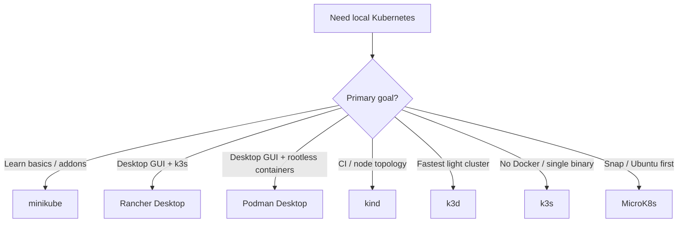

Running Kubernetes on a laptop is the fastest way to learn scheduling, Deployments, Services, and Ingress without a cloud bill. The problem is choice: **minikube**, **kind**, **k3d**, **k3s**, **MicroK8s**, **Rancher Desktop**, and **Podman Desktop** all create a local API server — with different runtimes, multi-node stories, and UX.

This guide maps **seven open-source (or OSS-core) local installers**, explains **single-node vs multi-node** modes with copy-paste examples, and compares **open-source Kubernetes UIs** you can attach to any of them.

1. **[minikube](https://github.com/kubernetes/minikube)**{:target="_blank" rel="noopener"} — Official local cluster with many drivers and addons.
2. **[kind](https://github.com/kubernetes-sigs/kind)**{:target="_blank" rel="noopener"} — Kubernetes-in-Docker; CI-friendly multi-node topologies.
3. **[k3d](https://github.com/k3d-io/k3d)**{:target="_blank" rel="noopener"} — Runs [k3s](https://github.com/k3s-io/k3s){:target="_blank" rel="noopener"} nodes in Docker; very fast and light.
4. **[k3s](https://github.com/k3s-io/k3s)**{:target="_blank" rel="noopener"} — Lightweight single-binary Kubernetes (native install, not only Docker).
5. **[MicroK8s](https://github.com/canonical/microk8s)**{:target="_blank" rel="noopener"} — Canonical snap; local cluster plus easy node join.
6. **[Rancher Desktop](https://github.com/rancher-sandbox/rancher-desktop)**{:target="_blank" rel="noopener"} — Desktop app: container engine + optional k3s Kubernetes.
7. **[Podman Desktop](https://github.com/containers/podman-desktop)**{:target="_blank" rel="noopener"} — Open-source container & K8s desktop GUI; one-click kind/minikube creation, Podman machine manager, and Compose-to-K8s generator.

For broader project maturity context across the cloud-native ecosystem, see our companion guides on CNCF observability and architecture.

## TL;DR — Quick Recommendations

| Use Case | Best Fit | Runner-Up | Why |
| -------- | -------- | --------- | --- |
| **Learn K8s basics on a laptop** | **minikube** | Rancher Desktop | Addons, docs, and `minikube dashboard` / ingress are beginner-friendly |
| **CI / multi-node topology parity** | **kind** | k3d | Node roles via config YAML; widely used in GitHub Actions |
| **Lightest / fastest recreate** | **k3d** | k3s | k3s-in-Docker; seconds to create/destroy clusters |
| **Native single binary (no Docker required)** | **k3s** | MicroK8s | One server process; great for Linux labs and edge-like setups |
| **Ubuntu / snap-first workflow** | **MicroK8s** | minikube | `snap install` + addons (`dns`, `ingress`, `storage`) |
| **GUI for containers + K8s together (k3s)** | **Rancher Desktop** | Podman Desktop | Direct Docker Desktop alternative; bundles k3s, nerdctl/docker CLI |
| **GUI for containers + kind/minikube (daemonless)** | **Podman Desktop** | Rancher Desktop | Rootless containers, built-in kind cluster manager, Compose-to-K8s manifest export |
| **Browser UI for any cluster** | **Headlamp** | Radar | CNCF Sandbox; extensible; modern successor narrative to Dashboard |
| **Lightweight real-time web dashboard** | **[Skooner](https://github.com/skooner-k8s/skooner)**{:target="_blank" rel="noopener"} | Kubernetes Dashboard | 1-manifest deploy, real-time live metrics, no complex auth overhead |
| **Debug / topology / AI-agent UI** | **[Radar](https://github.com/skyhook-io/radar)**{:target="_blank" rel="noopener"} | Headlamp | Single Go binary; issues, topology, Helm, GitOps, built-in MCP |
| **Terminal UI (fastest day-to-day)** | **k9s** | — | No browser; works with any kubeconfig context |
| **Desktop IDE (Lens alternative)** | **[Freelens](https://github.com/freelensapp/freelens)**{:target="_blank" rel="noopener"} | Aptakube | Fully OSS community fork of Lens without proprietary accounts or telemetry |
| **Fast multi-cluster desktop client** | **[Aptakube](https://aptakube.com/)**{:target="_blank" rel="noopener"} | Freelens | Ultra-fast native desktop client (commercial/freemium) for multi-cluster switching |
| **Configuration validation & hierarchy** | **[Kubevious](https://github.com/kubevious/kubevious)**{:target="_blank" rel="noopener"} | Radar | App-centric hierarchy, validation, blast-radius analysis, and time-travel history |
| **Manifest / GitOps authoring IDE** | **[Monokle](https://github.com/kubeshop/monokle)**{:target="_blank" rel="noopener"} | Freelens | Desktop YAML/Helm/Kustomize IDE — note upstream maintenance pause |

> Jump to [Install Modes](#install-modes-single-node-vs-multi-node), [Open-Source Kubernetes UIs](#open-source-kubernetes-uis), or [When to Use What](#when-to-use-what).

## Table of Contents

- [TL;DR — Quick Recommendations](#tldr--quick-recommendations)
- [Approach & Scope Demarcation](#approach--scope-demarcation)
- [Local Install Options Compared](#local-install-options-compared)
- [Install Modes: Single-Node vs Multi-Node](#install-modes-single-node-vs-multi-node)
- [Open-Source Kubernetes UIs](#open-source-kubernetes-uis)
  - [Desktop GUI Landscape (Freelens, Lens, Aptakube)](#desktop-gui-landscape-freelens-lens-aptakube)
- [When to Use What](#when-to-use-what)
- [Quick Start Recipe (kind + Headlamp)](#quick-start-recipe-kind--headlamp)
- [References](#references)

## Approach & Scope Demarcation

### Selection Criteria

Tools in the primary comparison had to meet most of the following:

1. **Local-first:** Creates a usable Kubernetes API on a developer laptop (macOS, Linux, and/or Windows).
2. **Open-source core:** Usable without a mandatory paid control plane (commercial editions may exist alongside).
3. **Actively maintained:** Receives regular releases suitable for current Kubernetes minor versions.
4. **Documented single- and/or multi-node modes:** Clear path to one node or multiple nodes for learning.

### What This Guide Is NOT

1. **Managed Kubernetes (EKS, GKE, AKS, DigitalOcean, etc.):** Production cloud control planes — out of scope.
2. **Full bare-metal HA production installers:** kubeadm/kubespray/OpenShift for datacenter HA get only honorable-mention treatment.
3. **Proprietary Lens Desktop:** Mirantis Lens transitioned to a proprietary subscription model; we cover **OpenLens**, **Freelens**, and commercial alternatives like **Aptakube** instead.
4. **Docker Desktop Kubernetes:** Convenient but proprietary commercial license for enterprise; covered as an adjacent context.

## Local Install Options Compared

### Capability Matrix

| Tool | How it runs | Single-node | Multi-node on one laptop | Typical RAM (idle-ish) | Best for |
| ---- | ----------- | ----------- | ------------------------ | ---------------------- | -------- |
| **minikube** | VM / container / bare-metal drivers | Yes (default) | Yes (`--nodes=N`) | Medium–high | Learning, addons, Ingress demos |
| **kind** | Containers (Docker/Podman) | Yes | Yes (config YAML) | Medium | CI, multi-node topology tests |
| **k3d** | Containers wrapping k3s | Yes | Yes (`--servers` / `--agents`) | Low–medium | Fast local + light multi-node |
| **k3s** | Native binary (systemd/process) | Yes | Yes (server + agents) | Low | Linux labs, edge-like single binary |
| **MicroK8s** | Snap (Linux; also Windows/macOS builds) | Yes | Yes (`add-node`) | Medium | Ubuntu-centric local + small clusters |
| **Rancher Desktop** | Desktop app + k3s | Yes (desktop cluster) | Limited vs kind/minikube | Medium | GUI users replacing Docker Desktop with k3s |
| **Podman Desktop** | Desktop app + kind/minikube | Yes | Yes (via kind extension) | Low–medium | Rootless container GUI + one-click kind/minikube |

### Decision Flow



### minikube

[minikube](https://minikube.sigs.k8s.io/docs/start/){:target="_blank" rel="noopener"} is the Kubernetes project's local cluster tool. It supports multiple **drivers** and a rich **addon** system (`ingress`, `metrics-server`, `dashboard`, storage provisioners). The driver you pick depends on your OS and what hypervisor/runtime is already installed — not every driver works on every platform.

#### Drivers by OS

| Driver | Linux | macOS | Windows | Notes |
| ------ | ----- | ----- | ------- | ----- |
| **docker** | Yes | Yes | Yes | Most common default when Docker (or compatible) is installed |
| **podman** | Yes | Yes | Limited | Prefer rootful Podman for fewer surprises |
| **qemu** / **qemu2** | Yes | Yes | Yes | Needs [QEMU](https://www.qemu.org/){:target="_blank" rel="noopener"}; good when you do not want Docker |
| **virtualbox** | Yes | Yes | Yes | Needs VirtualBox; works everywhere but heavier |
| **kvm2** | Yes | — | — | Needs KVM/libvirt; strong native Linux VM driver |
| **hyperv** | — | — | Yes | Needs Hyper-V (Windows Pro/Enterprise/Education) |
| **vfkit** | — | Yes (esp. Apple Silicon) | — | Lightweight macOS VM driver via Virtualization.framework |
| **hyperkit** | — | Yes (Intel) | — | Older macOS driver; prefer docker/qemu/vfkit on Apple Silicon |
| **parallels** | — | Yes | — | Needs Parallels Desktop |
| **vmware** / **vmwarefusion** | Limited | Yes | Yes | Needs VMware product installed |
| **none** (bare metal) | Yes | — | — | Runs components on the host; advanced / CI-style Linux only |
| **ssh** | Yes | Yes | Yes | Use an existing remote/local VM you manage yourself |

Check what minikube can use on *this* machine:

```bash
minikube start --help | less   # see --driver
# Or try auto-detect, then inspect:
minikube config get driver     # if previously set
```

#### Install and start (pick a driver)

```bash
# Install (macOS example; Linux/Windows: see minikube docs)
brew install minikube kubectl

# See which driver minikube would pick
minikube start --dry-run --output=json 2>/dev/null | head

# --- Docker (macOS / Linux / Windows with Docker Desktop, Colima, or dockerd) ---
minikube start --driver=docker --cpus=4 --memory=8192

# --- QEMU (no Docker; install qemu first) ---
# macOS: brew install qemu
# Linux: sudo apt install qemu-system   # or distro equivalent
minikube start --driver=qemu2 --cpus=4 --memory=8192
# older alias still seen in docs/scripts:
# minikube start --driver=qemu --cpus=4 --memory=8192

# --- Linux KVM ---
minikube start --driver=kvm2 --cpus=4 --memory=8192

# --- Windows Hyper-V (PowerShell / elevated as needed) ---
# minikube start --driver=hyperv --cpus=4 --memory=8192

# --- macOS Apple Silicon via vfkit ---
# minikube start --driver=vfkit --cpus=4 --memory=8192

# --- VirtualBox (any OS with VirtualBox installed) ---
# minikube start --driver=virtualbox --cpus=4 --memory=8192

# Persist default driver so you need not pass --driver every time
minikube config set driver docker

kubectl get nodes
minikube addons enable ingress
minikube addons enable metrics-server
```

> **Tip:** On Apple Silicon Macs, prefer **docker** (Colima/Docker/Rancher Desktop backend), **qemu2**, or **vfkit**. Avoid assuming HyperKit. On Windows Home without Hyper-V, use **docker** or **virtualbox** / **qemu**. On Linux laptops, **docker** or **kvm2** are the usual choices.

#### Stop and delete

```bash
# Stop the current cluster (keeps disk image; faster next start)
minikube stop

# Delete the default cluster (removes the VM/container)
minikube delete

# Named profile
minikube start -p lab --driver=docker
minikube delete -p lab

# Delete every minikube cluster/profile
minikube delete --all

# Nuclear: all clusters + cached images/ISOs under ~/.minikube
minikube delete --all --purge
```

**When to prefer it:** Tutorials, Ingress demos, and anyone who wants “official local K8s” with batteries included.  
**When not:** You need the lightest possible CI recreate loop — use kind or k3d instead.

### kind (Kubernetes IN Docker)

[kind](https://kind.sigs.k8s.io/){:target="_blank" rel="noopener"} runs Kubernetes nodes as containers. It is the default choice for many CI pipelines and for testing multi-node scheduling behavior without VMs.

```bash
brew install kind kubectl   # or go install / package manager of choice

# Single-node
kind create cluster --name dev

kubectl cluster-info --context kind-dev
```

**When to prefer it:** GitHub Actions / local parity with “real” multi-node topologies; Kubernetes contributor workflows.  
**When not:** You want a polished desktop app or native Linux single-binary without a container runtime.

### k3d

[k3d](https://k3d.io/){:target="_blank" rel="noopener"} wraps [k3s](https://k3s.io/){:target="_blank" rel="noopener"} nodes in Docker (or compatible runtimes). Clusters create and destroy quickly — ideal for “throwaway” local environments.

```bash
brew install k3d kubectl

# Single-node (1 server, 0 agents)
k3d cluster create mylab

kubectl get nodes

# Delete cluster
k3d cluster delete mylab
```

**When to prefer it:** Fast iteration, low resource use, multi-node without VM overhead.  
**When not:** You need full upstream Kubernetes (not k3s packaging) — prefer kind or minikube.

### k3s

[k3s](https://docs.k3s.io/){:target="_blank" rel="noopener"} is a certified Kubernetes distribution packaged as a single binary (SQLite by default, Traefik and other components optional/configurable). On a laptop it usually means a Linux VM (Multipass, UTM, Lima) or a native Linux host.

```bash
# On a Linux host or VM — single-node server
curl -sfL https://get.k3s.io | sh -

sudo k3s kubectl get nodes
# kubeconfig: /etc/rancher/k3s/k3s.yaml
```

**When to prefer it:** Edge/IoT-like footprints, air-gapped-friendly packaging, learning “lightweight distro” ops.  
**When not:** You insist on pure upstream kubeadm-style components on the laptop without the k3s opinionated stack.

### MicroK8s

[MicroK8s](https://microk8s.io/){:target="_blank" rel="noopener"} (Canonical) installs via snap on Linux and has builds for macOS/Windows. Addons cover DNS, storage, Ingress, and more.

```bash
# Linux (snap)
sudo snap install microk8s --classic
sudo usermod -a -G microk8s "$USER"
# re-login, then:
microk8s status --wait-ready
microk8s enable dns storage ingress
microk8s kubectl get nodes

# Optional: alias
sudo snap alias microk8s.kubectl kubectl
```

**When to prefer it:** Ubuntu-first shops, snap lifecycle, small multi-machine labs with `microk8s add-node`.  
**When not:** Non-Linux hosts where snap/VM friction outweighs benefits — minikube/kind/k3d are smoother.

### Rancher Desktop

[Rancher Desktop](https://rancherdesktop.io/){:target="_blank" rel="noopener"} is an open-source desktop application that provides a container engine (dockerd or containerd) and an optional **Kubernetes (k3s)** cluster with a GUI for versions and resource limits.

**When to prefer it:** You want Docker Desktop–like UX with OSS tooling and a toggleable local cluster.  
**When not:** You need flexible multi-node topologies (control-plane + N workers) — use kind, k3d, or minikube `--nodes`.

> **Naming tip:** **Rancher Desktop** ≠ **Rancher** (the multi-cluster management platform). Desktop is the laptop app; Rancher is the fleet/UI product covered in the UI section below.

### Podman Desktop

[Podman Desktop](https://podman-desktop.io/){:target="_blank" rel="noopener"} is Red Hat's open-source desktop container management application (Apache 2.0). Unlike Docker Desktop, it operates with rootless Podman machines by default on macOS and Windows (via WSL2 or Hyper-V) and talks directly to native Podman on Linux.

Beyond managing images and containers, Podman Desktop has deep **Kubernetes-native workflows**:
- **Built-in Kind & Minikube extensions:** Initialize, create, and start a kind or minikube cluster with one click from the UI tray without touching the CLI.
- **Generate Kube YAML:** Select one or more running local containers and export clean Kubernetes Pod and Deployment manifests (`podman generate kube`).
- **Play Kube YAML:** Test and apply Kubernetes manifests locally directly on Podman without spinning up an entire multi-node control plane (`podman play kube`).
- **Context switcher & pod explorer:** Inspect cluster nodes, switch namespaces, view pod logs, and open terminal exec sessions directly in the GUI.

```bash
# macOS
brew install podman-desktop podman

# Windows (winget or scoop)
winget install RedHat.PodmanDesktop

# Linux (Flatpak)
flatpak install flathub io.podman_desktop.PodmanDesktop
```

**When to prefer it:** You prefer daemonless/rootless containers, want a single desktop app to create kind/minikube clusters, or regularly convert Compose apps to Kubernetes manifests.  
**When not:** You need an all-in-one embedded cluster pre-bundled without configuring an extension (Rancher Desktop bundles k3s natively out of the box).

### Honorable Mentions

| Option | Notes |
| ------ | ----- |
| **kubeadm + Multipass/VMs** | Closest to “real” cluster bootstrap; heavier for daily laptop use |
| **Colima + k3s/k8s** | Popular macOS container runtime path; pair with kubectl |
| **Talos / siderolabs local** | Immutable OS learning labs; steeper curve than minikube/kind |
| **Docker Desktop K8s** | Easy if already licensed/installed; not the focus of this OSS map |

## Install Modes: Single-Node vs Multi-Node

### Terminology

| Mode | What it means on a laptop | Why use it |
| ---- | ------------------------- | ---------- |
| **Single-node** | One node runs control plane + workloads | Default for tutorials, most app develop/test |
| **Multi-node (“cluster” mode)** | Multiple nodes (often containers/VMs on one machine) | Learn scheduling, pod anti-affinity, DaemonSets across nodes, failure domains |

Multi-node on a laptop is still **one physical machine**. It simulates topology; it is not HA production.

### minikube

**Single-node** (swap `--driver` for `qemu2`, `kvm2`, `hyperv`, `vfkit`, etc.):

```bash
minikube start --cpus=4 --memory=8192 --driver=docker
# minikube start --cpus=4 --memory=8192 --driver=qemu2
```

**Multi-node (example: 3 nodes):**

```bash
minikube start --nodes=3 --cpus=2 --memory=4096 --driver=docker
kubectl get nodes -o wide
```

**Delete / cleanup:**

```bash
minikube stop
minikube delete                 # current/default profile
minikube delete -p minikube     # explicit profile name
minikube delete --all           # all profiles
minikube delete --all --purge   # all profiles + local caches
```

### kind

**Single-node** (default when no config is passed):

```bash
kind create cluster --name single
```

**Multi-node** — save as `kind-config.yaml`:

```yaml
kind: Cluster
apiVersion: kind.x-k8s.io/v1alpha4
nodes:
  - role: control-plane
  - role: worker
  - role: worker
```

```bash
kind create cluster --name multi --config kind-config.yaml
kubectl get nodes
```

Optional: map Ingress with `extraPortMappings` on the control-plane node (see kind docs).

### k3d

**Single-node:**

```bash
k3d cluster create single
```

**Multi-node (1 server + 2 agents):**

```bash
k3d cluster create multi --servers 1 --agents 2
kubectl get nodes
```

**Multi-server sketch (HA-style learning):**

```bash
k3d cluster create ha --servers 3 --agents 2

# Cleanup:
k3d cluster delete single
k3d cluster delete multi
k3d cluster delete ha
```

### k3s

**Single-node:**

```bash
curl -sfL https://get.k3s.io | sh -
sudo k3s kubectl get nodes
```

**Multi-node (server + agent on a second Linux host/VM):**

```bash
# On server — note the node token
sudo cat /var/lib/rancher/k3s/server/node-token

# On agent
curl -sfL https://get.k3s.io | K3S_URL=https://<SERVER_IP>:6443 \
  K3S_TOKEN=<TOKEN> sh -
```

On a single laptop, run the agent inside a second Multipass/Lima VM and point `K3S_URL` at the server VM’s IP.

### MicroK8s

**Single-node:**

```bash
microk8s status --wait-ready
microk8s kubectl get nodes
```

**Multi-node:**

```bash
# On primary
microk8s add-node
# Follow printed join command on the second machine/VM, e.g.:
# microk8s join <IP>:<PORT>/<TOKEN>
```

### Rancher Desktop

Rancher Desktop exposes a **single local Kubernetes cluster** via Preferences (enable Kubernetes, pick k3s version, set CPUs/memory). It does **not** match kind/minikube’s first-class multi-worker topology knobs. For multi-node experiments, keep Rancher Desktop for containers and run **kind** or **k3d** alongside (or instead).

### Podman Desktop

Podman Desktop provisions and interacts with Kubernetes through built-in engine extensions and CLI integration:

- **Kind Cluster via GUI:** Open **Settings > Resources > Kind**, click **Create New**, specify the cluster name, node count, and HTTP/HTTPS ingress port forwards. It creates container nodes directly inside your rootless Podman virtual machine.
- **Minikube via Podman Driver:** In minikube settings, select `podman` as the driver:
  ```bash
  minikube start --driver=podman
  ```
- **Local Pod Testing (No full cluster needed):** Podman can run multi-container Kubernetes pods locally using Kubernetes YAML directly:
  ```bash
  podman play kube app-pod.yaml
  ```
  And when you want to teardown:
  ```bash
  podman play kube --down app-pod.yaml
  ```

## Open-Source Kubernetes UIs

`kubectl` is enough — until you want to click through Deployments, tail logs, or switch contexts visually. Below are open-source UIs that work with local clusters.

### UI Capability Matrix

| Tool | Type | Attach to any cluster | License (OSS core) | Best for |
| ---- | ---- | --------------------- | ------------------ | -------- |
| **[Headlamp](https://github.com/kubernetes-sigs/headlamp)**{:target="_blank" rel="noopener"} | Web / desktop | Yes | Apache 2.0 | Modern browser UI; plugins; CNCF Sandbox |
| **[Radar](https://github.com/skyhook-io/radar)**{:target="_blank" rel="noopener"} | Web / desktop / CLI | Yes | Apache 2.0 | Topology, issues, Helm, GitOps, MCP; one Go binary |
| **[Skooner](https://github.com/skooner-k8s/skooner)**{:target="_blank" rel="noopener"} | Web | Yes | Apache 2.0 | Ultra-fast real-time dashboard; zero-friction 1-command deploy |
| **[Kubernetes Dashboard](https://github.com/kubernetes/dashboard)**{:target="_blank" rel="noopener"} | Web | Yes | Apache 2.0 | Classic in-cluster dashboard |
| **[k9s](https://github.com/derailed/k9s)**{:target="_blank" rel="noopener"} | Terminal (TUI) | Yes | Apache 2.0 | Fast daily ops without a browser |
| **[Freelens](https://github.com/freelensapp/freelens)**{:target="_blank" rel="noopener"} | Desktop (OSS) | Yes | MIT | Free, community-maintained Lens fork without accounts or telemetry |
| **[Aptakube](https://aptakube.com/)**{:target="_blank" rel="noopener"} | Desktop (Native) | Multi-cluster | Proprietary (freemium) | Ultra-lightweight multi-cluster switching and comparison |
| **[Lens Desktop](https://k8slens.dev/)**{:target="_blank" rel="noopener"} | Desktop | Multi-cluster | Proprietary / Commercial | Polished ecosystem for teams willing to pay commercial licensing |
| **[Kubevious](https://github.com/kubevious/kubevious)**{:target="_blank" rel="noopener"} | Web | Yes | Apache 2.0 | App hierarchy tree, blast-radius analysis, and config validation |
| **[Monokle](https://github.com/kubeshop/monokle)**{:target="_blank" rel="noopener"} | Desktop IDE | Yes (plus local YAML) | MIT | Author/validate manifests, Helm, Kustomize, Git |
| **[Rancher](https://github.com/rancher/rancher)**{:target="_blank" rel="noopener"} | Web (platform) | Multi-cluster | Apache 2.0 | Fleet/multi-cluster management |
| **[KubeSphere](https://github.com/kubesphere/kubesphere)**{:target="_blank" rel="noopener"} | Web platform | Cluster + platform | Apache 2.0 | Heavier devops platform UI |
| **[Portainer CE](https://github.com/portainer/portainer)**{:target="_blank" rel="noopener"} | Web | K8s + Docker | Zlib | Teams already using Portainer for Docker |

### Headlamp

[Headlamp](https://headlamp.dev/){:target="_blank" rel="noopener"} is a CNCF Sandbox project and the leading modern open-source Kubernetes web UI — often discussed as the practical successor path for teams leaving the older Dashboard UX. Plugin system, resource browsers, logs, and desktop builds are available.

```bash
# Helm (in-cluster) — version pin in real use
helm repo add headlamp https://kubernetes-sigs.github.io/headlamp/
helm install headlamp headlamp/headlamp -n kube-system

# Or run the desktop app / binary and point at your kubeconfig
```

**When not:** You only ever live in a terminal — install k9s instead.

### Radar

[Radar](https://github.com/skyhook-io/radar){:target="_blank" rel="noopener"} ([radarhq.io](https://radarhq.io/){:target="_blank" rel="noopener"}) is an open-source Kubernetes UI packaged as a **single Go binary** — no account, no agents, no CRDs required for the laptop workflow. It talks to the API via your kubeconfig (works with minikube, kind, k3s, and cloud clusters), streams live updates, and adds views most classic dashboards skip: **issues**, **topology**, **event timeline**, **Helm**, **GitOps** (Argo CD / Flux), live service traffic, cost/audit, and a **built-in MCP server** so AI agents can inspect the cluster through Radar.

```bash
# Laptop / local kubeconfig (opens browser)
curl -fsSL https://get.radarhq.io | sh
kubectl radar
# or: brew install kubectl-radar && kubectl radar

# Optional: in-cluster for shared team access
helm repo add skyhook https://skyhook-io.github.io/helm-charts
helm install radar skyhook/radar -n radar --create-namespace
```

Also available as a desktop app (`brew install --cask skyhook-io/tap/radar-desktop`), Krew (`kubectl krew install radar`), and Scoop on Windows.

**When to prefer it:** Debugging “what broke / what changed,” Helm/GitOps-heavy clusters, or AI-assisted ops via MCP.
**When not:** You want the lightest possible TUI — use k9s; or you only need a minimal official-style resource browser — Headlamp/Dashboard may be enough.

### Skooner (formerly K8dash)

[Skooner](https://github.com/skooner-k8s/skooner){:target="_blank" rel="noopener"} ([skooner.io](https://skooner.io/){:target="_blank" rel="noopener"}) is an ultra-lightweight, real-time web dashboard designed for zero-friction cluster inspection. Unlike the official Kubernetes Dashboard, Skooner uses WebSockets to stream live resource metrics and pod statuses in real time without manual page refreshes.

- **Zero dependencies:** No stateful databases, caches, or CRDs to install.
- **Native live metrics:** Renders live CPU and memory utilization graphs automatically whenever `metrics-server` is enabled on your cluster.
- **Instant deployment:** Ready to test in a single `kubectl apply` command.

```bash
# Direct manifest install
kubectl apply -f https://raw.githubusercontent.com/skooner-k8s/skooner/master/kubernetes-skooner.yaml

# Port forward to access UI
kubectl port-forward -n kube-system svc/skooner 4654:80
```

Open `http://localhost:4654` and authenticate using a cluster ServiceAccount token or kubeconfig.

**When to prefer it:** You want a clean, instant browser dashboard without the token dance or heavyweight dependencies of Kubernetes Dashboard.  
**When not:** You require deep Helm/GitOps visualization (use Radar) or rich frontend extensibility (use Headlamp).

### Kubernetes Dashboard

The classic [Kubernetes Dashboard](https://kubernetes.io/docs/tasks/access-application-cluster/web-ui-dashboard/){:target="_blank" rel="noopener"}. Still useful; token/RBAC setup is easy to get wrong on local clusters — prefer short-lived tokens and least privilege.

```bash
# Modern install via Helm (Dashboard v7+)
helm repo add kubernetes-dashboard https://kubernetes.github.io/dashboard/
helm upgrade --install kubernetes-dashboard kubernetes-dashboard/kubernetes-dashboard \
  --create-namespace --namespace kubernetes-dashboard

# Legacy single-manifest install (older v2.x clusters)
# kubectl apply -f https://raw.githubusercontent.com/kubernetes/dashboard/v2.7.0/aio/deploy/recommended.yaml

# minikube shortcut
minikube addons enable dashboard
minikube dashboard
```

### k9s

[k9s](https://k9scli.io/){:target="_blank" rel="noopener"} is a terminal UI over your current kubeconfig context. Ideal for kind/k3d/minikube day-to-day.

```bash
brew install derailed/k9s/k9s
k9s   # uses current kubectl context
```

Pulse through namespaces, describe pods, shell exec, and logs without leaving the terminal.

### Desktop GUI Landscape (Freelens, Lens, Aptakube)

For developers who prefer dedicated desktop applications over browser tabs or terminal commands, the ecosystem has undergone a major shift over recent years.

#### Mirantis Lens: The Licensing Pivot

[Lens](https://k8slens.dev/){:target="_blank" rel="noopener"} was once the universal desktop client for Kubernetes. However, Mirantis shifted Lens to a **commercial subscription model (Lens Pro)** for enterprise users and companies with over $10M in annual revenue or 100+ employees. Additionally, newer versions introduced mandatory Lens ID accounts, cloud login prompts, and telemetry, causing friction for open-source and privacy-conscious teams.

#### OpenLens & The Stripped Features

Mirantis maintains the open-source core as [OpenLens](https://github.com/lensapp/lens){:target="_blank" rel="noopener"}. However, starting with OpenLens v6, Mirantis removed native container log streaming and shell exec capabilities from official build artifacts, relegating them to external extension plugins.

#### Freelens: The Pure Community Fork

To solve the OpenLens regression, the community launched **[Freelens](https://github.com/freelensapp/freelens)**{:target="_blank" rel="noopener"} ([freelens.app](https://freelens.app/){:target="_blank" rel="noopener"}), an independent open-source desktop client built under the MIT license:
- **Restored core functionality:** Pod logs, container terminal exec, and node metrics graphs work out of the box with zero plugin configuration.
- **Zero telemetry & no accounts:** No sign-up, no Lens ID, no cloud tracking.
- **Cross-platform:** Available for macOS, Windows, and Linux.

```bash
# macOS
brew install --cask freelens

# Linux / Windows: Download native binaries from GitHub releases
```

#### Aptakube: The Lightweight Native Alternative

Electron-based desktop clients (Lens, Freelens, Headlamp desktop) are feature-packed but can consume 500MB to 1GB+ of RAM per window.

**[Aptakube](https://aptakube.com/){:target="_blank" rel="noopener"}** is a modern desktop client designed specifically for high speed and minimal resource footprint:
- **Instant startup & tiny footprint:** Native execution without Electron bloat.
- **Multi-cluster aggregated tabs:** Open multiple clusters simultaneously (e.g., local kind cluster alongside staging and production) and switch between them in unified tabs.
- **Licensing note:** Aptakube is **commercial / freemium** (not open source), but remains a popular pragmatic choice for engineers who find Lens/Electron too resource-heavy.

### Kubevious

[Kubevious](https://github.com/kubevious/kubevious){:target="_blank" rel="noopener"} ([kubevious.io](https://kubevious.io/){:target="_blank" rel="noopener"}) takes an application-centric approach to Kubernetes visualization rather than listing flat tables of API resources.

- **Hierarchical Application Tree:** Groups related resources together (Namespace → Application → Service → Ingress → Pods → ConfigMaps/Secrets), making it immediately obvious which ConfigMap feeds which Deployment.
- **Automated Configuration Validation:** Continuously checks for common configuration errors before they cause outages — such as broken Service selectors, missing Secrets, container port mismatches, and security policy violations.
- **TimeMachine:** Provides a historical playback slider to travel back in time and inspect exactly what your cluster state looked like before an incident occurred.

```bash
# Helm deployment
helm repo add kubevious https://helm.kubevious.io
helm repo update
helm install kubevious kubevious/kubevious -n kubevious --create-namespace

# Access UI
kubectl port-forward -n kubevious svc/kubevious 4000:80
```

Open `http://localhost:4000` to browse your cluster's architectural graph.

### Monokle

[Monokle](https://github.com/kubeshop/monokle){:target="_blank" rel="noopener"} ([monokle.io](https://monokle.io/){:target="_blank" rel="noopener"}) is a set of OSS desktop tools for **creating and maintaining Kubernetes configurations** — not a full fleet ops console. It gives a visual IDE over manifests, Helm, and Kustomize: schema/OPA validation, resource relationships, Git lifecycle, cluster compare/apply, and CRD-aware editing (MIT license).

Download builds for Windows, macOS, and Linux from the [GitHub releases](https://github.com/kubeshop/monokle/releases){:target="_blank" rel="noopener"} page, open a project folder or connect a kubeconfig context, then validate and deploy from the UI.

> **Maintenance note:** Upstream maintainers currently state they are **not able to maintain or evolve Monokle**; community contributions are still welcome. Prefer it for local authoring experiments, and plan a fallback (VS Code + YAML/Helm extensions, or Headlamp/Radar for live cluster views) for long-lived tooling bets.

**When to prefer it:** Learning manifest structure, Helm/Kustomize previews, and policy validation on a laptop.
**When not:** You need an actively stewarded day-to-day cluster UI — use Headlamp, Radar, or k9s instead.

### Rancher (multi-cluster manager)

[Rancher](https://www.rancher.com/products/rancher){:target="_blank" rel="noopener"} is a full management platform: import local clusters, manage RBAC, apps, and multiple clusters from one UI. Heavier than Headlamp for “just show me my kind cluster,” but the right tool when you outgrow single-cluster browsing.

```bash
# Sketch — follow current Rancher docs for the supported install path
# Often: Docker single-node Rancher for labs, or Helm on an existing cluster
docker run -d --restart=unless-stopped -p 80:80 -p 443:443 \
  --privileged rancher/rancher:latest
```

Then import your local kubeconfig cluster from the Rancher UI.

### KubeSphere & Portainer CE (adjacent)

- **KubeSphere:** Full platform (CI, service mesh integrations, multi-tenant UI). Overkill for a single local learning cluster; useful if you are evaluating the platform itself.
- **Portainer CE:** Familiar if you already manage Docker with Portainer; Kubernetes features are a bonus, not as K8s-deep as Headlamp/k9s for power users.

> **Archived note (VMware Octant):** Once a very popular extensible desktop-web dashboard from VMware, **Octant was officially retired and archived** in 2023. If you come across older blog tutorials recommending Octant, substitute it with **Headlamp**, **Radar**, or **Freelens**.

## When to Use What

### Installer × UI pairings

| Goal | Installer | UI | Why |
| ---- | --------- | -- | --- |
| First week learning K8s | minikube | Dashboard addon or Skooner | Fast visuals + simple addons |
| CI-like local cluster | kind | k9s + optional Headlamp / Radar | Topology fidelity + speed |
| Throwaway light clusters | k3d | k9s or `kubectl radar` | Create/destroy in seconds |
| Desktop containers + K8s (k3s) | Rancher Desktop | Built-in UI + k9s | One app for runtime + cluster |
| Daemonless containers + kind/minikube | Podman Desktop | Podman GUI + Freelens | Rootless Podman + 1-click kind cluster |
| Instant lightweight browser dashboard | kind or minikube | Skooner | Real-time live websocket metrics, 1-command deploy |
| Debug broken workloads / GitOps | any | Radar | Issues, timeline, Helm/GitOps, MCP |
| Understand app hierarchy & blast radius | any | Kubevious | Dependency tree, configuration linting, TimeMachine |
| Full desktop cluster IDE (Lens replacement) | any | Freelens | Free open-source Lens fork with restored pod logs/exec |
| Multi-cluster desktop switching | any local + cloud | Aptakube | Super fast, low memory, simultaneous tabs |
| Edit manifests visually | any | Monokle (with maintenance caveat) | YAML/Helm/Kustomize IDE |
| Multi-cluster lab later | any local + import | Rancher | Grow into fleet management |
| Terminal-only workflow | any | k9s | Lowest friction |

### Quick chooser

| If you… | Pick |
| ------- | ---- |
| Want official docs + addons | minikube |
| Test DaemonSets / anti-affinity across nodes | kind or k3d multi-node |
| Hate waiting for cluster create | k3d |
| Avoid Docker entirely on Linux | k3s or MicroK8s |
| Want a menu-bar / desktop app for containers + k3s | Rancher Desktop |
| Want a rootless container desktop app with kind integration | Podman Desktop |
| Want a modern CNCF web UI with plugins | Headlamp |
| Want an ultra-lightweight real-time browser dashboard | Skooner |
| Want topology / Helm / MCP on laptop | Radar |
| Want a free, full-featured desktop GUI (Lens fork) | Freelens |
| Want an ultra-fast multi-cluster native desktop client | Aptakube (commercial) |
| Want to visualize resource hierarchy and catch config bugs | Kubevious |
| Want a manifest authoring IDE | Monokle (check maintenance status) |
| Live in the terminal | k9s |

## Quick Start Recipe (kind + Headlamp)

End-to-end path for macOS or Linux with Docker (or Podman) available:

```bash
# 1) Tools
brew install kind kubectl helm   # Linux: use your package manager

# 2) Multi-node kind cluster (Bash / Zsh)
cat <<'EOF' > kind-config.yaml
kind: Cluster
apiVersion: kind.x-k8s.io/v1alpha4
nodes:
  - role: control-plane
  - role: worker
  - role: worker
EOF

# On Windows PowerShell, create kind-config.yaml with:
# @"
# kind: Cluster
# apiVersion: kind.x-k8s.io/v1alpha4
# nodes:
#   - role: control-plane
#   - role: worker
#   - role: worker
# "@ | Out-File -Encoding utf8 kind-config.yaml

kind create cluster --name local --config kind-config.yaml
kubectl config use-context kind-local
kubectl get nodes

# 3) Sample workload
kubectl create deployment nginx --image=nginx:1.27 --replicas=3
kubectl expose deployment nginx --port=80 --type=ClusterIP
kubectl get pods -o wide

# 4) Optional Terminal UI — k9s
# brew install derailed/k9s/k9s && k9s

# 4b) Optional UI — Radar (single binary via local kubeconfig)
# curl -fsSL https://get.radarhq.io | sh && kubectl radar

# 4c) Optional UI — Skooner (instant real-time web UI)
# kubectl apply -f https://raw.githubusercontent.com/skooner-k8s/skooner/master/kubernetes-skooner.yaml
# kubectl port-forward -n kube-system svc/skooner 4654:80

# 5) UI — Headlamp via Helm
helm repo add headlamp https://kubernetes-sigs.github.io/headlamp/
helm repo update
kubectl create namespace headlamp
helm install headlamp headlamp/headlamp -n headlamp

# 6) Generate admin auth token for Headlamp
kubectl create serviceaccount headlamp-admin -n kube-system
kubectl create clusterrolebinding headlamp-admin --clusterrole=cluster-admin --serviceaccount=kube-system:headlamp-admin
kubectl create token headlamp-admin -n kube-system

# 7) Access Headlamp in browser
kubectl -n headlamp port-forward svc/headlamp 4466:80
# Open http://localhost:4466 and paste the token output from step 6
```

Cleanup:

```bash
kind delete cluster --name local
```

## References

- [minikube docs](https://minikube.sigs.k8s.io/docs/){:target="_blank" rel="noopener"}
- [kind docs](https://kind.sigs.k8s.io/){:target="_blank" rel="noopener"}
- [k3d docs](https://k3d.io/){:target="_blank" rel="noopener"}
- [k3s docs](https://docs.k3s.io/){:target="_blank" rel="noopener"}
- [MicroK8s docs](https://microk8s.io/docs){:target="_blank" rel="noopener"}
- [Rancher Desktop](https://docs.rancherdesktop.io/){:target="_blank" rel="noopener"}
- [Podman Desktop](https://podman-desktop.io/){:target="_blank" rel="noopener"} · [containers/podman-desktop](https://github.com/containers/podman-desktop){:target="_blank" rel="noopener"}
- [Headlamp](https://headlamp.dev/){:target="_blank" rel="noopener"} · [kubernetes-sigs/headlamp](https://github.com/kubernetes-sigs/headlamp){:target="_blank" rel="noopener"}
- [Radar](https://radarhq.io/){:target="_blank" rel="noopener"} · [skyhook-io/radar](https://github.com/skyhook-io/radar){:target="_blank" rel="noopener"}
- [Skooner](https://skooner.io/){:target="_blank" rel="noopener"} · [skooner-k8s/skooner](https://github.com/skooner-k8s/skooner){:target="_blank" rel="noopener"}
- [Kubernetes Dashboard](https://kubernetes.io/docs/tasks/access-application-cluster/web-ui-dashboard/){:target="_blank" rel="noopener"}
- [k9s](https://k9scli.io/){:target="_blank" rel="noopener"}
- [Freelens](https://freelens.app/){:target="_blank" rel="noopener"} · [freelensapp/freelens](https://github.com/freelensapp/freelens){:target="_blank" rel="noopener"}
- [Aptakube](https://aptakube.com/){:target="_blank" rel="noopener"}
- [Lens](https://k8slens.dev/){:target="_blank" rel="noopener"}
- [Kubevious](https://kubevious.io/){:target="_blank" rel="noopener"} · [kubevious/kubevious](https://github.com/kubevious/kubevious){:target="_blank" rel="noopener"}
- [Monokle](https://monokle.io/){:target="_blank" rel="noopener"} · [kubeshop/monokle](https://github.com/kubeshop/monokle){:target="_blank" rel="noopener"}
- [Rancher](https://ranchermanager.docs.rancher.com/){:target="_blank" rel="noopener"}
