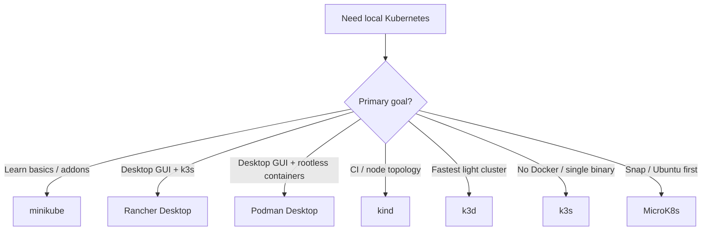

Running Kubernetes on a laptop is the fastest way to learn scheduling, Deployments, Services, and Ingress without a cloud bill. The problem is choice: **minikube**, **kind**, **k3d**, **k3s**, **MicroK8s**, **Rancher Desktop**, and **Podman Desktop** all create a local API server — with different runtimes, multi-node stories, and UX.

This guide maps **seven open-source (or OSS-core) local installers**, explains **single-node vs multi-node** modes with copy-paste examples, and compares **Kubernetes UIs** you can attach to any of them — **OSS-first**, with proprietary and archived tools called out separately.

1. **[minikube](https://github.com/kubernetes/minikube)**{:target="_blank" rel="noopener"} — Official local cluster with many drivers and addons.
2. **[kind](https://github.com/kubernetes-sigs/kind)**{:target="_blank" rel="noopener"} — Kubernetes-in-Docker; CI-friendly multi-node topologies.
3. **[k3d](https://github.com/k3d-io/k3d)**{:target="_blank" rel="noopener"} — Runs [k3s](https://github.com/k3s-io/k3s){:target="_blank" rel="noopener"} nodes in Docker; very fast and light.
4. **[k3s](https://github.com/k3s-io/k3s)**{:target="_blank" rel="noopener"} — Lightweight single-binary Kubernetes (native install, not only Docker).
5. **[MicroK8s](https://github.com/canonical/microk8s)**{:target="_blank" rel="noopener"} — Canonical snap; local cluster plus easy node join.
6. **[Rancher Desktop](https://github.com/rancher-sandbox/rancher-desktop)**{:target="_blank" rel="noopener"} — Desktop app: container engine + optional k3s Kubernetes.
7. **[Podman Desktop](https://github.com/containers/podman-desktop)**{:target="_blank" rel="noopener"} — Open-source container & K8s desktop GUI; one-click kind/minikube creation, Podman machine manager, and Compose-to-K8s generator.

For broader cloud-native context, see [Open-Source Observability Platforms Compared]().

## TL;DR — Quick Recommendations

| Use Case | Best Fit | Runner-Up | Why |
| -------- | -------- | --------- | --- |
| **Learn K8s basics on a laptop** | **minikube** | Rancher Desktop | Addons, docs, and Headlamp / ingress are beginner-friendly |
| **CI / multi-node topology parity** | **kind** | k3d | Node roles via config YAML; widely used in GitHub Actions |
| **Lightest / fastest recreate** | **k3d** | k3s | k3s-in-Docker; seconds to create/destroy clusters |
| **Native single binary (no Docker required)** | **k3s** | MicroK8s | One server process; great for Linux labs and edge-like setups |
| **Ubuntu / snap-first workflow** | **MicroK8s** | minikube | `snap install` + addons (`dns`, `ingress`, `storage`) |
| **GUI for containers + K8s together (k3s)** | **Rancher Desktop** | Podman Desktop | Direct [Docker Desktop](https://www.docker.com/products/docker-desktop/){:target="_blank" rel="noopener"} alternative; bundles k3s, [nerdctl](https://github.com/containerd/nerdctl){:target="_blank" rel="noopener"}/docker CLI |
| **GUI for containers + kind/minikube (daemonless)** | **Podman Desktop** | Rancher Desktop | Rootless containers, built-in kind cluster manager, Compose-to-K8s manifest export |
| **Browser UI for any cluster** | **Headlamp** | Radar | CNCF Sandbox; extensible; modern successor narrative to Dashboard |
| **Debug / topology / AI-agent UI** | **[Radar](https://github.com/skyhook-io/radar)**{:target="_blank" rel="noopener"} | Headlamp | Single Go binary; issues, topology, Helm, GitOps, built-in MCP |
| **Terminal UI (fastest day-to-day)** | **k9s** | — | No browser; works with any kubeconfig context |
| **Desktop IDE (Lens alternative)** | **[Freelens](https://github.com/freelensapp/freelens)**{:target="_blank" rel="noopener"} | Headlamp desktop | Fully OSS community fork of Lens without proprietary accounts or telemetry |
| **Manifest / GitOps authoring IDE** | [VS Code](https://code.visualstudio.com/){:target="_blank" rel="noopener"} + YAML/Helm extensions | Freelens | Prefer actively maintained editors; Monokle is maintenance-paused (see below) |
| **Archived / stalled (avoid new bets)** | — | Kubernetes Dashboard, Skooner, Kubevious, Monokle | Prefer Headlamp/Radar/Freelens — see caveats in UI section |
| **Commercial contrast (not OSS)** | Aptakube / Lens Desktop | Freelens | Fast multi-cluster desktop or polished paid Lens — see proprietary contrast box |

> Jump to [Local Install Options](#local-install-options-compared) (per-tool single/multi-node), [Install Modes glance](#install-modes-single-node-vs-multi-node), [Open-Source Kubernetes UIs](#open-source-kubernetes-uis), or [When to Use What](#when-to-use-what).

## Table of Contents

Auto-generated from headings (`toc: true` in frontmatter). Major sections: [TL;DR](#tldr--quick-recommendations) · [Local installers](#local-install-options-compared) · [Install modes glance](#install-modes-single-node-vs-multi-node) · [UIs](#open-source-kubernetes-uis) · [When to Use What](#when-to-use-what) · [Quick Start](#quick-start-recipe-kind--headlamp) · [References](#references).

## Approach & Scope Demarcation

### Selection Criteria

Tools in the primary comparison had to meet most of the following:

1. **Local-first:** Creates a usable Kubernetes API on a developer laptop (macOS, Linux, and/or Windows).
2. **Open-source core:** Usable without a mandatory paid control plane (commercial editions may exist alongside).
3. **Actively maintained (for primary picks):** Receives regular releases suitable for current Kubernetes minor versions. Archived or stalled projects are listed with explicit caveats, not as Best Fits.
4. **Documented single- and/or multi-node modes:** Clear path to one node or multiple nodes for learning.
5. **OSS-first for recommendations:** Proprietary tools may appear for contrast only.

### What This Guide Is NOT

1. **Managed Kubernetes (EKS, GKE, AKS, DigitalOcean, etc.):** Production cloud control planes — out of scope.
2. **Full bare-metal HA production installers:** [kubeadm](https://kubernetes.io/docs/setup/production-environment/tools/kubeadm/create-cluster-kubeadm/){:target="_blank" rel="noopener"} / [kubespray](https://github.com/kubernetes-sigs/kubespray){:target="_blank" rel="noopener"} / [OpenShift](https://www.redhat.com/en/technologies/cloud-computing/openshift){:target="_blank" rel="noopener"} for datacenter HA get only honorable-mention treatment.
3. **Primary proprietary desktop clients:** Mirantis **Lens Desktop** and **Aptakube** are **not** open source. They appear only under [Commercial / proprietary contrast](#commercial--proprietary-contrast-lens--aptakube) for comparison with Freelens/Headlamp — they are not primary recommendations in this OSS-first guide.
4. **[Docker Desktop](https://www.docker.com/products/docker-desktop/){:target="_blank" rel="noopener"} Kubernetes:** Convenient but proprietary for many commercial uses; listed under honorable mentions, not as a primary installer.
5. **Archived or stalled UIs:** **Kubernetes Dashboard** (archived Jan 2026 — prefer Headlamp), **Skooner** (CNCF-archived), **Kubevious** dashboard (stalled releases), and **Monokle** (upstream maintenance pause) are documented with caveats — do not treat them as default picks.

## Local Install Options Compared

### Capability Matrix

| Tool | How it runs | Single-node | Multi-node on one laptop | Typical RAM (idle-ish) | Best for |
| ---- | ----------- | ----------- | ------------------------ | ---------------------- | -------- |
| **minikube** | VM / container / bare-metal drivers | Yes (default) | Yes (`--nodes=N`) | Medium–high | Learning, addons, Ingress demos |
| **kind** | Containers (Docker/Podman) | Yes | Yes (config YAML) | Medium | CI, multi-node topology tests |
| **k3d** | Containers wrapping k3s | Yes | Yes (`--servers` / `--agents`) | Low–medium | Fast local + light multi-node |
| **k3s** | Native binary (systemd/process) | Yes | Yes (via 2nd VM/host) | Low | Linux labs, edge-like single binary |
| **MicroK8s** | Snap (Linux; also Windows/macOS builds) | Yes | Yes (`add-node` needs 2nd host/VM) | Medium | Ubuntu-centric local + small clusters |
| **Rancher Desktop** | Desktop app + k3s | Yes (desktop cluster) | Limited vs kind/minikube | Medium | GUI users replacing Docker Desktop with k3s |
| **Podman Desktop** | Desktop app + kind/minikube | Yes | Yes (via kind extension) | Low–medium | Rootless container GUI + one-click kind/minikube |

### Decision Flow



### minikube

[minikube](https://minikube.sigs.k8s.io/docs/start/){:target="_blank" rel="noopener"} is the Kubernetes project's local cluster tool. It supports multiple **drivers** and a rich **addon** system (`ingress`, `metrics-server`, storage provisioners; the old `dashboard` addon points at archived Dashboard — use Headlamp instead). The driver you pick depends on your OS and what hypervisor/runtime is already installed — not every driver works on every platform.

#### Drivers by OS

| Driver | Linux | macOS | Windows | Notes |
| ------ | ----- | ----- | ------- | ----- |
| **docker** | Yes | Yes | Yes | Most common when [Docker Engine](https://docs.docker.com/engine/){:target="_blank" rel="noopener"} / [Docker Desktop](https://www.docker.com/products/docker-desktop/){:target="_blank" rel="noopener"} / [Colima](https://github.com/abiosoft/colima){:target="_blank" rel="noopener"} is installed |
| **podman** | Yes | Yes | Limited | Prefer rootful [Podman](https://podman.io/){:target="_blank" rel="noopener"} for fewer surprises |
| **qemu** (alias: **qemu2**) | Yes | Yes | Yes (experimental) | Needs [QEMU](https://www.qemu.org/){:target="_blank" rel="noopener"}; prefer `--driver=qemu` — `qemu2` is the same driver under the old name ([docs](https://minikube.sigs.k8s.io/docs/drivers/qemu/){:target="_blank" rel="noopener"}) |
| **virtualbox** | Yes | Yes | Yes | Needs [VirtualBox](https://www.virtualbox.org/){:target="_blank" rel="noopener"}; works everywhere but heavier |
| **kvm2** | Yes | — | — | Needs [KVM](https://www.linux-kvm.org/){:target="_blank" rel="noopener"}/[libvirt](https://libvirt.org/){:target="_blank" rel="noopener"}; strong native Linux VM driver |
| **hyperv** | — | — | Yes | Needs [Hyper-V](https://learn.microsoft.com/en-us/windows-server/virtualization/hyper-v/){:target="_blank" rel="noopener"} (Windows Pro/Enterprise/Education) |
| **vfkit** | — | Yes (esp. Apple Silicon) | — | Lightweight macOS VM driver via [vfkit](https://github.com/crc-org/vfkit){:target="_blank" rel="noopener"} / Virtualization.framework |
| **hyperkit** | — | Yes (Intel) | — | Older [HyperKit](https://github.com/moby/hyperkit){:target="_blank" rel="noopener"} driver; prefer docker/qemu/vfkit on Apple Silicon |
| **parallels** | — | Yes | — | Needs [Parallels Desktop](https://www.parallels.com/products/desktop/){:target="_blank" rel="noopener"} |
| **vmware** / **vmwarefusion** | Limited | Yes | Yes | Needs [VMware](https://www.vmware.com/){:target="_blank" rel="noopener"} product installed |
| **none** (bare metal) | Yes | — | — | Runs components on the host; advanced / CI-style Linux only |
| **ssh** | Yes | Yes | Yes | Use an existing remote/local VM you manage yourself |

```bash
minikube start --help | less   # see --driver
minikube config get driver     # if previously set
```

#### Single-node (pick **one** driver)

Paste **one** `minikube start` only — alternatives are commented so a full-block copy does not fight the same profile.

```bash
# Install (macOS via Homebrew: https://brew.sh — Linux/Windows: see minikube docs)
brew install minikube kubectl

# Default example: Docker (Colima / Docker Desktop / dockerd)
minikube start --driver=docker --cpus=4 --memory=8192

# --- Alternatives (uncomment exactly one; do not run alongside docker above) ---
# QEMU (no Docker): brew install qemu  OR  sudo apt install qemu-system
# Prefer --driver=qemu (current name). qemu2 is a legacy alias for the same driver.
# minikube start --driver=qemu --cpus=4 --memory=8192
# minikube start --driver=kvm2 --cpus=4 --memory=8192          # Linux KVM
# minikube start --driver=hyperv --cpus=4 --memory=8192        # Windows Hyper-V
# minikube start --driver=vfkit --cpus=4 --memory=8192         # macOS Apple Silicon
# minikube start --driver=virtualbox --cpus=4 --memory=8192

minikube config set driver docker   # optional default for next starts
kubectl get nodes
minikube addons enable ingress
minikube addons enable metrics-server
```

> **Tip:** On Apple Silicon Macs, prefer **docker** ([Colima](https://github.com/abiosoft/colima){:target="_blank" rel="noopener"} / [Docker Desktop](https://www.docker.com/products/docker-desktop/){:target="_blank" rel="noopener"} / [Rancher Desktop](https://rancherdesktop.io/){:target="_blank" rel="noopener"} backend), **qemu**, or **vfkit**. Avoid assuming HyperKit. On Windows Home without Hyper-V, use **docker** or **virtualbox** / **qemu**. On Linux laptops, **docker** or **kvm2** are the usual choices.

#### Multi-node

```bash
minikube start --nodes=3 --cpus=2 --memory=4096 --driver=docker
kubectl get nodes -o wide
```

#### Stop and delete

```bash
minikube stop
minikube delete                 # default profile
minikube delete -p lab          # named profile
minikube delete --all
minikube delete --all --purge   # all profiles + ~/.minikube caches
```

**When to prefer it:** Tutorials, Ingress demos, and anyone who wants “official local K8s” with batteries included.  
**When not:** You need the lightest possible CI recreate loop — use kind or k3d instead.

### kind (Kubernetes IN Docker)

[kind](https://kind.sigs.k8s.io/){:target="_blank" rel="noopener"} runs Kubernetes nodes as containers ([Docker](https://docs.docker.com/engine/){:target="_blank" rel="noopener"} or [Podman](https://podman.io/){:target="_blank" rel="noopener"}). It is the default choice for many CI pipelines and for testing multi-node scheduling behavior without VMs.

```bash
brew install kind kubectl   # or go install / package manager of choice
```

#### Single-node

```bash
kind create cluster --name single
kubectl get nodes
kubectl cluster-info --context kind-single
```

#### Multi-node (1 control-plane + 2 workers)

Save as `kind-config.yaml`:

```yaml
kind: Cluster
apiVersion: kind.x-k8s.io/v1alpha4
nodes:
  - role: control-plane
  - role: worker
  - role: worker
```

```bash
kind create cluster --name multi --config kind-config.yaml
kubectl get nodes
```

#### Multi-control-plane (HA-style learning)

Save as `kind-ha.yaml`:

```yaml
kind: Cluster
apiVersion: kind.x-k8s.io/v1alpha4
nodes:
  - role: control-plane
  - role: control-plane
  - role: control-plane
  - role: worker
  - role: worker
```

```bash
kind create cluster --name ha --config kind-ha.yaml
kubectl get nodes
```

Optional: map Ingress with `extraPortMappings` on a control-plane node (see kind docs).

#### Delete

```bash
kind delete cluster --name single
kind delete cluster --name multi
kind delete cluster --name ha
```

**When to prefer it:** GitHub Actions / local parity with “real” multi-node topologies; Kubernetes contributor workflows.  
**When not:** You want a polished desktop app or native Linux single-binary without a container runtime.

### k3d

[k3d](https://k3d.io/){:target="_blank" rel="noopener"} wraps [k3s](https://k3s.io/){:target="_blank" rel="noopener"} nodes in [Docker](https://docs.docker.com/engine/){:target="_blank" rel="noopener"} (or compatible runtimes such as [Podman](https://podman.io/){:target="_blank" rel="noopener"}). Clusters create and destroy quickly — ideal for “throwaway” local environments.

```bash
brew install k3d kubectl
```

#### Single-node

```bash
k3d cluster create single
kubectl get nodes
```

#### Multi-node (1 server + 2 agents)

```bash
k3d cluster create multi --servers 1 --agents 2
kubectl get nodes
```

#### Multi-server (HA-style learning)

```bash
k3d cluster create ha --servers 3 --agents 2
kubectl get nodes
```

#### Delete

```bash
k3d cluster delete single
k3d cluster delete multi
k3d cluster delete ha
```

**When to prefer it:** Fast iteration, low resource use, multi-node without VM overhead.  
**When not:** You need full upstream Kubernetes (not k3s packaging) — prefer kind or minikube.

### k3s

[k3s](https://docs.k3s.io/){:target="_blank" rel="noopener"} is a certified Kubernetes distribution packaged as a single binary (SQLite by default, [Traefik](https://traefik.io/){:target="_blank" rel="noopener"} and other components optional/configurable). On a laptop it usually means a Linux VM ([Multipass](https://canonical.com/multipass){:target="_blank" rel="noopener"}, [UTM](https://mac.getutm.app/){:target="_blank" rel="noopener"}, [Lima](https://lima-vm.io/){:target="_blank" rel="noopener"}) or a native Linux host.

#### Single-node

```bash
# Prefer reviewing/pinning the install script; curl|sh is a supply-chain trust step
curl -sfL https://get.k3s.io | sh -
sudo k3s kubectl get nodes
# kubeconfig: /etc/rancher/k3s/k3s.yaml
```

#### Multi-node (server + agent — typically a second Linux VM)

```bash
# --- VM A (server), e.g. Multipass ---
# multipass launch -n k3s-server -c 2 -m 2G && multipass shell k3s-server
curl -sfL https://get.k3s.io | sh -
sudo cat /var/lib/rancher/k3s/server/node-token
# Note SERVER_IP (multipass list / ip -4 addr)

# --- VM B (agent) ---
# multipass launch -n k3s-agent -c 2 -m 2G && multipass shell k3s-agent
curl -sfL https://get.k3s.io | \
  K3S_URL=https://<SERVER_IP>:6443 \
  K3S_TOKEN=<TOKEN> sh -

# From server:
sudo k3s kubectl get nodes -o wide
```

#### Delete / uninstall

```bash
# On the server node:
sudo /usr/local/bin/k3s-uninstall.sh
# On each agent node:
sudo /usr/local/bin/k3s-agent-uninstall.sh
# If using Multipass VMs:
# multipass delete --purge k3s-server k3s-agent
```

**When to prefer it:** Edge/IoT-like footprints, air-gapped-friendly packaging, learning “lightweight distro” ops.  
**When not:** You insist on pure upstream kubeadm-style components on the laptop without the k3s opinionated stack.

### MicroK8s

[MicroK8s](https://microk8s.io/){:target="_blank" rel="noopener"} (Canonical) is strongest on Linux via [snap](https://snapcraft.io/){:target="_blank" rel="noopener"}. On macOS/Windows, use Canonical’s documented installer or run Linux MicroK8s inside [Multipass](https://canonical.com/multipass){:target="_blank" rel="noopener"} — the snap commands below are **Linux** (or Multipass VM). Addons cover DNS, storage, Ingress, and more.

#### Single-node (Linux snap / Multipass Linux VM)

```bash
sudo snap install microk8s --classic
sudo usermod -a -G microk8s "$USER"
# re-login, then:
microk8s status --wait-ready
microk8s enable dns storage ingress
microk8s kubectl get nodes
sudo snap alias microk8s.kubectl kubectl   # optional
```

#### Multi-node (needs a second host or local VM)

```bash
# --- Primary (VM A) ---
microk8s status --wait-ready
microk8s add-node
# Prints: microk8s join <IP>:<PORT>/<TOKEN>

# --- Second node (VM B): install MicroK8s, then run the printed join ---
# microk8s join 192.168.64.2:25000/<TOKEN>

microk8s kubectl get nodes -o wide
```

#### Delete / cleanup

```bash
microk8s reset                 # wipe workloads; keep the snap
# sudo snap remove microk8s    # full uninstall (on each node)
```

**When to prefer it:** Ubuntu-first shops, snap lifecycle, small multi-machine labs with `microk8s add-node` (typically a **second host or VM**, not a second process on the same laptop).  
**When not:** Non-Linux hosts where snap/VM friction outweighs benefits — minikube/kind/k3d are smoother.

### Rancher Desktop

[Rancher Desktop](https://rancherdesktop.io/){:target="_blank" rel="noopener"} is an open-source desktop application that provides a container engine (dockerd or containerd) and an optional **Kubernetes (k3s)** cluster with a GUI for versions and resource limits.

#### Single-node (embedded k3s only)

Preferences → enable Kubernetes → pick k3s version / CPUs / memory. One local cluster; **no** first-class multi-worker topology.

#### Multi-node

**Not applicable** inside Rancher Desktop’s embedded cluster. Keep RD for the container engine, then create a multi-node cluster with **kind** or **k3d** and switch `kubectl` context:

```bash
# While RD provides docker/containerd
kind create cluster --name rd-multi --config kind-config.yaml
kubectl config use-context kind-rd-multi
kubectl get nodes
kind delete cluster --name rd-multi
```

#### Teardown

Preferences → Kubernetes → disable or reset Kubernetes (stops embedded k3s without uninstalling the app).

**When to prefer it:** You want Docker Desktop–like UX with OSS tooling and a toggleable local cluster.  
**When not:** You need flexible multi-node topologies inside the app — use kind, k3d, or minikube `--nodes`.

> **Naming tip:** **Rancher Desktop** ≠ **Rancher** (the multi-cluster management platform). Desktop is the laptop app; Rancher is the fleet/UI product covered in the UI section below.

### Podman Desktop

[Podman Desktop](https://podman-desktop.io/){:target="_blank" rel="noopener"} is Red Hat's open-source desktop container management application (Apache 2.0). Unlike Docker Desktop, it operates with rootless Podman machines by default on macOS and Windows (via [WSL2](https://learn.microsoft.com/en-us/windows/wsl/){:target="_blank" rel="noopener"} or [Hyper-V](https://learn.microsoft.com/en-us/windows-server/virtualization/hyper-v/){:target="_blank" rel="noopener"}) and talks directly to native [Podman](https://podman.io/){:target="_blank" rel="noopener"} on Linux.

Beyond managing images and containers, Podman Desktop has deep **Kubernetes-native workflows**:
- **Built-in Kind & Minikube extensions:** Initialize, create, and start a kind or minikube cluster with one click from the UI tray without touching the CLI.
- **Generate Kube YAML:** Select one or more running local containers and export clean Kubernetes Pod and Deployment manifests (`podman generate kube`).
- **Play Kube YAML:** Test and apply Kubernetes manifests locally via Podman without a kube-apiserver (`podman play kube`) — useful preview, **not** a real cluster.
- **Context switcher & pod explorer:** Inspect cluster nodes, switch namespaces, view pod logs, and open terminal exec sessions directly in the GUI.

Install [Podman](https://podman.io/){:target="_blank" rel="noopener"} + Podman Desktop via your platform package manager:

```bash
# macOS — Homebrew (https://brew.sh)
brew install podman-desktop podman

# Windows — winget (https://learn.microsoft.com/en-us/windows/package-manager/winget/)
# or Scoop (https://scoop.sh)
winget install RedHat.PodmanDesktop

# Linux — Flatpak + Flathub (https://flatpak.org / https://flathub.org)
flatpak install flathub io.podman_desktop.PodmanDesktop
```

#### Single-node

- **Kind (GUI):** Settings → Resources → Kind → Create New → 1 node.
- **CLI:** `KIND_EXPERIMENTAL_PROVIDER=podman kind create cluster --name pd-single` or `minikube start --driver=podman`.

#### Multi-node (Kind or minikube)

Easiest path: Podman Desktop **Kind UI** → Create New → set **node count** > 1.

CLI (requires Kind to talk to Podman — set the experimental provider; on macOS/Windows prefer a **rootful** Podman machine for fewer Kind issues):

```bash
export KIND_EXPERIMENTAL_PROVIDER=podman
cat <<'EOF' > kind-config.yaml
kind: Cluster
apiVersion: kind.x-k8s.io/v1alpha4
nodes:
  - role: control-plane
  - role: worker
  - role: worker
EOF
kind create cluster --name pd-multi --config kind-config.yaml
kubectl get nodes

# Or minikube multi-node on the podman driver
minikube start --driver=podman --nodes=3 --cpus=2 --memory=4096
kubectl get nodes -o wide
```

#### Podman-only YAML preview (not a Kubernetes cluster)

```bash
podman play kube app-pod.yaml
podman play kube --down app-pod.yaml
```

#### Delete / teardown

```bash
kind delete cluster --name pd-single
kind delete cluster --name pd-multi
minikube delete -p minikube
# Or delete the Kind/minikube cluster from the Podman Desktop UI
```

**When to prefer it:** You prefer daemonless/rootless containers, want a single desktop app to create kind/minikube clusters, or regularly convert Compose apps to Kubernetes manifests.  
**When not:** You need an all-in-one embedded cluster pre-bundled without configuring an extension (Rancher Desktop bundles k3s natively out of the box).

### Honorable Mentions

| Option | Notes |
| ------ | ----- |
| **[kubeadm](https://kubernetes.io/docs/setup/production-environment/tools/kubeadm/create-cluster-kubeadm/)**{:target="_blank" rel="noopener"} + **[Multipass](https://canonical.com/multipass)**{:target="_blank" rel="noopener"} / VMs | Closest to “real” cluster bootstrap; heavier for daily laptop use. Also see [kubespray](https://github.com/kubernetes-sigs/kubespray){:target="_blank" rel="noopener"} for Ansible-based multi-node. |
| **[Colima](https://github.com/abiosoft/colima)**{:target="_blank" rel="noopener"} + k3s/k8s | Popular macOS container runtime path; pair with [kubectl](https://kubernetes.io/docs/reference/kubectl/){:target="_blank" rel="noopener"} |
| **[Talos](https://www.talos.dev/)**{:target="_blank" rel="noopener"} / [Sidero Labs](https://www.siderolabs.com/){:target="_blank" rel="noopener"} local | Immutable OS learning labs; steeper curve than minikube/kind |
| **[Docker Desktop](https://www.docker.com/products/docker-desktop/)**{:target="_blank" rel="noopener"} K8s | Easy if already licensed/installed; not the focus of this OSS map |
| **[UTM](https://mac.getutm.app/)**{:target="_blank" rel="noopener"} / **[Lima](https://lima-vm.io/)**{:target="_blank" rel="noopener"} | Handy macOS VMs for running Linux-only tools (k3s, MicroK8s join labs) |

## Install Modes: Single-Node vs Multi-Node

### Terminology

| Mode | What it means on a laptop | Why use it |
| ---- | ------------------------- | ---------- |
| **Single-node** | One node runs control plane + workloads | Default for tutorials, most app develop/test |
| **Multi-node (“cluster” mode)** | Multiple nodes (often containers/VMs on one machine) | Learn scheduling, pod anti-affinity, DaemonSets across nodes, failure domains |

Multi-node on a laptop is still **one physical machine** (or a couple of local VMs). It simulates topology; it is not HA production.

Copy-paste single-node and multi-node commands live under each installer above — use the glance table to jump:

### Multi-node support at a glance

| Installer | Multi-node on one laptop? | How | Jump to commands |
| --------- | ------------------------- | --- | ---------------- |
| **minikube** | Yes | `--nodes=N` | [minikube](#minikube) |
| **kind** | Yes | config YAML node roles | [kind](#kind-kubernetes-in-docker) |
| **k3d** | Yes | `--servers` / `--agents` | [k3d](#k3d) |
| **k3s** | Yes (via 2nd VM/host) | server + agent join | [k3s](#k3s) |
| **MicroK8s** | Yes (via 2nd VM/host) | `add-node` / `join` | [MicroK8s](#microk8s) |
| **Rancher Desktop** | **No** (embedded k3s) | use kind/k3d alongside | [Rancher Desktop](#rancher-desktop) |
| **Podman Desktop** | Yes (via Kind/minikube) | Kind UI node count or CLI | [Podman Desktop](#podman-desktop) |

## Open-Source Kubernetes UIs

`kubectl` is enough — until you want to click through Deployments, tail logs, or switch contexts visually. Below are **OSS-first** UIs for local clusters; proprietary and archived tools are separated explicitly.

### UI Capability Matrix

#### Primary OSS picks

| Tool | Type | Attach to any cluster | License (OSS core) | Best for |
| ---- | ---- | --------------------- | ------------------ | -------- |
| **[Headlamp](https://github.com/kubernetes-sigs/headlamp)**{:target="_blank" rel="noopener"} | Web / desktop | Yes | Apache 2.0 | Modern browser UI; plugins; CNCF Sandbox (Dashboard successor) |
| **[Radar](https://github.com/skyhook-io/radar)**{:target="_blank" rel="noopener"} | Web / desktop / CLI | Yes | Apache 2.0 | Topology, issues, Helm, GitOps, MCP; one Go binary |
| **[k9s](https://github.com/derailed/k9s)**{:target="_blank" rel="noopener"} | Terminal (TUI) | Yes | Apache 2.0 | Fast daily ops without a browser |
| **[Freelens](https://github.com/freelensapp/freelens)**{:target="_blank" rel="noopener"} | Desktop (OSS) | Yes | MIT | Community Lens fork without accounts or telemetry |
| **[Rancher](https://github.com/rancher/rancher)**{:target="_blank" rel="noopener"} | Web (platform) | Multi-cluster | Apache 2.0 | Fleet/multi-cluster management |

#### Adjacent platforms (heavier / niche)

| Tool | Notes |
| ---- | ----- |
| **[KubeSphere](https://github.com/kubesphere/kubesphere)**{:target="_blank" rel="noopener"} | Full devops platform UI — overkill for a single local learning cluster |
| **[Portainer CE](https://github.com/portainer/portainer)**{:target="_blank" rel="noopener"} | Familiar if you already manage Docker; not as K8s-deep as Headlamp/k9s |

#### Archived / stalled (caveats — not primary picks)

| Tool | Status | Notes |
| ---- | ------ | ----- |
| **[Kubernetes Dashboard](https://github.com/kubernetes/dashboard)**{:target="_blank" rel="noopener"} | **Archived Jan 2026** | Official guidance: migrate to Headlamp ([k8s blog](https://kubernetes.io/blog/2026/06/01/dashboard-to-headlamp/){:target="_blank" rel="noopener"}) |
| **[Skooner](https://github.com/skooner-k8s/skooner)**{:target="_blank" rel="noopener"} | CNCF-archived | Prefer Headlamp/Radar for new work |
| **[Kubevious](https://github.com/kubevious/kubevious)**{:target="_blank" rel="noopener"} | Dashboard releases stalled | Hierarchy/validation interesting; verify before adopting |
| **[Monokle](https://github.com/kubeshop/monokle)**{:target="_blank" rel="noopener"} | Upstream maintenance pause | Manifest IDE; plan a fallback editor |

#### Commercial / proprietary contrast

| Tool | License | Notes |
| ---- | ------- | ----- |
| **[Aptakube](https://aptakube.com/)**{:target="_blank" rel="noopener"} | Proprietary (freemium) | Fast native multi-cluster desktop — not OSS |
| **[Lens Desktop](https://k8slens.dev/)**{:target="_blank" rel="noopener"} | Proprietary / commercial | Polished paid ecosystem; Freelens is the OSS alternative |

### Headlamp

[Headlamp](https://headlamp.dev/){:target="_blank" rel="noopener"} is a CNCF Sandbox project and the leading modern open-source Kubernetes web UI — often discussed as the practical successor path for teams leaving the older Dashboard UX. Plugin system, resource browsers, logs, and desktop builds are available. Install with [Helm](https://helm.sh/){:target="_blank" rel="noopener"} or use the desktop app.

```bash
# Helm (in-cluster) — prefer a dedicated namespace; version-pin in real use
helm repo add headlamp https://kubernetes-sigs.github.io/headlamp/
kubectl create namespace headlamp
helm install headlamp headlamp/headlamp -n headlamp

# Access UI
kubectl -n headlamp port-forward svc/headlamp 4466:80
# Open http://localhost:4466 (use kubeconfig auth or a short-lived SA token)

# Teardown
# helm uninstall headlamp -n headlamp
# kubectl delete namespace headlamp
# Or run the desktop app / binary and point at your kubeconfig (no in-cluster install)
```

**When not:** You only ever live in a terminal — install k9s instead.

### Radar

[Radar](https://github.com/skyhook-io/radar){:target="_blank" rel="noopener"} ([radarhq.io](https://radarhq.io/){:target="_blank" rel="noopener"}) is an open-source Kubernetes UI packaged as a **single Go binary** — no account, no agents, no CRDs required for the laptop workflow. It talks to the API via your kubeconfig (works with minikube, kind, k3s, and cloud clusters), streams live updates, and adds views most classic dashboards skip: **issues**, **topology**, **event timeline**, **Helm**, **GitOps** ([Argo CD](https://argo-cd.readthedocs.io/){:target="_blank" rel="noopener"} / [Flux](https://fluxcd.io/){:target="_blank" rel="noopener"}), live service traffic, cost/audit, and a **built-in MCP server** so AI agents can inspect the cluster through Radar.

```bash
# Laptop / local kubeconfig (opens browser)
# Prefer brew/krew when possible; curl|sh is convenient but a supply-chain trust step.
curl -fsSL https://get.radarhq.io | sh
kubectl radar
# or: brew install kubectl-radar && kubectl radar
# or: kubectl krew install radar

# Optional: in-cluster for shared team access
helm repo add skyhook https://skyhook-io.github.io/helm-charts
helm install radar skyhook/radar -n radar --create-namespace
```

Also available as a desktop app (`brew install --cask skyhook-io/tap/radar-desktop`), [Krew](https://krew.sigs.k8s.io/){:target="_blank" rel="noopener"} (`kubectl krew install radar`), and [Scoop](https://scoop.sh/){:target="_blank" rel="noopener"} on Windows.

**When to prefer it:** Debugging “what broke / what changed,” Helm/GitOps-heavy clusters, or AI-assisted ops via MCP.  
**When not:** You want the lightest possible TUI — use k9s; or you only need a minimal resource browser — Headlamp may be enough.

**Teardown (in-cluster):** `helm uninstall radar -n radar && kubectl delete namespace radar` (CLI/desktop mode needs no cluster uninstall).

### Skooner (formerly K8dash) — archived

[Skooner](https://github.com/skooner-k8s/skooner){:target="_blank" rel="noopener"} was a lightweight, real-time web dashboard (WebSocket live metrics when `metrics-server` is present). It was **archived by the CNCF** and is **not recommended for new deployments** — prefer **Headlamp**, **Radar**, or **Freelens**.

Included here only so older tutorials make sense if you still encounter them.

```bash
# Historical install sketch — verify the repo is still what you expect before applying
kubectl apply -f https://raw.githubusercontent.com/skooner-k8s/skooner/master/kubernetes-skooner.yaml

# The stock manifest is often Deployment+Service only — you still need RBAC
# (ServiceAccount + ClusterRole/Binding) or a kubeconfig/token that can list resources.
kubectl port-forward -n kube-system svc/skooner 4654:80
# Open http://localhost:4654 and authenticate with an SA token or kubeconfig credentials
```

**When not:** Any greenfield local lab in 2026 — use **Headlamp**, **Radar**, or **Freelens** instead.

### Kubernetes Dashboard — archived (Jan 2026)

The classic [Kubernetes Dashboard](https://github.com/kubernetes/dashboard){:target="_blank" rel="noopener"} ([docs](https://kubernetes.io/docs/tasks/access-application-cluster/web-ui-dashboard/){:target="_blank" rel="noopener"}) is **archived and unmaintained** as of January 2026. SIG UI and the Kubernetes blog recommend **[Headlamp](https://headlamp.dev/){:target="_blank" rel="noopener"}** as the successor ([Dashboard → Headlamp](https://kubernetes.io/blog/2026/06/01/dashboard-to-headlamp/){:target="_blank" rel="noopener"}).

Do **not** pick Dashboard for new local labs. Historical Helm sketch (v7+ uses Kong as the proxy) if you must revive an old cluster:

```bash
helm repo add kubernetes-dashboard https://kubernetes.github.io/dashboard/
helm upgrade --install kubernetes-dashboard kubernetes-dashboard/kubernetes-dashboard \
  --create-namespace --namespace kubernetes-dashboard

# Access (Dashboard v7 Kong proxy — confirm service name with kubectl get svc -n kubernetes-dashboard)
kubectl -n kubernetes-dashboard port-forward svc/kubernetes-dashboard-kong-proxy 8443:443
# Open https://localhost:8443 — use a short-lived SA token + least-privilege RBAC (lab only)

# Teardown
# helm uninstall kubernetes-dashboard -n kubernetes-dashboard
# kubectl delete namespace kubernetes-dashboard

# Older minikube shortcut (addon may still exist; prefer Headlamp instead)
# minikube addons enable dashboard && minikube dashboard
```

### k9s

[k9s](https://k9scli.io/){:target="_blank" rel="noopener"} is a terminal UI over your current kubeconfig context. Ideal for kind/k3d/minikube day-to-day.

```bash
brew install derailed/k9s/k9s
k9s   # uses current kubectl context
```

Pulse through namespaces, describe pods, shell exec, and logs without leaving the terminal.

### Freelens (OSS desktop)

For developers who prefer a dedicated desktop app, the community **[Freelens](https://github.com/freelensapp/freelens)**{:target="_blank" rel="noopener"} ([freelens.app](https://freelens.app/){:target="_blank" rel="noopener"}) fork is the OSS-first Lens alternative (MIT):

- **Restored core functionality:** Pod logs, container terminal exec, and node metrics graphs work out of the box.
- **Zero telemetry & no accounts:** No Lens ID / cloud login requirement.
- **Cross-platform:** macOS, Windows, and Linux.

```bash
# macOS
brew install --cask freelens

# Linux / Windows: download native binaries from GitHub releases
```

**When not:** You only need a browser UI — Headlamp/Radar; or terminal-only — k9s.

### Commercial / proprietary contrast (Lens & Aptakube)

These are **not** open-source primary picks; included so the Lens history and common commercial alternatives are clear.

#### Mirantis Lens Desktop

[Lens](https://k8slens.dev/){:target="_blank" rel="noopener"} was once the default desktop Kubernetes client. Mirantis moved Lens to a **commercial subscription model (Lens Pro)** for organizations above Mirantis’s published revenue/funding threshold (commonly cited as **>$10M annual revenue/funding** — verify against the current Lens/Mirantis FAQ before relying on third-party summaries). Newer builds also pushed Lens ID accounts and telemetry, which many OSS-oriented users rejected.

Mirantis still publishes an open core as [OpenLens](https://github.com/lensapp/lens){:target="_blank" rel="noopener"}; from OpenLens v6 onward, official builds removed some log/exec capabilities into extensions — one reason Freelens exists.

#### Aptakube

**[Aptakube](https://aptakube.com/)**{:target="_blank" rel="noopener"} is a **proprietary / freemium** native desktop client (not Electron). Strengths: fast startup, low memory, multi-cluster tabs. Use it if you consciously choose commercial tooling; otherwise prefer **Freelens** or **Headlamp**.

### Kubevious — stalled dashboard releases

[Kubevious](https://github.com/kubevious/kubevious){:target="_blank" rel="noopener"} ([kubevious.io](https://kubevious.io/){:target="_blank" rel="noopener"}) takes an application-centric approach (hierarchy tree, config validation, TimeMachine history) rather than flat API tables.

> **Maintenance caveat:** Dashboard/Helm release cadence has been sparse compared with Headlamp/Radar. Treat like Monokle — fine for labs if the chart still works, **not** a primary long-term recommendation. Prefer Headlamp/Radar for day-to-day UIs.

```bash
# Helm — pin a known chart version from upstream docs when possible
helm repo add kubevious https://helm.kubevious.io
helm repo update
kubectl create namespace kubevious
helm upgrade --atomic -i kubevious kubevious/kubevious -n kubevious

# Correct service name/ports per upstream Helm docs
kubectl port-forward -n kubevious svc/kubevious-ui-clusterip 8080:80
# Open http://localhost:8080

# Teardown
# helm uninstall kubevious -n kubevious
# kubectl delete namespace kubevious
```

### Monokle

[Monokle](https://github.com/kubeshop/monokle){:target="_blank" rel="noopener"} ([monokle.io](https://monokle.io/){:target="_blank" rel="noopener"}) is a set of OSS desktop tools for **creating and maintaining Kubernetes configurations** — not a full fleet ops console. It gives a visual IDE over manifests, [Helm](https://helm.sh/){:target="_blank" rel="noopener"}, and [Kustomize](https://kustomize.io/){:target="_blank" rel="noopener"}: schema/[OPA](https://www.openpolicyagent.org/){:target="_blank" rel="noopener"} validation, resource relationships, Git lifecycle, cluster compare/apply, and CRD-aware editing (MIT license).

Download builds for Windows, macOS, and Linux from the [GitHub releases](https://github.com/kubeshop/monokle/releases){:target="_blank" rel="noopener"} page, open a project folder or connect a kubeconfig context, then validate and deploy from the UI.

> **Maintenance note:** Upstream maintainers currently state they are **not able to maintain or evolve Monokle**; community contributions are still welcome. Prefer it for local authoring experiments, and plan a fallback ([VS Code](https://code.visualstudio.com/){:target="_blank" rel="noopener"} + YAML/Helm extensions, or Headlamp/Radar for live cluster views) for long-lived tooling bets.

**When to prefer it:** Learning manifest structure, Helm/Kustomize previews, and policy validation on a laptop.
**When not:** You need an actively stewarded day-to-day cluster UI — use Headlamp, Radar, or k9s instead.

### Rancher (multi-cluster manager)

[Rancher](https://www.rancher.com/products/rancher){:target="_blank" rel="noopener"} is a full management platform: import local clusters, manage RBAC, apps, and multiple clusters from one UI. Heavier than Headlamp for “just show me my kind cluster,” but the right tool when you outgrow single-cluster browsing.

```bash
# Lab sketch only — follow current Rancher docs for the supported install path.
# --privileged + binding host ports is a serious trust boundary; pin an image tag
# (not :latest) and prefer Helm on a disposable kind/k3d cluster for safer labs.
docker run -d --restart=unless-stopped \
  -p 8080:80 -p 8443:443 \
  --privileged \
  rancher/rancher:v2.10.3
```

Then import your local kubeconfig cluster from the Rancher UI. For anything beyond a disposable laptop lab, use the official Helm chart and current hardening guidance from [Rancher docs](https://ranchermanager.docs.rancher.com/){:target="_blank" rel="noopener"}.

**Teardown (Docker lab):** `docker ps` → stop/remove the Rancher container; for Helm installs use `helm uninstall` per upstream docs.

### KubeSphere & Portainer CE (adjacent)

- **KubeSphere:** Full platform (CI, service mesh integrations, multi-tenant UI). Overkill for a single local learning cluster; useful if you are evaluating the platform itself.
- **Portainer CE:** Familiar if you already manage Docker with Portainer; Kubernetes features are a bonus, not as K8s-deep as Headlamp/k9s for power users.

> **Archived note (VMware Octant):** Once a very popular extensible desktop-web dashboard from VMware, **[Octant](https://github.com/vmware-archive/octant){:target="_blank" rel="noopener"}** was officially retired and archived in 2023. If you come across older blog tutorials recommending Octant, substitute it with **Headlamp**, **Radar**, or **Freelens**.

## When to Use What

### Installer × UI pairings

| Goal | Installer | UI | Why |
| ---- | --------- | -- | --- |
| First week learning K8s | minikube | Headlamp (or Radar) | Fast visuals + maintained UI |
| CI-like local cluster | kind | k9s + optional Headlamp / Radar | Topology fidelity + speed |
| Throwaway light clusters | k3d | k9s or `kubectl radar` | Create/destroy in seconds |
| Desktop containers + K8s (k3s) | Rancher Desktop | Built-in UI + k9s | One app for runtime + cluster |
| Daemonless containers + kind/minikube | Podman Desktop | Podman GUI + Freelens | Rootless Podman + 1-click kind cluster |
| Instant browser dashboard | kind or minikube | Headlamp | CNCF Sandbox; maintained plugin UI |
| Debug broken workloads / GitOps | any | Radar | Issues, timeline, Helm/GitOps, MCP |
| Full desktop cluster IDE (Lens replacement) | any | Freelens | OSS Lens fork with restored pod logs/exec |
| Multi-cluster desktop (commercial OK) | any local + cloud | Aptakube (proprietary) | Fast native tabs — contrast only |
| Edit manifests visually | any | [VS Code](https://code.visualstudio.com/){:target="_blank" rel="noopener"} / Freelens (not Monokle for new bets) | Actively maintained editors |
| Multi-cluster lab later | any local + import | Rancher | Grow into fleet management |
| Terminal-only workflow | any | k9s | Lowest friction |

### Quick chooser

| If you… | Pick |
| ------- | ---- |
| Want official docs + addons | minikube |
| Test DaemonSets / anti-affinity across nodes | kind or k3d multi-node |
| Hate waiting for cluster create | k3d |
| Avoid Docker entirely on Linux | k3s or MicroK8s |
| Want a menu-bar / desktop app for containers + k3s | Rancher Desktop |
| Want a rootless container desktop app with kind integration | Podman Desktop |
| Want a modern CNCF web UI with plugins | Headlamp |
| Want topology / Helm / MCP on laptop | Radar |
| Want a free, full-featured desktop GUI (Lens fork) | Freelens |
| Want commercial native multi-cluster desktop | Aptakube (proprietary contrast) |
| Live in the terminal | k9s |
| Saw Skooner / Kubevious / Monokle in old blogs | Prefer Headlamp / Radar / Freelens / VS Code instead |

## Quick Start Recipe (kind + Headlamp)

End-to-end path for macOS or Linux with Docker (or Podman) available:

```bash
# 1) Tools — Homebrew (https://brew.sh); Helm: https://helm.sh
brew install kind kubectl helm   # Linux: use your package manager

# 2) Multi-node kind cluster (Bash / Zsh)
cat <<'EOF' > kind-config.yaml
kind: Cluster
apiVersion: kind.x-k8s.io/v1alpha4
nodes:
  - role: control-plane
  - role: worker
  - role: worker
EOF

# On Windows PowerShell, create kind-config.yaml with:
# @"
# kind: Cluster
# apiVersion: kind.x-k8s.io/v1alpha4
# nodes:
#   - role: control-plane
#   - role: worker
#   - role: worker
# "@ | Out-File -Encoding utf8 kind-config.yaml

kind create cluster --name local --config kind-config.yaml
kubectl config use-context kind-local
kubectl get nodes

# 3) Sample workload
kubectl create deployment nginx --image=nginx:1.27 --replicas=3
kubectl expose deployment nginx --port=80 --type=ClusterIP
kubectl get pods -o wide

# 4) Optional Terminal UI — k9s
# brew install derailed/k9s/k9s && k9s

# 4b) Optional UI — Radar (prefer brew/krew over curl|sh when possible)
# brew install kubectl-radar && kubectl radar

# 5) UI — Headlamp via Helm (dedicated namespace)
helm repo add headlamp https://kubernetes-sigs.github.io/headlamp/
helm repo update
kubectl create namespace headlamp
helm install headlamp headlamp/headlamp -n headlamp

# 6) Lab-only auth token for Headlamp
# WARNING: cluster-admin is for disposable local labs only — never reuse this pattern on shared/prod clusters.
# Prefer Headlamp desktop / kubeconfig auth when you can avoid minting cluster-admin bindings.
kubectl create serviceaccount headlamp-admin -n headlamp
kubectl create clusterrolebinding headlamp-admin \
  --clusterrole=cluster-admin \
  --serviceaccount=headlamp:headlamp-admin
kubectl create token headlamp-admin -n headlamp

# 7) Access Headlamp in browser
kubectl -n headlamp port-forward svc/headlamp 4466:80
# Open http://localhost:4466 and paste the token from step 6
```

Cleanup (removes cluster and the lab RBAC/Helm artifacts if the cluster still exists):

```bash
# If the cluster is still up:
kubectl delete clusterrolebinding headlamp-admin --ignore-not-found
helm uninstall headlamp -n headlamp 2>/dev/null || true
kubectl delete namespace headlamp --ignore-not-found
kubectl delete deploy nginx --ignore-not-found
kubectl delete svc nginx --ignore-not-found

kind delete cluster --name local
```

## References

### Installers & runtimes

- [minikube](https://minikube.sigs.k8s.io/docs/){:target="_blank" rel="noopener"} · [kind](https://kind.sigs.k8s.io/){:target="_blank" rel="noopener"} · [k3d](https://k3d.io/){:target="_blank" rel="noopener"} · [k3s](https://docs.k3s.io/){:target="_blank" rel="noopener"} · [MicroK8s](https://microk8s.io/docs){:target="_blank" rel="noopener"}
- [Rancher Desktop](https://docs.rancherdesktop.io/){:target="_blank" rel="noopener"} · [Podman Desktop](https://podman-desktop.io/){:target="_blank" rel="noopener"} · [Podman](https://podman.io/){:target="_blank" rel="noopener"}
- [kubectl](https://kubernetes.io/docs/reference/kubectl/){:target="_blank" rel="noopener"} · [Helm](https://helm.sh/){:target="_blank" rel="noopener"} · [Kustomize](https://kustomize.io/){:target="_blank" rel="noopener"}
- [Docker Engine](https://docs.docker.com/engine/){:target="_blank" rel="noopener"} · [Docker Desktop](https://www.docker.com/products/docker-desktop/){:target="_blank" rel="noopener"} · [nerdctl](https://github.com/containerd/nerdctl){:target="_blank" rel="noopener"} · [Colima](https://github.com/abiosoft/colima){:target="_blank" rel="noopener"}
- [QEMU](https://www.qemu.org/){:target="_blank" rel="noopener"} · [VirtualBox](https://www.virtualbox.org/){:target="_blank" rel="noopener"} · [KVM](https://www.linux-kvm.org/){:target="_blank" rel="noopener"} · [libvirt](https://libvirt.org/){:target="_blank" rel="noopener"} · [vfkit](https://github.com/crc-org/vfkit){:target="_blank" rel="noopener"}
- [Multipass](https://canonical.com/multipass){:target="_blank" rel="noopener"} · [Lima](https://lima-vm.io/){:target="_blank" rel="noopener"} · [UTM](https://mac.getutm.app/){:target="_blank" rel="noopener"}
- [kubeadm](https://kubernetes.io/docs/setup/production-environment/tools/kubeadm/create-cluster-kubeadm/){:target="_blank" rel="noopener"} · [kubespray](https://github.com/kubernetes-sigs/kubespray){:target="_blank" rel="noopener"} · [Talos](https://www.talos.dev/){:target="_blank" rel="noopener"}

### Package managers

- [Homebrew](https://brew.sh/){:target="_blank" rel="noopener"} · [winget](https://learn.microsoft.com/en-us/windows/package-manager/winget/){:target="_blank" rel="noopener"} · [Scoop](https://scoop.sh/){:target="_blank" rel="noopener"}
- [Flatpak](https://flatpak.org/){:target="_blank" rel="noopener"} · [Flathub](https://flathub.org/){:target="_blank" rel="noopener"} · [snap](https://snapcraft.io/){:target="_blank" rel="noopener"} · [Krew](https://krew.sigs.k8s.io/){:target="_blank" rel="noopener"} (kubectl plugins)

### UIs & related

- [Headlamp](https://headlamp.dev/){:target="_blank" rel="noopener"} · [Radar](https://radarhq.io/){:target="_blank" rel="noopener"}
- Kubernetes Dashboard (archived Jan 2026): [github.com/kubernetes/dashboard](https://github.com/kubernetes/dashboard){:target="_blank" rel="noopener"} · migrate guide: [Dashboard → Headlamp](https://kubernetes.io/blog/2026/06/01/dashboard-to-headlamp/){:target="_blank" rel="noopener"}
- [k9s](https://k9scli.io/){:target="_blank" rel="noopener"} · [Freelens](https://freelens.app/){:target="_blank" rel="noopener"} · [Rancher](https://ranchermanager.docs.rancher.com/){:target="_blank" rel="noopener"}
- [Argo CD](https://argo-cd.readthedocs.io/){:target="_blank" rel="noopener"} · [Flux](https://fluxcd.io/){:target="_blank" rel="noopener"} · [OPA](https://www.openpolicyagent.org/){:target="_blank" rel="noopener"} · [VS Code](https://code.visualstudio.com/){:target="_blank" rel="noopener"}
- Aptakube (proprietary): [aptakube.com](https://aptakube.com/){:target="_blank" rel="noopener"} · Lens Desktop (proprietary): [k8slens.dev](https://k8slens.dev/){:target="_blank" rel="noopener"}
- Skooner (archived): [skooner-k8s/skooner](https://github.com/skooner-k8s/skooner){:target="_blank" rel="noopener"} · Kubevious (stalled): [kubevious/kubevious](https://github.com/kubevious/kubevious){:target="_blank" rel="noopener"} · Monokle (paused): [kubeshop/monokle](https://github.com/kubeshop/monokle){:target="_blank" rel="noopener"} · Octant (archived): [vmware-archive/octant](https://github.com/vmware-archive/octant){:target="_blank" rel="noopener"}
