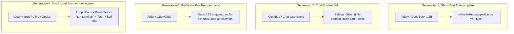
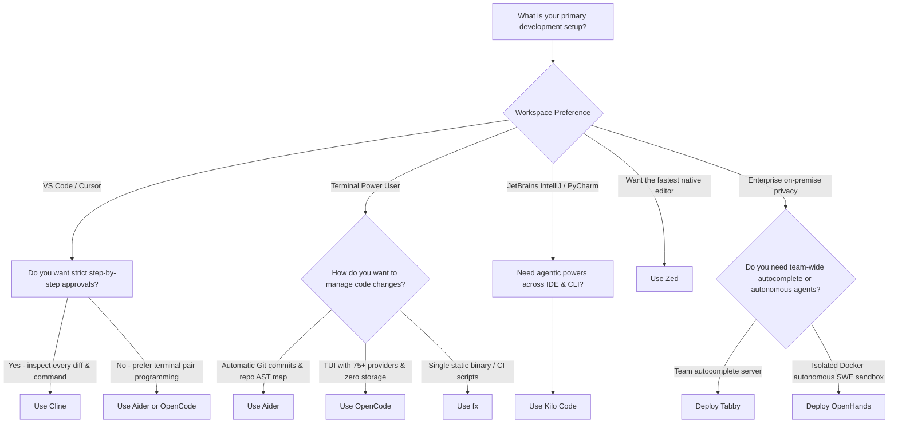

Proprietary AI coding assistants have taken over modern software development, but they come with real compromises: mandatory subscription fees ($10 to $39/month per developer), opaque prompt telemetry, vendor lock-in, and strict cloud dependencies that prevent code from staying private.

Over the past year, the open-source community has responded with an explosion of **open-source AI coding assistants and autonomous agents**. These tools don't just mimic GitHub Copilot or Cursor — in many ways, they surpass them by offering **multi-provider model flexibility**, **transparent human-in-the-loop approvals**, **git-native automated workflows**, and **100% offline operation** when paired with local models.

This guide comprehensively evaluates and compares the **10 leading open-source AI coding assistants and autonomous agents**:

1. **[OpenCode](https://opencode.ai){:target="_blank" rel="noopener"}** — Terminal-first agent with 75+ model providers, client/server architecture, and zero code storage.
2. **[Cline](https://github.com/cline/cline){:target="_blank" rel="noopener"}** — Autonomous VS Code agent with step-by-step approvals for file changes, terminal execution, and MCP tools.
3. **[OpenHands](https://github.com/All-Hands-AI/OpenHands){:target="_blank" rel="noopener"}** — Autonomous software development platform executing in a sandboxed Docker environment.
4. **[Aider](https://aider.chat/){:target="_blank" rel="noopener"}** — Git-native pair programmer that maps your repository AST and commits every code change with clean messages.
5. **[Goose](https://github.com/block/goose){:target="_blank" rel="noopener"}** — Extensible open agent runtime by Block / Linux Foundation with 70+ Model Context Protocol (MCP) tool extensions.
6. **[Codex CLI](https://github.com/openai/codex){:target="_blank" rel="noopener"}** — Lightweight terminal agent that reuses existing ChatGPT account credentials without duplicate subscription costs.
7. **[Kilo Code](https://github.com/kilocode/kilocode){:target="_blank" rel="noopener"}** — Unified multi-surface agent spanning VS Code, JetBrains IDEs, and terminal environments.
8. **[Zed](https://zed.dev){:target="_blank" rel="noopener"}** — Ultra-fast, GPU-accelerated code editor written in Rust with native parallel AI agent threads and Zeta2 edit prediction.
9. **[Tabby](https://tabby.tabbyml.com/){:target="_blank" rel="noopener"}** — Self-hosted code completion server providing an on-premise, enterprise-wide Copilot replacement.
10. **[fx](https://fx.sh){:target="_blank" rel="noopener"}** — High-performance, single-binary embeddable agent written in Zig with native WebAssembly runtime support.

> Want to run these coding assistants completely offline with zero API fees? Pair them with your own local models using our [Complete Guide to Running AI Models Locally by RAM Size]().
{: .prompt-tip }

---

## The Landscape: Autocomplete vs. Pair Programmers vs. Autonomous Agents

Before picking a tool, it is essential to understand the architectural shift in AI developer tooling:



1. **Inline Autocomplete (Ghost Text):** Fast, sub-second latency models predicting the next tokens directly in your editor line buffer (e.g., Tabby, Continue tab-complete).
2. **Interactive Chat & Inline Refactoring:** Sidebar conversation with repository context and inline code modification prompts (e.g., Continue).
3. **Terminal Pair Programmers:** CLI-first tools that construct a tree-sitter repository map, edit multiple files simultaneously, and commit clean changes to your git tree (e.g., Aider, OpenCode).
4. **Autonomous Sandboxed Agents:** High-agency systems that formulate a plan, read directory structures, write code, run compilers/tests in a terminal, parse errors, and iterate until the task is complete (e.g., OpenHands, Cline, Goose).

---

## TL;DR — Quick Recommendations

| Primary Need | Best Tool | Runner-Up | Why |
| :--- | :--- | :--- | :--- |
| **Terminal pair programming with Git** | **Aider** | OpenCode | Tree-sitter repo map, multi-file diffs, auto-commits changes with descriptive messages |
| **Terminal TUI with multi-provider flexibility** | **OpenCode** | Aider | 75+ providers, zero cloud code retention, client/server headless mode, beautiful TUI |
| **In-IDE autonomous agent with strict safety** | **Cline** | Kilo Code | Step-by-step human approval on every file write, terminal command, and MCP invocation |
| **Full autonomous background SWE sandbox** | **OpenHands** | Goose | Runs in Docker sandbox, browses web, reads GitHub issues, solves SWE-bench benchmarks |
| **Extensible tool use via MCP standards** | **Goose** | Cline | Developed by Block / Linux Foundation, 70+ MCP extensions, automates system tasks |
| **Reusing existing ChatGPT subscription** | **Codex CLI** | OpenCode | Direct OAuth login using existing personal or team ChatGPT accounts without new API keys |
| **Cross-IDE support (VS Code + JetBrains + CLI)** | **Kilo Code** | Cline | Consistent agentic workflow across JetBrains suite, VS Code, and terminal |
| **AI-native high-performance editor** | **Zed** | — | Native Rust performance, GPU rendering, parallel agent threads, Zeta2 edit prediction |
| **Self-hosted team autocomplete server** | **Tabby** | — | Enterprise self-hosted Copilot replacement, web admin dashboard, runs on consumer GPUs |
| **Ultra-lightweight embedded / CI/CD scripts** | **fx** | OpenCode | Single native binary written in Zig, zero dependencies, WebAssembly SDK (`libfx`) |

---

## 10 Best Open-Source AI Coding Assistants Compared

---

### 1. OpenCode: The Terminal-First Multi-Provider Agent

[OpenCode](https://opencode.ai){:target="_blank" rel="noopener"} is a fast, terminal-first open-source coding agent designed for developers who prefer keyboard-driven terminal workflows without getting locked into a single AI provider or proprietary client.

```bash
# Install OpenCode via curl
curl -fsSL https://opencode.ai/install.sh | bash

# Run in any git repository
opencode
```

#### OpenCode Highlights

* **75+ Provider Integrations:** Connects seamlessly to Anthropic, OpenAI, DeepSeek, Google Gemini, Groq, OpenRouter, and local runtimes like Ollama and vLLM.
* **Plan vs. Build Dual Modes:** Features an intuitive "Plan" mode (a safe, read-only architectural analysis pass that explores codebase dependencies without altering files) and an execution-ready "Build" mode (modifies files, generates patches, and runs terminal commands).
* **Client/Server Decoupling:** OpenCode features a headless backend server with multiple frontend surfaces (terminal TUI, desktop app, and VS Code extension). You can run the agent on a powerful remote server while controlling it from your local terminal.
* **Zero Code Storage:** Operates completely client-side. Your source code and prompts are sent exclusively to your chosen model provider with zero intermediary logging or telemetry storage.
* **Built-in Session Resumption:** Automatically tracks task sessions, allowing you to branch off, rewind, or inspect prompt histories without losing context.

#### OpenCode Evaluation

* **Pros:** Blazing fast TUI interface; unmatched provider choice; supports both local and cloud models; no vendor telemetry.
* **Cons:** Autonomous commands require attention since it operates directly in your local environment (unless executed via remote host).
* **Best For:** Developers who want a versatile, keyboard-driven terminal agent that easily switches between local Ollama and frontier cloud models.
* **License:** MIT License.

---

### 2. Cline: Step-by-Step Approval Inside VS Code

[Cline](https://github.com/cline/cline){:target="_blank" rel="noopener"} (formerly Claude Dev) has emerged as the definitive open-source autonomous coding agent for VS Code. Unlike traditional chat plugins that simply output markdown snippets, Cline creates files, edits code via unified diffs, inspects directory trees, and runs terminal commands — all under strict human supervision.

#### Cline Highlights

* **Granular Per-Action Approval:** Before Cline writes a file, executes a `bash` command, or browses a URL, it prompts you with an interactive diff and approval dialog. You can approve individual actions, reject them, or provide steering instructions.
* **Model Context Protocol (MCP) Native:** Cline allows you to plug in external MCP servers (PostgreSQL inspectors, GitHub APIs, Slack notifications, web scrapers) directly into the agent loop.
* **Token & Cost Transparency:** Displays real-time API token usage, cache-read savings (prompt caching), and exact dollar costs after every single response.
* **Checkpoints with Git Shadow Trees:** Automatically tracks snapshots of your files before executing edits, allowing one-click rollback if the agent takes a wrong turn.

#### Cline Evaluation

* **Pros:** Safest agent architecture due to granular permission controls; rich MCP ecosystem; full local model support via Ollama/LM Studio; prompt cache optimization.
* **Cons:** High-agency tasks with frontier cloud models can accumulate API token costs quickly without careful prompting; can feel slow if you manually approve dozens of file touches.
* **Best For:** VS Code developers who want autonomous coding capabilities without giving an AI unchecked root access to run arbitrary shell commands.
* **License:** Apache 2.0.

---

### 3. OpenHands: Sandboxed Software Engineering Platform

[OpenHands](https://github.com/All-Hands-AI/OpenHands){:target="_blank" rel="noopener"} (formerly OpenDevin) is an autonomous AI software development system engineered to function like a virtual software engineer. Rather than running directly on your host operating system, OpenHands operates inside an isolated Docker container.

```bash
# Launch OpenHands in Docker
docker run -it --rm --pull=always \
  -e SANDBOX_USER_ID=$(id -u) \
  -e WORKSPACE_BASE=$PWD \
  -v /var/run/docker.sock:/var/run/docker.sock \
  -p 3000:3000 \
  --add-host host.docker.internal:host-gateway \
  name.all-hands.dev/all-hands-ai/runtime:latest
```

#### OpenHands Highlights

* **Secure Docker Sandboxing:** Every bash command, file compile, dependency installation, and web browser action happens within a hardened Linux container. A runaway command (`rm -rf` or broken script) cannot damage your host machine.
* **Full-Stack Workspace:** Includes a browser-based IDE interface equipped with an interactive file tree, Monaco code editor, Jupyter-like bash terminal, and a live web browser preview for inspecting UI rendering.
* **SWE-Bench Competitor:** Regularly benchmarks among the top autonomous agents on SWE-bench Verified, resolving real-world GitHub issues by inspecting repos, reproducing bugs with test scripts, and generating verified patches.
* **Multi-Agent Coordination:** Supports sub-agent delegation where a planner agent directs specialized coding, testing, and browsing agents.

#### OpenHands Evaluation

* **Pros:** Enterprise-grade security via Docker isolation; capable of complex multi-step tasks (reproducing bugs, running test suites); web UI accessible across local networks.
* **Cons:** Heavy resource footprint (requires Docker runtime); slower startup compared to CLI tools.
* **Best For:** Autonomous end-to-end task delegation, GitHub issue triage, and organizations requiring strict sandbox security.
* **License:** MIT License.

---

### 4. Aider: Git-Native AI Pair Programmer

[Aider](https://aider.chat/){:target="_blank" rel="noopener"} is one of the most mature, battle-tested terminal pair programming tools in the open-source ecosystem (over 45,000 GitHub stars and millions of installs).

```bash
# Install Aider using uv or pipx
uv tool install aider-chat@latest

# Start Aider in your git repo with your chosen model
aider --model claude-3-7-sonnet-20250219
# Or with local Ollama
aider --model ollama_chat/qwen2.5-coder:14b
```

#### Aider Highlights

* **Tree-Sitter Repository Map:** Aider analyzes your entire codebase using `tree-sitter` AST parsers, building an indexed map of classes, functions, and call signatures. This feeds rich structural context to the LLM without exhausting the token budget.
* **Automated Git Commits:** Whenever Aider modifies files to implement a feature or fix a bug, it runs your git hooks, generates a clean unified diff, and commits the change with a clear, conventional commit message (e.g., `feat: add user authentication handler`).
* **Architect Mode:** Splits complex tasks into two phases: a reasoning model (like Claude 3.7 or DeepSeek-R1) designs the architecture plan, and a fast editor model applies the atomic file diffs.
* **Voice-to-Code & Browser Diffs:** Includes built-in voice input for dictating requirements and launches a local web UI to view side-by-side colorized diffs.

#### Aider Evaluation

* **Pros:** Exceptional code editing reliability; best git integration in the industry; efficient repo map minimizes token usage; works with virtually any LLM.
* **Cons:** Terminal-focused workflow might intimidate developers accustomed to pure GUI editors; requires basic comfort with Git workflows.
* **Best For:** Developers who live in the terminal and want clean, auditable, auto-committed code edits across complex multi-file projects.
* **License:** Apache 2.0.

---

### 5. Goose: Extensible Agent Runtime (Linux Foundation)

Originally created by Block (Square) and now hosted under the [Linux Foundation](https://goose-docs.ai){:target="_blank" rel="noopener"}, [Goose](https://github.com/block/goose){:target="_blank" rel="noopener"} is an open-source autonomous agent framework designed to automate engineering tasks across both your codebase and your operating system.

```bash
# Install Goose CLI
curl -fsSL https://github.com/block/goose/releases/download/stable/download_cli.sh | bash

# Launch an autonomous session
goose session
```

#### Goose Highlights

* **Native Model Context Protocol (MCP):** Goose is built from the ground up on MCP. It comes pre-packaged with 70+ extensions allowing the agent to read Jira tickets, query PostgreSQL/MySQL databases, manage GitHub PRs, and manipulate Google Drive documents.
* **Dual Surface (Desktop App & CLI):** Provides both a native desktop application with chat and file-viewing panels, and a headless scriptable CLI for terminal workflows.
* **Recipe System:** Allows engineers to define reusable YAML "recipes" for common repetitive workflows (e.g., database schema migrations, library upgrades, security patch audits).
* **Cross-Provider Freedom:** Works with OpenAI, Anthropic, Databricks, Ollama, and custom enterprise endpoints.

#### Goose Evaluation

* **Pros:** Backed by the Linux Foundation and Block; top-tier MCP integration for non-code system tasks; reusable recipe templates.
* **Cons:** Extension catalog can be overwhelming to configure initially; desktop app is still evolving.
* **Best For:** DevOps engineers and software teams who need an autonomous agent that touches both code and external enterprise services (Jira, GitHub, databases).
* **License:** Apache 2.0.

---

### 6. Codex CLI: Reusing Existing ChatGPT Subscriptions

[Codex CLI](https://github.com/openai/codex){:target="_blank" rel="noopener"} (and related community wrappers like `chatblade` and `mods`) solves a major pain point for developers: paying for API tokens when you already pay $20/month for a ChatGPT Plus or Team subscription.

#### Codex CLI Highlights

* **Subscription Token Authentication:** Uses OAuth browser flows to authenticate against your active ChatGPT account, leveraging your existing quota without generating metered API bills.
* **Minimalist Shell Interactivity:** Quickly translates natural language queries into shell commands, file edits, and inline script explanations directly in your terminal pipe.
* **Unix Philosophy:** Chains naturally with standard shell commands (`cat server.log | codex "diagnose root cause"`).

#### Codex CLI Evaluation

* **Pros:** Zero additional costs if you already maintain a ChatGPT subscription; minimal system overhead; quick setup.
* **Cons:** Locked to OpenAI models; cannot run against private local LLMs; less capable at complex multi-file repo edits than Aider or Cline.
* **Best For:** Individual developers already paying for ChatGPT who want quick terminal assistance without paying per-token API charges.
* **License:** Apache 2.0 / MIT.

---

### 7. Kilo Code: Multi-Surface Agent for VS Code & JetBrains

While many agents focus exclusively on VS Code or terminal interfaces, [Kilo Code](https://github.com/kilocode/kilocode){:target="_blank" rel="noopener"} bridges the gap between **VS Code, JetBrains IDEs (IntelliJ, PyCharm, WebStorm), and the CLI**.

#### Kilo Code Highlights

* **First-Class JetBrains Support:** Provides true autonomous agent capabilities (file touching, diff review, command execution) inside IntelliJ IDEA and PyCharm, where open-source agent tooling has historically lagged behind VS Code.
* **Unified Workflow State:** Share your agent memory, rules, and configuration across your IDE and terminal sessions without re-authenticating or re-indexing projects.
* **Flexible Permission Engine:** Employs configurable security policies allowing teams to mandate approvals for shell scripts while auto-approving read-only file queries.

#### Kilo Code Evaluation

* **Pros:** Solves the JetBrains gap for open-source AI agents; unified experience across multiple editors; strong enterprise provider integrations.
* **Cons:** Smaller community compared to Cline and Aider; plugin ecosystem is newer.
* **Best For:** Polyglot developers and enterprise teams working primarily in JetBrains IDEs who want Cline-like autonomous powers.
* **License:** Apache 2.0.

---

### 8. Zed: The AI-Native Rust Code Editor

Unlike other tools that bolt agent capabilities onto existing editors as extensions, [Zed](https://zed.dev){:target="_blank" rel="noopener"} is a complete, modern code editor built from scratch in **Rust**, rendered directly on the GPU using Metal/Vulkan.

#### Zed Highlights

* **Parallel Agent Threads:** Zed allows you to spawn multiple independent agent threads simultaneously from its Threads Sidebar. Each agent maintains its own context, runs tools, navigates files, and edits buffers concurrently at native speeds.
* **Zeta2 Edit Prediction:** Integrates Zeta2, an open-weight speculative model designed to predict your next edits across multiple lines before you even type them.
* **Native Protocol Integrations:** Built directly on the Language Server Protocol (LSP) and Debug Adapter Protocol (DAP), giving agents deep access to compiler diagnostics, type definitions, and live breakpoint states.
* **Zero Input Latency:** Operates with near-zero millisecond typing latency, contrasting sharply with heavier Electron-based editors.

#### Zed Evaluation

* **Pros:** Lightning-fast GPU rendering and startup; parallel agent workflows; built-in local Ollama support; native LSP integration.
* **Cons:** Full editor replacement (requires migrating from VS Code/JetBrains); plugin ecosystem still smaller than VS Code.
* **Best For:** Developers wanting the absolute fastest editing experience with deeply integrated, parallel AI agents.
* **License:** GPL-3.0 / AGPL-3.0 for editor components; Apache 2.0 for client crates.

---

### 9. Tabby: Self-Hosted Code Completion Server

If your organization has strict compliance requirements that forbid sending source code to third-party APIs, [Tabby](https://tabby.tabbyml.com/){:target="_blank" rel="noopener"} is the leading self-hosted solution. Written in Rust (92%+ of the codebase), Tabby acts as a private, on-premise GitHub Copilot server.

```bash
# Deploy Tabby server with Docker on GPU
docker run -it \
  --gpus all -p 8080:8080 -v $HOME/.tabby:/data \
  tabbyml/tabby \
  serve --model StarCoder2-3B --device cuda
```

#### Tabby Highlights

* **On-Premise Infrastructure:** Runs entirely inside your internal network, on bare-metal GPU servers, cloud VMs, or Apple Silicon machines. No code ever leaves your firewall.
* **Repository-Level Indexing:** Connects to your internal GitLab, GitHub, or Gitolite repositories, indexing private codebases to deliver context-aware code completions customized to your team's internal libraries.
* **Client Extension Ecosystem:** Provides lightweight editor extensions for VS Code, JetBrains, Vim, Neovim, and Eclipse.
* **Administrative Dashboard:** Includes user management, access tokens, model switching, and telemetry dashboards to monitor completion acceptance rates across engineering teams.

#### Tabby Evaluation

* **Pros:** 100% on-premise privacy; enterprise team administration; supports consumer GPUs and Apple Silicon; indexes private company repositories.
* **Cons:** Focuses primarily on inline autocomplete and chat rather than autonomous multi-file terminal agents; requires dedicated server infrastructure.
* **Best For:** Enterprises, financial institutions, and security-conscious engineering teams needing an on-premise Copilot alternative.
* **License:** Apache 2.0.

---

### 10. fx: Ultra-Fast Single-Binary Embeddable Agent

[fx](https://fx.sh){:target="_blank" rel="noopener"} represents the next wave of ultra-minimalist developer tooling. Written in **Zig**, `fx` packages a complete coding agent into a single, static native binary with zero runtime dependencies.

```bash
# Install fx via curl
curl -fsSL https://fx.sh/setup.sh | bash

# Run directly on any project
fx "refactor user auth middleware to support Bearer tokens"
```

#### fx Highlights

* **Zero Runtime Overhead:** Compiled into a single static binary. Starts instantaneously with virtually zero memory footprint, making it ideal for CI/CD runners, Docker containers, and edge environments.
* **WebAssembly SDK (`libfx`):** The core engine compiles to WebAssembly, allowing developers to embed the agent directly into browser runtimes, Node.js services, or custom developer portals via npm.
* **Pluggable Model Backends:** Connects cleanly to Vercel AI Gateway, OpenRouter, OpenAI, and local Ollama instances.

#### fx Evaluation

* **Pros:** Near-instant cold start; zero dependencies; embeddable WebAssembly library; great for automated scripting.
* **Cons:** Younger project with fewer GUI features; lacks the deep visual diffing of Cline or Aider.
* **Best For:** Automation scripts, CI/CD pipelines, containerized environments, and developers who value ultra-minimal software footprints.
* **License:** MIT License.

---

## 5 Emerging & Notable Alternatives Worth Watching

Beyond the top 10 featured tools above, several specialized and emerging open-source terminal agents solve distinct developer niches:

### 1. Qwen Code (Alibaba)

* **What It Is:** An open-source terminal CLI agent from Alibaba's Qwen team ([github.com/QwenLM/qwen-code](https://github.com/QwenLM/qwen-code){:target="_blank" rel="noopener"}), adapted from Gemini CLI and tuned specifically for the **Qwen3-Coder** model family.
* **Why It Matters:** Purpose-built to extract maximum performance from Qwen3-Coder weights (including the 30B and MoE models) with tuned prompt templates, tool-calling structures, and native Ollama/vLLM endpoints.
* **Best For:** Developers standardizing on Qwen models for local, offline coding workflows.

### 2. Crush (by Charm)

* **What It Is:** A modern terminal coding agent created by [Charm](https://charm.land/crush){:target="_blank" rel="noopener"} (the team behind Bubble Tea, Lip Gloss, and Mods) built with Go.
* **Why It Matters:** Bridges the terminal with the **Language Server Protocol (LSP)** for compiler-grade code intelligence. Supports the **Agent Skills** standard and communicates with **MCP servers** over stdio, HTTP, and SSE. Cross-platform support includes macOS, Linux, Windows, BSD, and Android (via Termux).
* **Best For:** Developers who want an aesthetically stunning, LSP-aware TUI agent that runs anywhere.

### 3. Gemini CLI (Google)

* **What It Is:** Google's official open-source terminal coding assistant ([github.com/google-gemini/gemini-cli](https://github.com/google-gemini/gemini-cli){:target="_blank" rel="noopener"}).
* **Why It Matters:** Provides a generous **free daily tier** using Google's Gemini models (including massive million-token context windows) without subscription costs. Features native tool use, shell execution, and MCP extensibility.
* **Best For:** Developers who want massive context windows (reading entire monorepos or large PDFs) for free via official APIs.

### 4. Trae Agent (ByteDance)

* **What It Is:** The open-source core agent ([github.com/bytedance/trae-agent](https://github.com/bytedance/trae-agent){:target="_blank" rel="noopener"}) powering ByteDance's adaptive AI IDE, Trae.
* **Why It Matters:** Designed for autonomous software-engineering tasks with trajectory recording, structured tool use, and multi-LLM backend support.
* **Best For:** Engineers exploring how modern adaptive AI IDEs orchestrate background coding agents.

### 5. Freebuff

* **What It Is:** An ad-subsidized terminal coding agent ([freebuff.com](https://freebuff.com/){:target="_blank" rel="noopener"}) requiring no API key, credit card, or recurring subscription.
* **Why It Matters:** Funded by lightweight text ads in the CLI, it provides a daily allowance of "Freebucks" to query open models (DeepSeek, GLM, MiMo). Includes built-in subagents for file picking, code review, and web browsing on the open Codebuff framework.
* **Best For:** Students and hobbyists who want zero setup and free cloud model access without signing up for API keys.

---

## Comprehensive Comparison Matrices

### 1. Interfaces, Architecture & Ecosystem

| Tool | Primary Surface | Architecture | Secondary Interfaces | Multi-File Edits | Auto Git Commits |
| :--- | :--- | :--- | :--- | :--- | :--- |
| **OpenCode** | Terminal TUI | Client/Server | Desktop App, VS Code | ✅ Yes | Optional |
| **Cline** | VS Code Extension | In-IDE Agent | JetBrains (Enterprise) | ✅ Yes | Shadow Tree |
| **OpenHands** | Web UI / Browser | Docker Container | CLI, GitHub Action | ✅ Yes | ✅ Yes |
| **Aider** | Terminal CLI | CLI App | Web UI Diff Viewer | ✅ Yes (AST map) | ✅ Native |
| **Goose** | Terminal CLI | MCP Runtime | Desktop App | ✅ Yes | Optional |
| **Codex CLI** | Terminal CLI | Single Binary | Standard Pipe (stdin) | Single file | ❌ Manual |
| **Kilo Code** | VS Code / JetBrains | IDE Plugin | Terminal CLI | ✅ Yes | Optional |
| **Zed** | Standalone Editor | Rust Native App | Terminal Threads | ✅ Yes | ❌ Manual |
| **Tabby** | Daemon Server | Client / Server | VS Code, JetBrains, Vim | Autocomplete | ❌ N/A |
| **fx** | Terminal CLI | Native Zig Binary | WebAssembly (`libfx`) | ✅ Yes | Optional |

---

### 2. Model Compatibility, Local LLMs & Protocol Standards

| Tool | Local LLM Support (Ollama/vLLM) | Cloud BYOK (Claude/OpenAI/DeepSeek) | Model Context Protocol (MCP) | Context Management Strategy |
| :--- | :--- | :--- | :--- | :--- |
| **OpenCode** | ✅ Native (`localhost:11434`) | ✅ 75+ Providers | ✅ Native | Dynamic session pruning |
| **Cline** | ✅ Native (Ollama, LM Studio) | ✅ Full (API Keys) | ✅ First-class | Token-budget tracking & prompt cache |
| **OpenHands** | ✅ Native (via LiteLLM) | ✅ Full | Planned | Long-horizon memory & summarizer |
| **Aider** | ✅ Native (`ollama_chat/`) | ✅ Full | Custom Tools | Tree-Sitter AST Repository Map |
| **Goose** | ✅ Native | ✅ Full | ✅ First-class (70+ tools) | Reusable recipe contexts |
| **Codex CLI** | ❌ Cloud only | ❌ OpenAI only | ❌ No | Standard context window |
| **Kilo Code** | ✅ Native | ✅ Full | ✅ Native | Workspace symbol graph |
| **Zed** | ✅ Native | ✅ Full | Planned | Project index & LSP buffer queries |
| **Tabby** | ✅ Dedicated engine | ❌ Self-hosted local only | ❌ No | Local git repo embeddings & BM25 |
| **fx** | ✅ Native | ✅ OpenAI-compatible | Planned | Streamlined token sliding window |

---

### 3. Security, Sandboxing & Code Privacy

| Tool | Execution Environment | Approval & Safety Model | Code Privacy / Telemetry | Air-Gapped Operation |
| :--- | :--- | :--- | :--- | :--- |
| **OpenCode** | Host Terminal | Direct execution / confirmation | Zero storage, client-side only | ✅ Yes (with local model) |
| **Cline** | Host VS Code | **Strict step-by-step human approval** | Zero telemetry on code diffs | ✅ Yes (with local model) |
| **OpenHands** | **Isolated Docker Container** | Configurable auto-run or human check | Fully self-hosted | ✅ Yes |
| **Aider** | Host Terminal | Diffs presented, auto-commit | Zero code logging | ✅ Yes (with local model) |
| **Goose** | Host Terminal / Desktop | Extension-level permission grants | Open-source runtime | ✅ Yes |
| **Codex CLI** | Host Terminal | Command confirmation | Subject to OpenAI terms | ❌ No |
| **Kilo Code** | Host IDE / Terminal | Policy-based command approval | Local-first, BYOK | ✅ Yes (with local model) |
| **Zed** | Native Host Process | Interactive file review | Open-weight prediction option | ✅ Yes |
| **Tabby** | Dedicated On-Prem Server | Server-side read-only analysis | **100% on-premise, zero leak** | ✅ Yes (Fully air-gapped) |
| **fx** | Native Host Process | Direct execution | Zero telemetry | ✅ Yes |

---

## When to Use What: Practical Decision Guide



### Choose Aider if

* You live in the terminal and believe every AI-generated code change should be committed cleanly to Git with descriptive commit messages.
* You work on large, complex codebases where Aider's `tree-sitter` repository map helps the model understand cross-file references without blowing past context limits.

### Choose Cline if

* You code in VS Code and want an autonomous agent that can create files and run tests, but **you refuse to give AI blind execution authority**.
* You want to see transparent token usage, dollar cost breakdowns, and exact diffs before any code touches your disk.

### Choose OpenCode if

* You want a keyboard-driven terminal agent that looks and feels like a modern CLI application (TUI) and can switch effortlessly between local models (Ollama) and dozens of cloud APIs.

### Choose OpenHands if

* You need an autonomous software engineer to tackle complex GitHub issues, write test suites from scratch, and browse documentation inside an isolated Docker sandbox.

### Choose Tabby if

* You manage an engineering team that cannot use cloud-hosted Copilot due to legal, IP, or compliance restrictions and need an on-premise autocomplete server.

### Choose Zed if

* You are tired of heavy, laggy Electron-based IDEs and want a hyper-fast, GPU-accelerated code editor written in Rust with parallel AI agent threads built into the core editor.

---

## Step-by-Step: Connecting Open-Source Agents to Local Ollama

One of the greatest superpowers of open-source coding assistants is running them **100% offline for $0** using local models. Here is how to configure the top tools with [Ollama](https://ollama.com){:target="_blank" rel="noopener"}:

### 1. Prerequisites: Pull a Coding Model

First, ensure Ollama is installed and running, then pull a capable coding model (see our [RAM sizing guide]() to pick the right parameter size):

```bash
# Recommended for 16 GB RAM
ollama pull qwen2.5-coder:14b

# Recommended for 32 GB RAM
ollama pull qwen3-coder:30b

# Verify Ollama is serving locally
curl http://localhost:11434/api/tags
```

> **Important Context Window Setting:** Ollama defaults to a conservative 2,048 tokens. For coding agents that inspect multiple files, create a custom Modelfile or configure `num_ctx 32768` so your agent has sufficient memory to read code.
{: .prompt-warning }

### 2. Configure Aider with Local Ollama

Aider natively supports Ollama's chat API endpoint using the `ollama_chat/` prefix:

```bash
# Point Aider to your local Ollama instance
export OLLAMA_API_BASE=http://127.0.0.1:11434

# Start Aider with your local coding model
cd /path/to/your/project
aider --model ollama_chat/qwen2.5-coder:14b
```

### 3. Configure Cline in VS Code with Local Ollama

1. Open VS Code and click the **Cline** robot icon in the Activity Bar.
2. Click the **Settings (Gear Icon)** in the top right of the Cline panel.
3. In the **API Provider** dropdown, select **Ollama**.
4. Set the **Base URL** to `http://localhost:11434`.
5. In the **Model ID** field, enter your pulled model name: `qwen2.5-coder:14b` or `qwen3-coder:30b`.
6. Set the **Context Window** slider to `32768`.

### 4. Configure OpenCode with Local Ollama

OpenCode auto-detects local Ollama instances running on default ports:

```bash
# Launch OpenCode and specify the local model
opencode --provider ollama --model qwen2.5-coder:14b
```

### 5. The 80/20 Hybrid Strategy: Slash API Bills to Under $5/Month

The most cost-effective workflow used by senior engineers isn't 100% local or 100% cloud — it's an **80/20 hybrid stack**:

* **80% Local ($0/month):** Use local models (`qwen2.5-coder:14b` or `qwen3-coder:30b` via Ollama) for routine tasks: code completions, single-file refactoring, docstrings, explaining test failures, and unit test generation.
* **20% Cloud BYOK ($3–$5/month):** Escalate to frontier reasoning models (like Claude 3.7 Sonnet or DeepSeek-R1) only for complex multi-file architectural refactors and elusive cross-module bug hunts.

### 6. Power Hack: The `CLIProxyAPI` Bridge

If you want cloud-grade frontier reasoning for $0, tools like Google's **Gemini CLI** provide up to 1,000 free requests per day. You can use community proxy bridges like [CLIProxyAPI](https://github.com/router-for-me/CLIProxyAPI){:target="_blank" rel="noopener"} to expose the Gemini CLI session as a local OpenAI-compatible endpoint (`http://localhost:8000/v1`).

This allows agents like **Aider**, **Cline**, and **OpenCode** to consume free Gemini 2.5/3.0 Pro quota through standard OpenAI endpoint configurations without incurring per-token API charges.

---

## Zero-Cost Cloud Setup: Free AI APIs for Open-Source Coding Agents

If your development machine doesn't have 32 GB of RAM or a dedicated GPU to run large models locally, you don't need to pay for commercial API tokens. You can pair open-source agents (like **Aider**, **Cline**, or **OpenCode**) with **generous free cloud tiers** that offer frontier reasoning and massive context windows.

### Free Cloud Tier Comparison

| Provider | Free Tier Rate Limits | Recommended Models | Best Used For |
| :--- | :--- | :--- | :--- |
| **Google AI Studio** | 15 RPM (Requests/min) / 1,500 RPD (Requests/day) | `gemini-2.5-pro`, `gemini-2.5-flash` | Whole-repo context (up to 2M tokens), deep debugging, heavy refactors |
| **OpenRouter (Free Tier)** | Variable rate limits (community capacity) | `qwen/qwen-2.5-coder-32b-instruct:free`, `deepseek/deepseek-r1:free` | Quick script writing, algorithmic tasks, and CSS/HTML generation |
| **SiliconFlow / Cloudflare** | Free monthly token grant on sign-up | `Qwen2.5-Coder-7B`, `DeepSeek-V3` | Fast API completions without local GPU overhead |

---

### Option 1: Aider + Google Gemini API (Recommended for Large Repos)

Google AI Studio offers a free tier for Gemini models with a context window of up to **2 million tokens** — allowing Aider to ingest entire codebases without token fees.

#### Step 1: Get Your Free API Key

1. Visit [Google AI Studio](https://aistudio.google.com/){:target="_blank" rel="noopener"}.
2. Sign in with any standard Google account and click **Create API Key**.
3. Copy your generated key.

#### Step 2: Install Aider

```bash
# Install via uv (recommended) or pip
pip install aider-chat
```

#### Step 3: Export Key and Launch

On **Linux / macOS (Bash / Zsh):**
```bash
export GEMINI_API_KEY="your_api_key_here"
cd /path/to/your/project
aider --model gemini/gemini-2.5-pro
```

On **Windows (PowerShell):**
```powershell
$env:GEMINI_API_KEY="your_api_key_here"
cd \path\to\your\project
aider --model gemini/gemini-2.5-pro
```

---

### Option 2: OpenCode / Cline + OpenRouter Free Endpoints

OpenRouter provides dedicated `:free` endpoints for open-weight models like **Qwen 2.5 Coder 32B** and **DeepSeek-R1**.

#### Step 1: Generate an OpenRouter Key

1. Go to [OpenRouter.ai](https://openrouter.ai/){:target="_blank" rel="noopener"} and create a free account.
2. Navigate to **Keys** $\rightarrow$ **Create a New Key** and copy it (leave your credit balance at `$0.00`).

#### Step 2: Launch with OpenCode CLI

```bash
# Install OpenCode CLI via npm or curl
npm install -g @opencode/cli

# Export your key and launch with the free 32B model
export OPENROUTER_API_KEY="your_openrouter_key"
opencode --model openrouter/qwen/qwen-2.5-coder-32b-instruct:free
```

#### Step 3: Connect in Cline (VS Code)

1. Open Cline Settings $\rightarrow$ Select **OpenRouter** as the API Provider.
2. Paste your OpenRouter API key.
3. In Model ID, enter `qwen/qwen-2.5-coder-32b-instruct:free`.

---

### Top Free Models to Drive Your Agents

| Model | Best Fulfillment Strategy | Setup Type | Key Strength |
| :--- | :--- | :--- | :--- |
| **Qwen 2.5 / 3 Coder** | Local (Ollama) / Cloud (OpenRouter / SiliconFlow) | Local GGUF or Free Cloud Endpoint | Exceptional daily driver across 30+ programming languages |
| **Google Gemini 2.5 Pro** | Cloud (Google AI Studio) | Free Cloud API (1,500 RPD) | Massive 2M token context; reads entire monorepos without clipping |
| **DeepSeek V3 / R1** | Cloud (OpenRouter `:free` or Together) | Free Cloud API | Top-tier reasoning and autonomous bug fixing |
| **Gemma 4** | Local Execution (Ollama) | Local GGUF | Strong reasoning weights optimized to run completely offline |

---

## Security & Best Practices for Autonomous Coding Agents

Autonomous agents have the ability to read your filesystem, create new files, install packages, and execute shell commands. To protect your machine and codebase, follow these security rules:

1. **Beware of Auto-Approve Flags:** Never run agents with unrestricted auto-execution flags (`--dangerously-skip-permissions` or `--auto-approve`) in a project containing production secrets, credentials, or `.env` files.
2. **Containerize Unknown Workflows:** If you are testing an autonomous agent on an open-source repo or unfamiliar codebase, run it inside a Docker container (like OpenHands) rather than your host macOS/Linux system.
3. **Audit `.gitignore` First:** Ensure `.env`, `id_rsa`, `.aws/credentials`, and sensitive configuration files are properly ignored before pointing an agent at your repository. Agents often read files matching wildcard queries.
4. **Use Prompt Caching:** When using cloud BYOK providers (Anthropic Claude, DeepSeek), ensure your agent supports prompt caching (Aider and Cline do). This cuts your recurring API costs by up to 80–90% when re-evaluating the same repository context.

---

## Frequently Asked Questions

### Can open-source coding agents replace GitHub Copilot or Cursor?

Yes. For inline code completions, **Tabby** and **Zed** match Copilot's speed. For multi-file agentic tasks, **Cline**, **Aider**, and **OpenCode** frequently outperform Cursor because they allow you to plug in the latest frontier models (Claude 3.7 Sonnet, DeepSeek V3/R1) immediately on release day, without waiting for a proprietary IDE to update its internal routing.

### What does it cost to run an open-source coding agent?

The software itself is 100% free and open-source. For compute, you have two options:

1. **$0 Free Forever:** Run against local models using [Ollama or llama.cpp]() on your own hardware.
2. **Pay-as-you-go (BYOK):** Use your own API keys with cloud providers. Developers typically spend $3 to $15/month with DeepSeek or Anthropic for daily coding — significantly less than standard $20–$40/month SaaS subscriptions.

### Do open-source coding agents store or train on my source code?

No. Tools like Aider, OpenCode, Cline, and fx operate client-side; they send data directly to your configured model endpoint (whether that is your local Ollama server or your private API key). There is no intermediary telemetry server indexing or retaining your proprietary intellectual property.

### Which tool is best for beginners vs. senior developers?

* **Beginners:** Start with **Cline** in VS Code. The visual UI, inline diffs, and explicit "Approve / Reject" buttons provide a gentle learning curve with zero risk of running accidental terminal commands.
* **Senior Engineers & Terminal Users:** Use **Aider** or **OpenCode**. Their terminal efficiency, Git commit automation, and AST-driven codebase indexing fit seamlessly into advanced UNIX workflows.

---

## References & Community Links

* [OpenCode Official Website](https://opencode.ai){:target="_blank" rel="noopener"} & [GitHub Repository](https://github.com/sst/opencode){:target="_blank" rel="noopener"}
* [Cline VS Code Extension](https://github.com/cline/cline){:target="_blank" rel="noopener"}
* [OpenHands Autonomous Development Platform](https://github.com/All-Hands-AI/OpenHands){:target="_blank" rel="noopener"}
* [Aider AI Pair Programming](https://aider.chat/){:target="_blank" rel="noopener"} & [Documentation](https://aider.chat/docs/){:target="_blank" rel="noopener"}
* [Goose by Linux Foundation / Block](https://goose-docs.ai){:target="_blank" rel="noopener"}
* [Zed Code Editor](https://zed.dev){:target="_blank" rel="noopener"}
* [Tabby Self-Hosted Coding Assistant](https://tabby.tabbyml.com/){:target="_blank" rel="noopener"}
* [fx Single-Binary Agent](https://fx.sh){:target="_blank" rel="noopener"}
* [Qwen Code by Alibaba](https://github.com/QwenLM/qwen-code){:target="_blank" rel="noopener"}
* [Crush by Charm](https://charm.land/crush){:target="_blank" rel="noopener"}
* [Gemini CLI by Google](https://github.com/google-gemini/gemini-cli){:target="_blank" rel="noopener"}
* [Trae Agent by ByteDance](https://github.com/bytedance/trae-agent){:target="_blank" rel="noopener"}
* [Freebuff Zero-Key Agent](https://freebuff.com/){:target="_blank" rel="noopener"}
* [CLIProxyAPI Endpoint Bridge](https://github.com/router-for-me/CLIProxyAPI){:target="_blank" rel="noopener"}
* [Ollama Model Library & Local Serving](https://ollama.com){:target="_blank" rel="noopener"}
